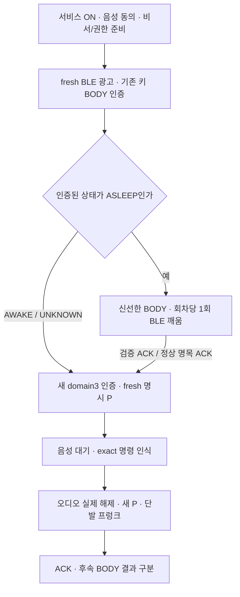

# Hey Tesla

**인증된 차량 연결과 신선한 주차(P) 상태에서 사용하는 Android 네이티브 음성 프렁크 앱.** v76(0.76.0)은 UWB·좌표 거리/방향을 제거하고 연결 기반 제품 경로로 전환한다. BLE 신호나 연결은 거리·차량 밖 위치·화자 신원을 보장하지 않는다.

> 현재 계약은 [인증된 수면 상태의 단발 BLE 깨움](wiki/Tesla-Integration.md#v80-인증된-수면-상태의-단발-ble-깨움)과 [기존 검증 모델 연결](wiki/Tesla-Integration.md#v78-검증-모델-연결), 소스·설치본·저장 ON/OFF·검증 수치는 [기기 검증 단일 정본](wiki/Device-Validation.md#현재-소스설치검증-상태)을 따른다. 구현을 실차 성공으로 표시하지 않는다. 과거 UWB 실측·REA·로그는 역사 자료이며 현재 사용 조건이 아니다.
>
> 제품 자동 음성은 기존 튜닝 sherpa-onnx 한국어 zipformer를 사용한다. Android 온디바이스 `SpeechRecognizer`는 수동 진단·별도 수동 프렁크에 유지하며 제품 fallback이 아니다. 비교진단의 인식 결과로 차량을 제어하지 않는다.
>
> 호출어·명령 문구의 단일 원본은 `SpeechCommandPhrases`다. 표시용 기본값 두 개에서 정규화 문장·sherpa 보정 문구·로그 마스킹의 기본 허용 어휘·진단 안내를 파생한다. 기존 정확 일치·취소·점수·차량 안전 조건은 유지하며, 호출어 설정 UI와 사용자 호출어의 저장·변경 기능은 아직 없다.
>
> 아래는 v0.50 전환 기록이며 그 Android 음성 경로는 현재 수동 진단·별도 수동 프렁크에 유지된다. 제품 자동 음성은 위 현재 계약을 따른다.
>
> v0.50 전환 당시 소스는 **`0.50.0-probe`(`versionCode=50`) Android 내장 온디바이스 `SpeechRecognizer`(`ko-KR`) 전환**이다. v47~v49의 로컬 Moonshine STT(sherpa-onnx)는 v0.50에서 모델·AAR·라이선스 자산과 함께 완전히 제거했다. 앱이 직접 캡처한 16 kHz mono PCM을 `AndroidPcmRecognizer`가 `EXTRA_AUDIO_SOURCE` 파이프와 segmented session으로 인식기에 전달한다. 후보(n-best) 중 하나라도 정규화 후 `헤이테슬라프렁크열어줘`와 정확히 일치하면 수락하고, 하나라도 `취소`/`열지마`를 포함하면 차단한다. 인식기가 점수를 주지 않으면(0.0·−1·null·비유한값) "점수 미제공"으로 기록하고 신뢰도 게이트를 생략하며, 실제 점수는 0.85 이상이어야 한다. STT 일치는 차량 제어 허가가 아니며 P·HANDOFF 5초·명령 10초·안전 동의 게이트는 그대로다. **v0.50 실기·실차 결과는 아직 기록되지 않았다.** [v0.50 검증 절차](wiki/Device-Validation.md#0500-probe--android-온디바이스-speechrecognizer-전환)를 따른다.
>
> 프로젝트 전용 [hey-tesla-ui 스킬](.omp/skills/hey-tesla-ui/SKILL.md)을 적용해 차콜 테마, 상태 중심 홈, 설정 행, 입력 선택·결과 상세를 분리한 진단 화면을 구현했다. 설계 근거와 검증 경계는 [UI 개편 기록](wiki/UI-Design.md)에 둔다.

## 목표와 사용 환경

- 사용자 1명, 차량 1대용 개인 앱으로 시작한다.
- 대상 휴대폰은 Samsung Galaxy S23 Ultra, 차량은 Tesla Model Y 주니퍼 AWD/롱레인지다.
- 실제 Android·One UI·차량 펌웨어 버전은 실기기에서 확인한다.
- Tesla 공식 앱의 폰키 등록은 우리 앱의 차량 제어 권한을 의미하지 않는다.
- 인증된 ASLEEP 상태의 **BLE 깨움은 승인된 준비 명령**이고, 음성 인정 뒤의 차량 액션은 **프렁크 개방 요청 하나**다. 깨움 ACK는 물리 기상·P가 아니며, 프렁크 래치 해제와 후드를 끝까지 들어 올리는 기능도 구분한다.



자동 깨움은 차량 전력 사용을 늘릴 수 있다. 상태 미확인에는 깨우지 않으며 실패·불명·기한·취소에서의 동작과 마이크/프렁크 차단 조건은 위 현재 계약을 따른다. 기상 준비 추가가 기존 실차 인증 무응답의 원인 해결을 증명하는 것은 아니다.

연결 대기에는 고정 10/90초 제한이 없다. 발화는 최대 10초, handoff는 5초, 명령 작업은 40초다. 비명령·낮은 신뢰도는 조건 재확인 후 새 발화를 기다리고 취소·실패·기한 만료는 회차를 끝낸다.

성공 기준은 음성 인식 버튼이 있는 것이 아니라, **잠긴 휴대폰을 주머니에 둔 사용자가 실제 차량 밖에서 접근부터 명령 인식까지 한 번도 화면을 만지지 않는 것**이다. 이후 승인된 실제 연동에서 안전 조건을 만족할 때만 명령을 전달한다.

## 변경한 기술 방향

Android 앱은 React Native가 아닌 **Kotlin 네이티브**로 개발한다. 시스템 기능을 얇은 JS 브리지로 감싸는 대신 Android 서비스와 오디오 수명을 직접 관리한다.

| 영역 | 채택 방향 |
| --- | --- |
| 앱 언어·UI | Kotlin, Jetpack Compose |
| 비동기 처리·상태 전달 | Kotlin Coroutines, Flow/StateFlow |
| 명령 해석·상태 머신·차량 게이트웨이 | Kotlin, UI와 분리한 정책 로직 |
| 설정 | DataStore, 토큰·키 저장과 분리 |
| 시스템 연동 | VoiceInteractionService, 적절한 foreground service, Bluetooth/CDM API의 실기기 검증 |
| 음성 | 인증 연결·fresh P 동안 제품 sherpa 한국어 모델 대기, 별도 수동 Android 온디바이스 `SpeechRecognizer`(`ko-KR`, PCM 파이프)·TTS 진단 |
| 테스트 | Kotlin/JVM 파서·상태 전이 테스트, Android 실기기 서비스·오디오 검증 |
| 차량 연동 | 앱 자체 AndroidKeyStore P-256 키·키카드 승인·로컬 BLE 우선. 공식 공개 wire contract와 JCA 사용 |
| 선택 인터넷 경로 | 필요성과 승인 확인 후 Fleet API/OAuth 검토. 서버가 필요하면 Node.js + TypeScript 가능, 서명 프록시는 공식 Go `vehicle-command` 재사용 |

개발 도구와 라이브러리는 아래 빌드 조합으로 고정했다. v0.50 Android PCM/STT와 v0.52 sherpa 진단 도입은 당시 이력이다. 현재 제품 자동 경로는 기존 sherpa 모델·튜닝을 재사용하고 수동 진단 경로와 차량 제어 권한을 구분한다. 새 외부 음성 SDK·모델, 계정·비용 발생 또는 외부 오디오 전송은 사전 동의 없이 추가하지 않는다.

### 기능별 Kotlin 소스구조

단일 Android `app` 모듈의 `app/src/main/java/com/heytesla/app/`에서 `app/`은 런타임·설정, `service/`는 Android 서비스·리시버, `vehicle/`은 `detection/`·`ble/`·`protocol/`·`key/`·`connection/`·`frunk/`, `speech/product/`는 제품 음성, 나머지 `speech/`는 공용 음성, `diagnostics/`는 수동 진단, `logging/`은 로그, `ui/`는 Compose 표현을 맡는다. `logging/legacy/`와 분석기는 역사 로그 해석을 보존한다. [소스구조](wiki/Native-Architecture.md#기능별-실제-소스구조)를 참고한다.

Manifest의 기존 Android component identity와 사용자 VIN·앱 키·등록·설정·수동 녹음·로그는 유지한다. UWB·navigation 실행 경로와 전용 UI/권한은 제거하며 공유 암호·GATT·안전 계약은 연결 경로에서 보존한다.

## 반드시 지킬 조건

- 초기 설치·권한·계정·설정 단계 외에는 앱 실행, 알림 터치, 잠금 해제, 마이크 버튼, 매번 지문 인증, 매사용 서비스 수동 시작을 요구하지 않는다.
- 인증 연결·fresh P가 없으면 제품 오디오를 수집하지 않는다. 거리 판정은 없다. 같은 GATT의 기어 감시는 응답 뒤 2초 간격이며 RX 5초/source 10초/future 2초 기준을 적용한다. D/R/N/UNKNOWN·stale·disconnect 관측 시 즉시 로컬 음성을 봉인하지만 실제 D 진입 감지는 통신 지연이 있다. 주기적 서버 조회·차량 깨우기·상시 wake lock은 사용하지 않는다.
- 앱 런타임에서 GPT·Codex·OpenAI API를 호출하지 않는다. 제한된 한국어 명령을 명시적인 규칙으로 해석한다.
- “프렁크 열지 마”, “아까 열어달라고 했잖아”, 모호한 “문 열어줘”를 실행하지 않는다. 부분 인식 결과로 먼저 명령을 보내지 않는다.
- 기어 정보 `null`·오래된 데이터·속도 0을 안전한 P 상태로 간주하지 않는다. 호출어와 음성 확인은 사용자 인증 수단이 아니다.
- 원시 오디오는 일반 동작에서 저장·전송하지 않는다. 사용자가 직접 시작한 개발용 마이크 시험은 녹음·최종 인식 원문을 백업 제외 전용 영역에 기본 저장하며 외부로 자동 전송하지 않는다. 민감정보와 토큰·키를 코드·일반 로그·Wiki에 기록하지 않는다.
- 기존 서비스 ON은 새 마이크·제어 동의가 아니다. 별도 영속 제품 음성 동의는 기본 false이며 사용자가 직접 승인한다. 음성은 화자 인증이 아니므로 타인·재생음이 명령으로 인정될 위험을 고지한다. mock/dry-run은 별도 수동 진단이며 승인된 제품 경로를 무조건 mock으로 바꾸지 않는다.
- 취소·만료된 명령을 저장해 나중에 실행하지 않는다. 전송 후 결과가 불명확하면 자동 재전송하거나 “열렸어요”라고 안내하지 않는다.

## 과거 개발 순서 — 현재 사용법 아님

1. **기술 타당성 확인:** 공식 문서와 실제 기기 조건을 분리해 기록한다.
2. **Android 검증 앱:** Tesla 실제 제어 없이 `잠금 + 실제 차량 접근 + 무터치 마이크 + 한 문장 인식 + 종료`를 확인한다.
3. **Mock 연동:** `VehicleGateway` 경계에서 안전 검사·확인·취소·중복·만료·오류·TTS를 검증한다.
4. **로컬 BLE Tesla 연동:** 앱 자체 키·키카드 승인 후 실차 인증·암호 상태 조회와 재연결 키 재사용을 확인한다. 주차 기어 조회 다음은 BLE·UWB 차량 감지 개선을 먼저 진행한다. 신선한 P·감지·안전 게이트를 확보한 뒤 별도 승인으로 수동 프렁크를 시험하고, 통과한 경로만 음성과 결합한다.
5. **배터리·안정성:** 장시간 대기, 접근·이탈, 재연결, 통화, 절전, 네트워크 장애, 프로세스 종료·재부팅을 실기기로 측정한다.

**실차 무터치 검증 전 대규모 서버 개발은 보류한다.** 사용자 요청에 따른 홈·설정·진단 UI 개편은 별도 트랙이며 무터치 동작의 합격을 뜻하지 않는다. 네이티브로 작성해도 Android의 백그라운드 마이크 제한은 사라지지 않는다. 알림을 눌러야 하는 대안을 동일한 성공으로 보고하지 않는다.

**차량 키를 API에서 발급받는 전제는 두지 않는다.** OAuth는 선택 Fleet API 호출용, 앱의 P-256 키는 BLE 인증용, UWB 세션 키·파라미터는 정밀 거리 측정용이다. 공식 앱 폰키를 복사하지 않으며 UWB는 BLE 키 등록과 별도 과제다. v21의 실차 인증·암호 상태 수신·새 BLE 연결에서 같은 키 조회는 두 방문으로 통과했다. 프렁크 제어와 UWB 거리 측정은 미확인이다. 개발 기준과 공식 근거는 [요구사항](wiki/Requirements.md#차량-연동-개발-기준), [Tesla 연동](wiki/Tesla-Integration.md)에 둔다.

## 개발 도구

프로젝트 MCP 설정에는 공용 `mobile-mcp`만 등록한다. 선택 도구인 REA는 각 개발자가 로컬 설정에 등록하며, 호스트별 Node/JDK/JAR 경로·분석 결과·기기에서 회수한 자료는 커밋하지 않는다. 앱 빌드와 실행에 REA는 필요하지 않다.

## 빌드와 실행

`com.heytesla.app`의 설치·기기 상태는 [기기 검증 정본](wiki/Device-Validation.md#현재-소스설치검증-상태)만 따른다. 앱 버전 표시는 `BuildConfig`에서 읽는다.

초기 설정에서 저장 VIN·시스템 차량 등록·기존 앱 키를 준비하고 Bluetooth/감지 권한을 승인한다. 설정에서 기본 비서를 **Hey Tesla로 직접 선택**하고 마이크 권한과 **별도 제품 음성 동의**를 승인한 뒤 홈 서비스 ON을 사용한다. 이전 ON을 동의로 취급하지 않는다. UWB 버튼·RANGING 권한·거리 시험은 현재 절차에 없다.

홈은 실제 연결/인증·fresh P·음성 대기·인식 중·명령 진행을 구분한다. SDK 전송, 차량 ACK, BODY 열림 보고는 각각 다른 근거이며 실제 후드를 들어 올린 물리 완료로 합치지 않는다. OFF·동의 철회는 즉시 음성/명령을 봉인한다. 오디오와 BLE 정리 완료 전에는 예약을 반환하지 않으며 정리 불명은 재시작 필요다. 동의 false 저장 실패도 RAM에서는 철회하고 저장 오류를 유지한다.

제품 음성 PCM은 RAM에서만 처리하며 녹음 파일로 저장하지 않는다. 개발 확인용으로 인식 텍스트와 종료 결과는 앱 내부의 백업 제외 영역에 자동 보관하며, 홈에 최근 결과를 표시한다. 주변 대화가 포함될 수 있다. 일반 로그에는 인식 원문을 쓰지 않고 자동 업로드나 자동 삭제는 하지 않는다. 사용자가 직접 시작한 수동 마이크 진단의 녹음·최종 원문 저장은 별도다.

Android16/API36 이상, JDK21 기반 빌드다. 빌드·설치·합성 결과는 차량 제어·잠금 음성 동작의 실측을 대신하지 않는다.

1. JDK 21과 Android SDK Platform 36 / Build Tools 36.0.0을 준비한다. 이 저장소의 실제 빌드는 Android Studio bundled JDK 21.0.10으로 수행했다.
2. `JAVA_HOME`을 JDK에 맞추고, Git에서 제외된 `local.properties`에 자신의 `sdk.dir`을 지정한다. `ANDROID_HOME`과 `ANDROID_SDK_ROOT`를 함께 설정했다면 동일한 SDK를 가리키게 하거나 빌드 명령의 환경에서 일치시킨다. 전역 환경을 자동 변경하지 않는다.
3. 새 클론은 아래 모델 준비 안내를 먼저 따른다. 로컬 모델·AAR이 준비되면 다음 명령으로 APK·단위 테스트·Lint를 실행한다.

```sh
./gradlew :app:assembleDebug :app:testDebugUnitTest :app:lintDebug --no-daemon
```

v0.50~v0.51은 앱에 STT 모델·native AAR을 패키지하지 않았다. 명령 판정 인식은 지금도 기기에 설치된 Android 온디바이스 음성 인식 서비스(S23은 Google 인식 서비스)와 그 `ko-KR` 언어 팩에 의존한다.

v0.52부터는 진단 그림자 인식용으로 sherpa-onnx 1.13.8 AAR(`.local-models/sherpa-onnx-1.13.8.aar`)과 zipformer asset(`.local-models/sherpa-assets/zipformer-ko/`)을 패키지한다. `.local-models/`는 Git에서 제외되므로 **새 클론에서는 빌드 전에 `python3 tools/prepare_sherpa_ko.py --download`를 실행**해 AAR·모델을 내려받고 sha256을 맞춘 뒤 `bpe.vocab`를 만든다. 크기는 모델 asset 약 76.5 MB(onnx 무압축), arm64-v8a native 약 32 MB이며 APK에는 arm64-v8a만 넣는다. 미사용 `.local-models/assets/moonshine-ko/`는 보존하지만 빌드에 쓰지 않는다.

라이선스: sherpa-onnx 런타임 Apache-2.0, AAR에 포함된 ONNX Runtime MIT, zipformer 모델 Apache-2.0(원 모델 카드 표기). 학습 데이터 KsponSpeech(AI Hub)의 이용 조건은 별도일 수 있다. 고지문은 `app/src/main/proto/licenses/`의 `sherpa-onnx-LICENSE`, `onnxruntime-LICENSE`, `sherpa-onnx-zipformer-korean-2024-06-24-NOTICE`로 APK에 동봉한다.

호스트 로그 분석기 회귀는 `python3 -B -m unittest discover -s tools -p 'test_*.py'`로 실행한다. 단말 계측 APK는 `./gradlew :app:assembleDebugAndroidTest --no-daemon`으로 빌드한다. 계측은 시험별 데이터 격리·권한·기기 조건을 확인한 뒤 실행하며, 프로세스 재시작 전용 시험은 일반 전체 실행과 별도로 수행한다. 컴파일·호스트 회귀는 실차·잠금·오디오 동작 검증을 대신하지 않는다.

APK는 `app/build/outputs/apk/debug/app-debug.apk`에 생성된다. 승인된 USB Android 기기가 한 대인 환경에서는 다음과 같이 설치·실행할 수 있다. `-g` 또는 `pm grant`로 권한을 대신 승인하지 않는다.

```sh
adb -d install -r app/build/outputs/apk/debug/app-debug.apk
adb -d shell am start -n com.heytesla.app/.MainActivity
```
과거 수동 UWB 버튼·거리 진단 절차는 [v54 역사 기록](wiki/Tesla-Integration.md#v54-수동-tesla-uwb-거리-진단)에 보존한다. v76에는 해당 실행 UI가 없으며 현재 사용자에게 거리 시험을 요구하지 않는다.

**설정 → 개발자 진단 → 차량 키**는 제품 자동 제어와 별도의 수동 진단이다. v21의 실차 앱 키 인증·암호 상태 조회·같은 키의 새 BLE 연결 조회는 통과했으므로 키 등록을 반복하지 않는다. 새 대상의 초기 등록에만 직접 동의한 **키 추가 요청 · 카드 승인 후 상태 1회 조회**와 실제 키카드 승인이 필요하다. 앱은 Driver 역할의 Android 키만 추가하며 기존 폰키를 제거·교체하지 않는다. **우리 앱 키로 인증·상태 1회 조회**와 **주차 기어 상태 1회 조회**는 등록 요청과 별개이며 개발자 진단 상단의 저장 VIN을 사용한다.

키 생성과 차량 등록, 인증 전 등록 보고와 검증된 암호 상태 수신은 별개다. 중간 인증 `OK` 응답은 기존 기한 안의 대기이며 서명·HMAC 검증을 생략하지 않는다. 키 미등록 응답도 실제 미등록의 인증된 증거가 아닌 보고로 표시한다. 진행 중에는 단계·취소를 표시하고 공통 VIN 변경·동의·모든 시작 버튼을 잠근다. 자기 예약을 다른 진단 충돌로 표시하지 않지만 실제 외부 예약과 정리 실패 차단은 유지한다. 잠금·프렁크 값과 기어는 지난 응답이며 현재 P·제어 준비를 추정하지 않는다. VIN·주소·키·원시 응답은 로그에 쓰지 않는다. 저장 VIN은 유지하되 편집 입력은 제출·화면 이탈 때 비운다. 전송 뒤 취소/시간 초과와 로컬 연결 종료는 차량 등록 철회를 보장하지 않는다. [현재 실측과 한계](wiki/Device-Validation.md)


홈 **서비스 사용 ON/OFF**는 연결 제품의 사용 의도다. 저장 ON과 실제 감시·연결·음성 실행은 별개이며 준비 부족·권한 상실·실패를 표시한다. OFF는 서비스 owner가 없어도 가능하다.

저장 ON 복원은 새 token·빈 후보·새 광고부터 시작한다. 과거 인증/P·음성·명령은 재생하지 않고 새 제품 동의를 자동 생성하지 않는다. 사용자 강제 종료·OS 시작 거절을 우회하지 않는다. 수동 키·상태 조회는 설정 → 개발자 진단에 유지한다.

작업 순서는 [AGENTS.md](AGENTS.md)의 **구현·검증·데이터 보존 설치 → 사용자 실차 테스트 → USB 로그 분석 → 다음 단계 판단**을 따른다. USB 없이도 내부 로그는 기록된다. 현재 조회 ON 여부와 미검증은 [기기 기록](wiki/Device-Validation.md)을 확인한다.

AltBeacon은 BLE 감시용 **connectedDevice FGS**만 소유하며 `ObservationService`는 bound-only다. 제품 오디오는 별도 **ProductMicrophoneService microphone FGS**가 정확한 활성 음성 lease 아래 실행한다. location FGS·좌표 수집은 제품에 없다.

AltBeacon 스캔 기간은 기본 foreground 1,100ms·background 30,000ms를 유지하고, 두 모드의 betweenScanPeriod를 명시적으로 0ms로 설정한다. 이전 기본 background 5분 대기는 제거했다. 기본 무선 모드와 콜백 주기는 별개이며 OS/OEM 지연·무선 duty cycle까지 없어진다는 보장은 아니다. `longScanForcingEnabled` 기본값은 유지한다. stock `NonBeaconLeScanCallback`은 원 수신 timestamp와 정확한 이름 필터 주입을 제공하지 않으므로 고정 소스의 좁은 어댑터를 사용한다. 가짜 BeaconParser·주소 고정·서비스 UUID 광고 포함을 가정하지 않는다. 상세 변경 범위는 [아키텍처](wiki/Native-Architecture.md)를 따른다.

기존 `events.jsonl`은 보존하고 `events-v2.jsonl`과 `events-v2.1.jsonl`~`events-v2.3.jsonl`만 순환한다. 파일당 512KiB·합계 2MiB, 큐 512개이며 쓰기 실패는 표시하되 감지를 중단하지 않는다. VIN·광고명/hash·MAC·키·RX 원문은 기록하지 않는다. `ScanResult.timestampNanos`와 전달 시각·역순/중복/이전 세대 거절·스캐너 중단을 분리한다. 이전 PendingIntent receiver는 고아 등록 정리 전용이다.

명시적 ON/OFF와 실행 상태를 분리한다. 프로세스 초기화·재부팅·업데이트·Bluetooth ON에서 감지만 복원하며 이전 근접 상태·명령은 재생하지 않는다. Android background/while-in-use FGS 제한·사용자 강제 종료 때문에 즉시 복원은 보장하지 않는다. FGS fallback은 정상 실시간 감지로 표시하지 않는다. 대기 wake lock은 추가하지 않았고 기존 짧은 GATT wake lock은 그대로다.

### 역사적 감지·음성 검증과 보존 로그

아래 버전별 실측은 당시 범위이며 현재 설치·검증 수치가 아니다. 현재 상태는 기기 검증 정본만 따른다. UWB 분석 옵션은 보존 로그 해석용이지 제거된 제품 실행 절차가 아니다.

`0.15` APK·110개 회귀 통과, Lint 오류 0·경고 13개다. 이전 `0.14` S23 실측에서는 실제 Compose 조작·감지만 후보 1/GATT 0·자기 BT 억제·실제 GATT 타임아웃 2회 제한·백그라운드 연결 요청 정리·알림 중지·계측 HOME/화면 OFF 15초 유지를 확인했다. 사용자 수동 SCAN 승인 뒤 실제 스캔 40초 종료/120초 재개·GATT 중 정지·최종 중지 뒤 재개 없음도 확인했다. 합성 입력은 실차 방문이 아니며 광고 match·차량 인증·UWB 거리를 증명하지 않는다. [0.14 실측과 한계](wiki/Device-Validation.md#0140-probe--ble-감지-대조-시험), [0.15 지원 조회 실측](wiki/Device-Validation.md#0150-probe--차량-방문-전-준비)
현장 분석기는 Python 표준 라이브러리만 사용하는 `tools/analyze_field_log.py`다. `python3 -B tools/analyze_field_log.py LOG --json`으로 **schema1..33** 보존 JSONL을 읽기 전용 분석한다. null/SDK0·실제 완료 callback·부분 조회·최종 회차·본시험/정리를 구분하고, 과거 Nordic/UWB/좌표 관측은 당시 스키마 범위로 해석한다. 미지원 값을 false/정상으로 채우거나 전달 시각을 RF 시각으로 바꾸지 않는다. `--exclude-trial UUID`, `--visits CSV --observer-offset-ms INTEGER`는 실제 제외 회차·관찰 기록·측정 시계 차이만 사용한다. [대조 조건](wiki/Device-Validation.md#실행-조건과-관찰자-csv)을 따르며 오류0은 물리 성공 증거가 아니다.

v72의 native 세션 관측과 보존 OS metric은 `python3 -B tools/analyze_field_log.py LOG --uwb-dump DUMPSYS_UWB.txt --json`으로 대조한다. 입력은 변경하지 않으며 보고서에는 원 session ID·주소·키 대신 상관용 태그와 허용된 metric만 포함한다. 과거 로그에는 태그를 소급 생성하지 않는다. 일치·미일치·중복 후보를 구분하며 **태그 일치는 RF 성공이나 종료 원인 확정이 아니다**. [계약·정적 분석·한계](wiki/Tesla-Integration.md#v72-native-세션-관측과-os-대조)를 따른다.
휴대폰 단독 실측은 일반 앱 FGS의 35분 생존·30분 heartbeat, 별도 65초 `Dozing` 유지, Bluetooth OFF 종료/ON 후 자동 복원 없음, 사용자 잠금 해제 후 실제 `USER_STOP`까지 확인했다. **35분 화면 OFF는 입증되지 않았고**, 비충전 deep Doze·배터리 비용·실차 감지율은 미확인이다. 시험 종료 시 서비스/오디오/GATT wake lock 없음·Bluetooth ON, 1,277행 로그와 이전 1,156행 전체 prefix 보존을 확인했다.


`0.12.0-probe`는 **설정 → 개발자 진단 → BLE 연결**에 등록 차량의 GATT 연결·Tesla 서비스/TX/RX 확인·RX 구독·짧은 관찰·취소/정리를 추가했다. 원격 해제는 CCCD `[0, 0]` 읽기 성공으로만 확인한다. 키·인증·TX characteristic 쓰기·차량 명령·Fleet API는 없다. APK·전체 71개 회귀·Lint(오류 0, 경고 11) 통과. S23 실제 화면에서 등록 주소 해석 오류 수정 후 GATT 시작·연결 타임아웃·취소/HOME·로컬 close와 예약 해제를 확인했으며, 실제 연결/구독 성공은 확인하지 못했다. [BLE 실측과 한계](wiki/Device-Validation.md#0120-probe--수동-ble-연결-진단)

`0.11.0-probe`는 **최종 STT 판정 → 한 번의 로컬 dry-run → 입력 해제 → 한국어 오프라인 음성 안내 → 출력·포커스 해제**를 같은 진단 소유권에 연결했다. 차량 전송 경로는 없고, 안내도 실제 차량 승인·개방으로 표현하지 않는다. 빌드·58개 테스트 통과, Lint 오류 0·경고 11개. S23에서 정답 처리·거절 입력 7종·중복 시작 차단·입력 및 안내 중 취소/HOME·실제 진단 UI의 처리/안내 완료 표시를 확인했다. 모든 14회차 종료 기록에서 예약 잔존 없음과 입력·출력·포커스 해제를 확인했으며 기존 로그는 보존됐다. 제품 전체의 잠금·접근·실차 게이트 합격은 아니다. [통합 실측](wiki/Device-Validation.md#0110-probe--로컬-dry-run과-오프라인-음성-안내)

`0.10.0-probe`는 진단 버튼으로 시작한 온디바이스 STT의 **최종 한 문장**에서 호출어·명령을 판정한다. 문장 시작의 “헤이 테슬라” 뒤 정확한 “프렁크 열어줘”만 후보로 표시하고, 호출어 없음·명령 없음·허용 외·취소/부정을 구분한다. 차량 전송·상시 STT·자동 접근 시작은 없다. 전체 47개 테스트, APK 빌드·Lint(오류 0, 경고 11) 및 컴파일된 판정 5분기·분절 연결·v3 파일 sink의 호스트 실행을 확인했다. S23 데이터 보존 업데이트·로그 보존·합성 문장 후보의 파일 기록·실제 UI 표시를 확인했다. 직접 정답 발화 재시험 2회 모두 문장 일치·명령 후보(4,262ms / 4,099ms), 호출어 없는 발화는 거절됐다. 추가 TTS 8종의 실제 STT는 정답만 후보·나머지 7종 거절이었다. 세부 판정은 6/8 기대 일치이며 부정·호출어 단독 입력의 세부 분류 차이는 미해결이다. 실제 발화 추가 시험은 사용자 요청으로 보류했다. [실측과 한계](wiki/Device-Validation.md#직접-발화와-tts-경계-입력-자동-실측)

`0.9.0-probe`는 STT 종료 요약의 파일 저장을 추가했다. `:app:assembleDebug :app:testDebugUnitTest :app:lintDebug` 성공, 전체 36개 테스트 통과, Lint 오류 0·경고 11개다. 별도 JVM 두 프로세스에서 실제 파일 sink를 실행해 기존 v1 행 보존·v2 추가·JSON 파싱·회차별 값 분리·신뢰도 `0.0`/`null` 보존을 확인했다. 이후 USB 재연결하여 S23에 데이터 보존 업데이트·정상 실행을 확인했다. 사용자 실제 발화 2회는 직접 마이크에서 모두 시험 문장 일치·최종 결과 수신에 성공했고 상세 결과가 파일에 저장됐다(4,420ms / 4,732ms, 신뢰도 각각 0.0, 예약 잔존 없음). 이는 해당 문장의 2회 인식 성공이며 차량 명령 안전성 합격은 아니다. 근거·한계는 [기기 검증](wiki/Device-Validation.md)에 기록했다.

2026-09-30 `0.8.0-probe`의 `:app:assembleDebug :app:testDebugUnitTest :app:lintDebug`가 성공했다. 전체 32개 테스트, Lint 오류 0·경고 11개다. S23 데이터 보존 업데이트 후 관찰 FGS·CDM 수락, HOME·짧은 화면 꺼짐 중 유지, 앱·실제 알림 버튼 종료와 로그 코드, 활성 관찰을 강제 종료한 뒤 재실행 OFF·등록 및 기존 로그 보존을 확인했다. 자동 탭이 무시되어 일부 시작·앱 종료는 사용자 조작으로 수행했다. 캡처 보호를 유지했으며 픽셀 검증·실차 접근·장기 생존은 미완료다.

2026-09-29 `0.7.0-probe`의 `:app:assembleDebug :app:testDebugUnitTest :app:lintDebug`가 성공했다. 전체 26개 테스트(파일 로그 12개 포함), Lint 오류 0·경고 11개다. 컴파일된 파일 sink를 별도 JVM 두 개에서 실행해 재시작 보존·JSON 파싱을 확인했고, 용량 제한·쓰기 실패도 직접 실행했다. USB 재연결 후 S23에 `adb install -r` 업데이트 설치·앱 실행을 완료했다. 홈·설정의 등록 유지와 USB JSONL 읽기, 강제 종료·재실행 후 기존 바이트 보존 및 새 프로세스 이벤트 추가를 확인했다. 이후 실차 시험 후 로그에서 BLE 출현·이탈 각 1회를 확인했다. 진단 상세 화면 전환의 자동화 검증과 사용자가 보고한 카운트 표시 지연 원인 확인은 남아 있다.

이전 `0.1.0-probe`는 수동 마이크의 10초 만료·즉시 종료·화면 이탈 뒤 서비스 해제를, `0.4.0-probe`는 합성 파일 인식·무음 대조·취소·재실행을 S23에서 실측했다. `0.5.0-probe`의 홈·설정 펼침·진단 지원 조회는 확인했으며, 활성 시험의 탭 전환 취소와 재진입 회귀는 아직 확인하지 못했다.

### 퇴근길 접근·이탈 관찰

`0.8.0-probe` 설치 후 **설정 → 개발자 진단 → 접근**에서 시험한다. 차량에서 떨어진 곳에서 **관찰 전용 · 마이크 시작 안 함**을 확인하고 **접근 관찰 시작**을 누른다. 등록 차량 1대·Bluetooth 권한 및 ON·알림 권한과 관찰 알림 허용이 필요하다. 기본 비서 변경이나 마이크 동의는 필요 없다. **관찰 서비스 실행 중**과 **관찰 요청 수락 true**를 구분해서 확인한다. 잠금·주머니 상태로 차량에 접근한 뒤 안전하게 정지한 곳에서 출현·이탈 기록을 확인하며, 운전 중에는 조작하지 않는다.

관찰 요청 수락은 실제 감지 성공이 아니다. 앱의 **접근 관찰 중지** 또는 지속 알림을 펼친 뒤 **관찰 즉시 종료**로 끝낸다. 프로세스 재생성·사용자 강제 중지 뒤 자동 재시작하지 않으며 과거 감지를 현재 감지로 복원하지 않는다. 화면 횟수는 프로세스 누적이고 저장 완료된 비민감 로그는 보존된다. 시험 후 파일 기록 대기·실패를 확인하고 USB로 회수한다. 자동 마이크는 별도 동의이며 오늘 시험에서는 켜지 않는다. 로그 정책과 회수 명령은 [기기 검증](wiki/Device-Validation.md#시험-로그-보관usb-회수)을 따른다.

### 온디바이스 인식 지원 확인과 음성 진단

USB 없이도 코드 작업·빌드·정책 검증을 할 수 있다. 새 APK를 기기에 설치한 뒤 **설정 → 개발자 진단 → 음성**에 들어가면 `createOnDeviceSpeechRecognizer()`의 `checkRecognitionSupport()`로 `ko-KR` 온디바이스 지원 메타데이터를 조회한다. 지원 조회 결과는 준비 상태일 뿐 실제 인식 성공이 아니며, 이 조회는 마이크·인식을 시작하지 않는다. VIN 입력·기본 비서 변경은 필요 없다.

과거 `0.2.0-probe`의 시스템 지원 메타데이터 측정(온디바이스 서비스 있음, `ko-KR` 설치 완료 보고, 약 134 ms·79 ms 응답)은 **당시 버전의 기록**이며 v0.50 인식 성능의 근거가 아니다. 현재 엔진은 Android 내장 온디바이스 `SpeechRecognizer`(`ko-KR`)이며 v47~v49의 Moonshine 경로는 제거됐다.

### 무음 파일 인식과 수동 마이크 진단

**설정 → 개발자 진단 → 음성**에서 사용한다. 접근 진단 OFF·기존 마이크 종료·마이크 권한·화면 표시 상태에서만 시작한다. 입력을 선택한 뒤 **선택한 입력으로 시험 시작**을 누른다. 선택만으로 입력이 시작되지 않는다. 모든 입력은 같은 PCM 파이프로 **Android 온디바이스 `SpeechRecognizer`(`ko-KR`)**에 전달된다.

1. **합성 음성**이 기본 선택이다. 앱에 포함한 “헤이 테슬라 프렁크 열어줘” 합성 WAV의 PCM을 RAM으로 읽어 같은 엔진에 전달한다. 스피커 재생과 앱의 `AudioRecord` 시작이 없다.
2. **무음 대조:** 같은 길이의 PCM을 0으로 채워 전달한다. 명령 없음이 기대 결과다. 무음 대조 파일을 쓸 수 있다는 것은 준비 상태이며 인식 성공·실패의 증거가 아니다. v0.50의 실제 결과는 시험 뒤에만 기록한다.
3. **직접 마이크 / 실차 동의 후 시작:** 실제 발화가 가능한 때만 사용한다. 앱이 16 kHz·mono·PCM16을 최대 10초 캡처하며 같은 PCM을 segmented session 인식기에 파이프로 전달한다. 결과는 세그먼트 결과를 결합한 최종 후보 목록이다. 입력 종료와 취소는 진행 중 진단 상단에 고정된다.
4. **최종 결과 수신·후보(n-best) 일치·호출어/명령 판정·신뢰도**를 표시한다. `0.51.0-probe`부터 인식 후보 원문도 최대 3개까지 점수와 함께 표시하고, 후보가 더 많으면 전체 개수를, 실차 음성 시험에는 판정·차단 사유를 함께 표시한다. 후보 원문은 RAM에만 두고 다음 같은 시험 시작·앱 프로세스 종료 시 지우며 일반 로그·이벤트·새 파일에 쓰지 않는다. 합성·무음 입력에도 표시하고 사용자 취소 회차는 표시하지 않는다. 주변 대화도 보일 수 있으며 표시된 후보는 차량 실행 허가가 아니다. S23 Google 인식 서비스는 `MAX_RESULTS`와 무관하게 2~3개 후보를 주고 confidence는 항상 0.0이었다. 이런 값은 "점수 미제공"으로 기록하고 신뢰도 게이트를 생략하며, 실제 점수는 0.85 이상이어야 한다. 후보 중 하나라도 정확 일치하면 수락, 하나라도 `취소`/`열지마`를 포함하면 차단한다. 인식기 실패는 부분 세그먼트가 있어도 명령 없음이다.

`0.9.0-probe`부터 각 시험 종료 이벤트의 `speechTrial` 객체에 입력 모드·종료 상태/사유·최종 응답 여부·문장 일치·신뢰도·처리 시간·샘플/전송 바이트·정리 후 해당 시험의 오디오 예약 잔존 여부를 저장한다. `0.10.0-probe`의 새 행은 `version: 3`이고 같은 객체에 호출어·명령 판정 `commandDecision`을 이름으로만 더한다. 판정에는 인식 원문이 담기지 않으며 실제 차량 전송과 무관하다. 문장 일치 미판정과 신뢰도 미제공/유효하지 않음은 `null`, 유효한 신뢰도 `0.0`은 그대로 남긴다. USB 없이 시험해도 파일에 기록되며 앱 재시작 뒤에도 USB 회수로 회차별 비교가 가능하다. 과거 결과를 화면에 복원하는 기능은 추가하지 않았다. 시험 후 **이벤트 → 파일 기록 대기 0·실패/유실 없음**을 확인한다. 이전 `0.8.0-probe` 시험의 상세 수치는 소급 복원할 수 없으므로 **새 APK 설치 후** 시험한다. 저장 경로·상한·회수는 [기기 검증](wiki/Device-Validation.md#시험-로그-보관usb-회수)을 따른다.

`0.11.0-probe`의 새 행은 `version: 4`이며 `dryRunResult`, `speechResponseStatus`, `speechResponseReason`, `inputReleased`, `outputReleased`, `audioFocusReleased`, `offlineVoiceSelected`, `speechResponseCleanupFailed`를 더한다. 이전 v1~v3 행은 수정하지 않는다. 로컬 처리 뒤 안내 취소·실패를 처리 미실행으로 덮지 않도록 판정·로컬 결과와 안내 상태를 분리한다. 로그에는 enum·측정값만 담고 음성 안내 문장·인식 원문은 저장하지 않는다.

`0.47.0-probe`~`0.49.0-probe`(당시 Moonshine 경로)의 음성 시험도 같은 `speechTrial`·`commandDecision` 기록 구조를 썼으며 당시 신뢰도는 항상 `null`이었다. v0.50은 같은 구조에 인식기 점수가 0.0·−1·null·비유한값이면 "점수 미제공"으로 기록한다. 일반 로그의 원문 마스킹은 유지하며 마스킹 어휘에 "열어", "줘", "해이", "페이", "브렁크", "프랑크"를 추가했다. `0.49.0-probe`부터 사용자가 직접 시작한 개발용 마이크 시험은 녹음·최종 원문을 백업 제외 전용 저장소에 기본 보관한다. 별도 저장 동의 체크는 없으며 실차 전송 안전 조건은 바꾸지 않는다.

2026-09-22 S23 **`0.4.0-probe`(당시 시스템 음성 인식기)** 실측에서는 16 kHz·mono·PCM16, 35,549샘플·71,098바이트·약 2.22초의 합성 파일을 두 번 주입해 모두 문장 일치, 진단 경과 596 ms·442 ms를 확인했다. 이는 미리 생성한 파일의 진단 시작부터 정리까지이며 실시간 발화 지연이 아니다. 신뢰도는 두 번 모두 `0.0000`이다. 같은 길이의 무음 대조는 164 ms에 `NO_MATCH(7)`, 진행 중 HOME 이탈은 `USER_CANCELED`였고 예약은 해제됐다. AppOps의 기존 녹음 기록은 갱신되지 않았고 최종 실행 서비스도 없었다. 픽셀 레이아웃 검증이 아닌 실제 UI 계층·OS 관찰이며 새 UI 검증으로 소급하지 않는다. **이 기록은 v0.50 PCM 파이프 경로의 인식 성능 근거가 아니다.**

`0.3.0-probe`의 스피커 재생 시험은 당시 시스템 인식기 경로에서 직접·녹음 후 PCM 모두 `NO_MATCH`였다. 과거 시험을 소급 합격 처리하지 않는다. 실제 사용자 발음·주변 소음·마이크·잠금·주머니 조건에서 **v0.50 인식은 아직 미검증**이다.

개발용 마이크 시험은 시작 버튼 근처에 기본 저장을 고지하며, 사용자가 버튼을 눌러야 녹음한다. 화면 진입·복원·복귀만으로 시작하지 않는다. WAV·원문 결과는 앱 내부 `no_backup/speech-recordings/<UUID>/`에 평문으로 저장되므로 개인정보가 포함될 수 있다. 자동 업로드·백업·자동 삭제는 하지 않는다. 일반 로그에는 기존 마스킹만 남긴다. 합성·무음 파일 시험은 자동 저장하지 않으며, 고정 합성 WAV `app/src/main/res/raw/speech_trial_ko.wav`는 비개인 시험 자산이다. 취소·화면 이탈·오류·시간 초과에 캡처·추론 객체·RAM을 정리하고 해제 불명은 새 시험을 막는다. 실차 프렁크 1회 안전 동의는 별도로 유지한다. 런타임 모델 다운로드·클라우드 대체는 없으며 API 키·계정이 필요 없다.

동봉 WAV는 [Supertonic 2](https://huggingface.co/Supertone/supertonic-2) 기본 F1 음성으로 생성한 한국어 합성 시험 음성이다. 사람의 녹음, 음성 복제 입력, 합성 모델은 동봉하지 않는다. [모델 라이선스 §6 및 부속서 A](https://huggingface.co/Supertone/supertonic-2/blob/75e6727618a02f323c720cba9478152d4bc16ca4/LICENSE)와 [자산 출처](wiki/Native-Architecture.md#진단-wav-출처)를 참고한다. 과거 Apple 시스템 음성으로 얻은 실측은 이 파일의 결과가 아니다.

### USB 녹음 회수와 휴대폰 재시험

디버그 앱과 계측 APK가 설치된 USB 기기가 필요하다. 아래 실행예제·도구는 소스 이관 뒤의 `com.heytesla.app.speech.SpeechRecordingReplayDeviceTest`를 대상으로 하므로, 기존 설치본에 실행하기 전에 이관본 앱·계측 APK를 함께 데이터 보존 설치해야 한다. PC에서 음성 모델을 실행하지 않으며, 저장 PCM은 휴대폰의 Android 온디바이스 `SpeechRecognizer`로만 재시험한다(재생 타임아웃 30초). 마이크·BLE·차량 명령은 실행하지 않는다.

> **경고:** `connectedAndroidTest`는 실행 후 앱을 삭제해 저장 녹음을 포함한 앱 데이터를 지우므로 사용하지 않는다. `adb install -r`로 앱 APK와 테스트 APK를 데이터 보존 설치한 뒤 `am instrument`로만 실행한다.

```sh
python3 -B tools/speech_recordings.py --serial DEVICE_SERIAL list
python3 -B tools/speech_recordings.py --serial DEVICE_SERIAL fetch --id RECORDING_UUID --output .local-recordings
python3 -B tools/speech_recordings.py --serial DEVICE_SERIAL replay --id RECORDING_UUID
```

`replay`는 계측 테스트 `com.heytesla.app.speech.SpeechRecordingReplayDeviceTest#replaySavedRecording`(인자 `recordingId`)을 실행해 저장 녹음을 재인식하고 결과를 해당 녹음의 `runs/`에 추가한다. 재시험 뒤 같은 `fetch` 명령으로 새 결과만 추가 회수한다. 기존 다른 파일은 덮어쓰지 않고 원본은 지우지 않는다. 회수물은 Git 제외 영역인 `.local-recordings/`에만 보관한다. 녹음의 생성 시각·ID로 마스킹 순환 로그의 해당 시험 시각과 비교한다.

고정 합성 fixture와 저장된 모든 녹음을 현재 정책에 통과시키려면 `replayAll`을 쓴다. `HTSTT` 진단 로그에는 일치·후보 수·판정·시간만 남기며 인식 원문과 녹음 식별자는 남기지 않는다. 휴대폰의 녹음·결과 파일은 바꾸지 않는다.

```sh
adb shell am instrument -w -e class com.heytesla.app.speech.SpeechRecordingReplayDeviceTest#replayAll com.heytesla.app.test/androidx.test.runner.AndroidJUnitRunner
adb logcat -d -s HTSTT:I
```

마이크·Bluetooth 상태·알림 권한은 사용자가 직접 승인한다. 기본 비서는 음성 진단에 필요하지 않으며, 선택하면 기존 비서를 대체한다. 기본 비서 등록용 인식 서비스는 일반 `SpeechRecognizer` 요청을 여전히 명시적 비지원 오류로 거절하며, 진단 STT는 `AndroidPcmRecognizer`를 통해 시스템 온디바이스 인식기를 직접 사용한다. 실제 차량의 VIN은 앱에만 입력하며, CDM 선택·기본 비서 변경·실제 접근은 [기기 검증 절차](wiki/Device-Validation.md)에 따라 별도로 수행한다. VIN 보호로 화면 캡처는 차단되며 UI 요소 조회로 진단할 수 있다.

과거 시험 후 OFF 기록과 현재 상태를 구분한다. 현재 설치·저장 서비스 의도·실제 실행은 [기기 검증 단일 정본](wiki/Device-Validation.md#현재-소스설치검증-상태)을 따른다. 저장 ON 복원도 새 token·빈 후보·새 광고만 사용하고 이전 세션·좌표·명령을 재생하지 않는다. 무인 자동 동작·RF·실차 제어 성공을 보장하지 않는다. 디버그 키는 개발용이며 공개 배포용 서명은 아직 구성하지 않았다.

## Wiki

| 문서 | 내용 |
| --- | --- |
| [Wiki 홈](wiki/Home.md) | 전체 문서 지도와 단계별 진행 조건 |
| [18단계 구현 계획](wiki/Implementation-Plan.md) | 승인된 5단계 18항목, 통과 기준, 의존성 및 승인 경계 |
| [제품 요구사항](wiki/Requirements.md) | 사용자 시나리오, MVP와 비목표, 안전 요구사항 |
| [UI 검토와 프로젝트 디자인 스킬](wiki/UI-Design.md) | 작업 이력 요약, Tesla 공식 화면 분석, 홈·설정·진단 개편안과 로컬 스킬 |
| [네이티브 아키텍처](wiki/Native-Architecture.md) | Kotlin 서비스·오디오·도메인 구조 |
| [상태 머신과 안전](wiki/State-Machine.md) | 전이·취소·만료·결과 불명과 테스트 계약 |
| [기술 타당성과 근거](wiki/Feasibility.md) | 문서 확인 사실·가설·실기기 미확인 사항 |
| [초기 설정 및 실기기 검증](wiki/Device-Validation.md) | 권한, 체크리스트, 배터리와 복구 시험 |
| [Tesla 연동과 비용](wiki/Tesla-Integration.md) | 로컬 BLE 키·등록·인증, 선택 Fleet API/OAuth, UWB와 안전·비용 경계 |

Wiki 원본은 루트의 `wiki/`에서 관리한다. 문서의 커밋·푸시와 별개로 **GitHub Wiki 웹 게시 여부는 따로 관리하며, 아직 게시하지 않았다.**

2026-10-08 [공개 저장소](https://github.com/sim-gyu-bin/Hey-Tesla)를 조회했을 때 기본 브랜치는 README·Wiki만 있는 이전 문서 상태였다. 위 빌드와 기능 설명은 **현재 로컬 소스·단말 설치** 기준이며 공개 APK 배포를 뜻하지 않는다. GitHub Wiki URL도 저장소 홈으로 이동했다. 로컬 빌드에는 공개 릴리스 서명·서버 배포 구성이 없으며, 커밋·푸시·Wiki 게시를 자동 수행하지 않는다.

## 비용과 현재 제약

우선 경로는 Fleet API를 호출하지 않는 로컬 BLE 등록·인증·제어다. API 호출 과금·결제카드·월 무료 크레딧을 이 경로의 전제로 두지 않는다. 선택 Fleet API를 채택하면 사용량 과금·월 할인·결제수단·한도 조건을 별도로 적용하며, 서버·도메인·선택 음성 SDK 비용은 도입 전 승인받는다. 제품 전체의 무조건 무료나 실차 성공을 약속하지 않는다. 공식 출처와 조건은 [Tesla 연동 문서](wiki/Tesla-Integration.md)에 정리한다.

다음 사항은 아직 검증되지 않았다.

- 목표 차량을 탑승 전에 안정적으로 감지하는 신호.
- S23 Ultra의 실제 OS·One UI에서 잠금 상태 오디오 시작과 장시간 복구.
- 주머니·바람·차량 소음 속 한국어 호출어와 연속 명령의 온디바이스 인식.
- 신선한 차량 안전 상태 확보, 실제 프렁크 동작과 완료 판정.
- 배터리 사용량, 반복 접근 성공률, 차량 절전 영향.

Hey Tesla는 Tesla 공식 앱이나 Tesla가 인증한 제품이 아닌 개인 개발 프로젝트다.

공개 열람과 재배포 허가는 별개다. 프로젝트 자체 코드에 대한 별도의 오픈소스 라이선스는 지정하지 않았다. 포함된 제3자 구성요소에는 각 구성요소의 라이선스와 고지가 적용된다.
