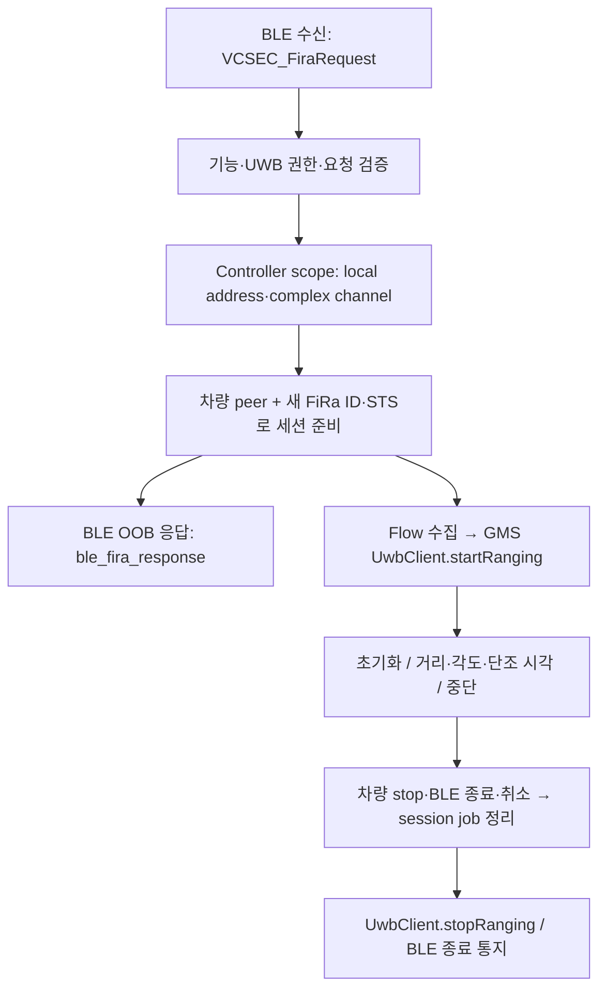

# Tesla 통합 전제

[Wiki 홈](Home.md)

## 문서 상태와 범위

현재 개발 기준은 **로컬 BLE 우선**이다. v42는 실제 프렁크 명령과 화면 표시 음성 확인을 연결했다. 감지/조회 진단과 실차 명령은 분리하며, 실차 시험 준비를 위해 감지는 정상 중지하고 RAM 동의는 미선택으로 남겼다. 데이터 보존 설치·S23 기기31개 검증을 수행했지만 실제 사용자 발화·차량 명령/개방·잠금 주머니 동작은 미검증이다. [v42 실차 절차](Device-Validation.md#0420-probe--화면-표시-음성-프렁크-실차-시험)를 따른다.

`0.14.0-probe`의 BLE 감지 대조 시험은 별도 경로다. CDM 기준과 선택된 BT·주소 필터 스캔·제한 재시도로 근접 후보와 GATT 회차를 분리하며, 서비스는 등록 차량 GATT·Tesla 서비스/TX/RX·RX 구독과 정리만 검사한다. 감지만 모드는 GATT도 하지 않는다. `VehicleGateway`는 여전히 로컬 dry-run이며 연결/구독·첫 RX는 가상 키·권한·차량 인증이 아니다. CCCD 제어 외 TX characteristic 쓰기·차량 명령·Fleet API 호출은 하지 않는다. 실제 검증과 합성 입력은 [기기 검증](Device-Validation.md#0140-probe--ble-감지-대조-시험)에 구분하고 UWB 세션 start·유효 거리·폰키 인증을 아래에서 따로 다룬다.

앱 내부 UI·도메인·파서·상태 머신·게이트웨이는 Kotlin, Compose, Coroutines/StateFlow, DataStore를 사용한다. 현재 수동 BLE 등록·읽기 진단의 공유 프로토콜과 AndroidKeyStore 경계를 재사용해 향후 네이티브 BLE 차량 게이트웨이를 개발한다. 선택 Fleet 경로에서 서버 필요성이 확인되고 사용자가 승인한 경우에만 Node.js+TypeScript를 검토하며, 해당 경로의 서명은 공식 Go `vehicle-command` 프록시 재사용을 우선한다. Node 서버를 먼저 개발하거나 AndroidKeyStore 개인키를 서버로 옮기는 방식은 채택하지 않는다. SDK·라이브러리 버전은 실제 호환성 검증 뒤 고정하며 외부 음성 SDK는 미선정·미승인 상태다.

## 0.16 도입·0.17 표시·0.18 인증 응답 수정 — 로컬 BLE 키 등록·읽기 진단

- **등록:** 우리 앱 UID의 AndroidKeyStore에서 비추출 하드웨어 P-256/ECDH 키를 생성하고 같은 alias를 재사용한다. 기존 키 손상·사용 불가 시 삭제/교체하거나 다른 앱의 폰키를 가져오지 않는다. 공개키를 `PRESENT_KEY` legacy add-key-request에 담아 `ROLE_DRIVER` / `KEY_FORM_FACTOR_ANDROID_DEVICE`로 요청하고 실제 차량의 NFC 키카드 접촉과 차량 UI 승인은 사용자가 수행한다. 등록 요청은 기존 CDM 대상 한 대에만 전송하며 자동 재등록/재시도는 없다.
- **등록과 인증 분리:** `registrationReported`는 인증 전 legacy 완료 형식의 응답 관측이다. 실제 저장·키 권한·차량 신원의 증거로 승격하지 않는다. 이후 새 VCSEC handshake의 HMAC·challenge·route/domain을 확인하고 personalized AES-GCM으로 `GET_STATUS` 한 회만 전송한다. `FLAG_ENCRYPT_RESPONSE`는 enum 값이 아닌 비트 마스크이며, 수신은 AEAD·request hash·response counter를 검증한다. 이 버전은 암호화되지 않은 상태 응답을 성공으로 취급하지 않는다.
- **중간 인증 응답:** 요청에 대응하는 명시적 무오류 `OK` ACK는 인증 성공이나 오류가 아니라 기존 기한 안의 대기다. 재전송하거나 단계 기한을 연장하지 않는다. 이후 session info의 서명·태그·파라미터·HMAC 검증을 모두 통과해야 상태 요청을 보낸다.
- **실패 근거:** 키 미등록 fault/session status는 차량 응답의 미등록 **보고**로 표시하며 실제 키 부재의 인증된 증거로 취급하지 않는다. 미지원 status·서명/태그 누락·무결성 실패를 구분하고 로그에는 12개 고정 `TESLA_KEY_AUTH_*` 코드만 남긴다. 원시 응답·예외·식별자를 저장하지 않는다.
- **신뢰 경계:** 공식 handshake는 peer 제공 공개키 기반 무결성 검증이며 차량 인증서 기반 신원 인증이 아니다. 사용자의 현장 대상 차량 확인·실제 NFC 승인과 별개로 표시한다. 공식 앱 등록 폰키를 재사용하는 위임 API나 UWB 폰키 구현이라고 주장하지 않는다.
- **수명/안전:** 표시·잠금 해제·Bluetooth ON·연결 권한·단일 CDM 대상과 전역 배타 예약을 시작/전송/250ms watchdog에서 확인한다. 전체 180초, 카드 대기 120초, 나머지 단계별 제한을 적용한다. HOME·화면/탭 이탈·BT/권한/대상 상실은 전송을 봉인하고 로컬 close한다. close 불명은 Application 예약을 유지하며 Activity 재생성으로 풀지 않는다. 전송 후 취소·오류는 등록 철회/미등록을 보장하지 않는다.
- **예약 표시:** 시작 전 입장 검사와 실행 중 자기 예약을 구분한다. 자기 예약 중에는 재진입을 비활성화하되 외부 충돌 문구를 표시하지 않는다. 실제 외부 예약·정리 실패 차단과 runtime 안전 조건은 유지한다.
- **보관/범위:** v24는 명시적으로 등록한 VIN을 앱 전용 암호화 설정에서 재사용하고 편집 중 원문만 RAM에 둔다. 원시 RX·키·주소·VIN·예외 원문은 상태/로그에 쓰지 않으며 공용 VIN 상태는 마스킹만 제공한다. v22의 별도 P 읽기와 등록/VCSEC 읽기를 구분하며 실제 프렁크/잠금/주행·UWB ranging·Fleet API·자동 음성 제어는 추가하지 않는다. 주말 BLE 진단의 RX-only 계약은 그대로 유지한다.

근거는 고정한 [공식 vehicle-command protocol](https://github.com/teslamotors/vehicle-command/blob/a4b43c1eff0e09d77deb9f2dce97031141fe8c8a/pkg/protocol/protocol.md), [SendAddKeyRequestWithRole](https://github.com/teslamotors/vehicle-command/blob/a4b43c1eff0e09d77deb9f2dce97031141fe8c8a/pkg/vehicle/security.go#L320-L366), [session dispatcher](https://github.com/teslamotors/vehicle-command/blob/a4b43c1eff0e09d77deb9f2dce97031141fe8c8a/internal/dispatcher/dispatcher.go), [응답 오류 판정](https://github.com/teslamotors/vehicle-command/blob/a4b43c1eff0e09d77deb9f2dce97031141fe8c8a/pkg/protocol/error.go)이다. 공식 protobuf 5개와 Apache-2.0 license를 보존했고 Java outer class 고정 및 수신 scalar presence만 추가했다. 누락된 잠금/프렁크 값을 enum 0으로 추정하지 않는다. host 회귀·실기기 키 보관·실제 방문 결과 불명과 휴대폰 수정 검증은 [기기 기록](Device-Validation.md#0180-probe--인증-ack-처리와-실패-근거-분리)에 구분한다. 지금 재방문·등록 반복을 권하지 않는다.

**확인된 실차 범위:** v21에서 두 방문 모두 `TESLA_KEY_STATUS_VERIFIED`·`COMPLETE`·`LOCAL_CLOSED`를 기록했다. 앱 키 인증·암호 상태 조회·이전 연결 종료 후 같은 키를 이용한 새 BLE 연결 조회는 통과했다. 두 회차는 같은 앱 프로세스이며 프로세스 종료·재부팅 후 키 재사용까지 확정하지 않는다. 이를 다음 개발의 필수 조건으로 추가하지 않는다. 프렁크 실행·주차 P·차량 접근 감지·UWB 거리 측정의 증거는 아니며 상세는 [실차 통과 기록](Device-Validation.md#실차-앱-키-인증재연결-조회-통과)에 둔다.

**공식 계약과 한계:** [SendAddKeyRequestWithRole / SendAddKeyRequest](https://github.com/teslamotors/vehicle-command/blob/main/pkg/vehicle/security.go)는 P-256 검증, FleetAPIConnector 거부, `PRESENT_KEY` 전송과 사용자 NFC·차량 UI 승인을 설명한다. 정상 반환은 전송만 보장하며 등록 완료가 아니다. 등록·infotainment 동기화 확인에는 `DomainInfotainment`의 `SessionInfo`를 안내한다. v22는 별도 주차 조회에서 새 Infotainment 세션을 검증하지만 대상 차량에서 이 경로의 성공은 미확인이다. [공식 CLI](https://github.com/teslamotors/vehicle-command/blob/main/cmd/tesla-control/commands.go)의 `add-key-request`는 `requiresAuth=false`, `requiresFleetAPI=false`이고 `driver` / `android_device`를 허용한다. Fleet Manager는 2023.38 이상에서 BLE 명령을 보낼 수 있으므로 로컬 Driver 키와 혼동하지 않는다.

**v21 이후 순서의 이력:** 통과한 키를 삭제·재등록하지 않고 v22의 별도 Infotainment 주차 조회와 감지 개선을 진행했다. 현재 v28의 접근 인증·읽기 통합은 아래 계약을 따른다. 연결·인증·지난 P를 근접이나 제어 허가로 취급하지 않으며 프렁크 시험은 별도 승인과 신선한 P·안전 조건 뒤에만 진행한다.

### v22 별도 주차 기어 읽기

- 진단의 **주차 기어 상태 1회 조회**는 기존 앱 키로 domain3 fresh handshake 후 암호화된 `Action.VehicleAction.GetVehicleData.GetDriveState`만 요청한다. [공식 GetState](https://github.com/teslamotors/vehicle-command/blob/a4b43c1eff0e09d77deb9f2dce97031141fe8c8a/pkg/vehicle/state.go)와 [Infotainment 응답](https://github.com/teslamotors/vehicle-command/blob/a4b43c1eff0e09d77deb9f2dce97031141fe8c8a/pkg/vehicle/infotainment.go)에 맞췄다. 기존 등록·VCSEC GET_STATUS·키 alias와 예약/취소 경계는 유지한다.
- domain3는 정확한 UUID·route/domain·전체 HMAC·request hash 기반 AEAD를 요구한다. 누락 UUID 허용은 domain2에만 남긴다. 암호 검증 뒤 실제 DriveState가 있어야 완료하며 차량 오류 원문은 노출하지 않는다. ActionStatus 생략은 공식 proto3 기본 OK 계약을 따르되 기어 데이터 누락은 실패다.
- P·R·N·D를 실제값대로 표시하고 missing/Invalid/SNA/미지원은 UNKNOWN이다. 정상 범위 차량 Timestamp만 원본 epoch ms로 보존하며 없거나 잘못되면 null이다. 최종 GATT fragment 수신 monotonic과 처리 시각 기반 기한을 구분한다. 지난 P 조회를 현재 P·감지·프렁크 허가로 쓰지 않는다.
- 공식 protobuf 4개를 같은 고정 revision에서 추가해 총 9개 schema를 lite로 생성하고 Apache-2.0 license를 유지한다. 독립 JCA 피어 직접 실행과 S23 화면/취소 계측은 통과했으나 실제 차량의 Infotainment 기어 수신·수면 호환성·실행 직전 신선성은 미확인이다. Fleet API·wake·자동 재등록·재전송·BODY fallback·차량 제어는 없다. [v22 실측 기록](Device-Validation.md#0220-probe--주차-기어-읽기)을 따른다.

### v23 공식 광고명 기반 감지

[공식 BLE connector](https://github.com/teslamotors/vehicle-command/blob/a4b43c1eff0e09d77deb9f2dce97031141fe8c8a/pkg/connector/ble/ble.go)의 `VehicleLocalName`은 VIN SHA-1 첫 8바이트를 `S…C` 이름으로 만든다. 기존 앱은 등록 chooser에만 이를 사용했고 반복 스캐너는 CDM 등록 주소로 고정했다. v23은 공유 계산·정확한 이름 필터·실제 ScanRecord 이름 재검증을 반복 감지 소비 경로에 연결했다. 등록 주소가 달라도 같은 이름의 광고를 소비하지만 이름 미광고/비광고·OS/OEM 제한·40초/120초 공백은 해결 보장이 없다.

이 경로는 **별도 BLE 진단의 감지 전용 모드**이며 이름 일치는 차량 신원·권한·거리·P·제어 허가가 아니다. GATT·TX·마이크·UWB는 없고 일반 CDM 자동 접근의 음성 조건도 바꾸지 않는다. v24는 저장 VIN의 시작 스냅샷으로 이름을 계산하며 name/hash는 RAM에서만 사용한다. 기존 키·등록·로그를 삭제하지 않는다. v23 호스트 검증과 S23 데이터 보존 설치·계측 21개·실제 준비 화면 확인은 완료했다. 스캐너 계측의 transport는 합성이므로 실제 차량 광고 감지는 별도 미확인이다. [v23 기록](Device-Validation.md#0230-probe--차량-광고명-감지)을 따른다.

### v28 접근 기반 기존 키 읽기

- 새 선택 모드는 실제 광고의 현재 기기를 RAM에 고정하고 10초 freshness·owner/token/후보/회차·단일 등록 대상·VIN/권한/FGS·기한을 검사한다. CDM의 과거 주소나 BT 연결만으로 인증 읽기를 시작하지 않는다.
- native 스캔 정지 확인 이후 기존 하드웨어 P256 키만 로드하고 같은 GATT에서 BODY→새 DRIVE 세션을 각각 fresh handshake와 읽기 요청으로 실행한다. 프로토콜·암호 검증은 기존 구현을 유지한다. 없는 키를 생성·등록·교체하지 않고 제어 명령은 전송하지 않는다.
- background 읽기 예외는 정확한 서비스 소유 회차에만 적용하며 수동 등록·조회 화면/잠금 게이트를 약화하지 않는다. 총40초·후보당 조회1회·실제 자원 해제/예약 반환 후 스캔 재개다. v36은 전송 전 초기133 연결만 정리 확인 후1초 뒤 한 번 재접속하며 인증/조회 요청은 재송신하지 않는다. BODY만 성공하면 부분 결과, 정리 불명은 재입장 차단이다.
- 지난 기어·누락 원본 시각·UNKNOWN은 현재 P나 프렁크 허가가 아니다. 프로세스 복원은 감지만이며 이전 조회를 재생하지 않는다. 실제 same-GATT 두 도메인·잠금 상태·공식 폰키 동시 사용은 사용자 실차 테스트와 [로그 분석](Device-Validation.md#0280-probe--접근-기반-인증읽기-조회)에서 판정한다.

### v24 공통 VIN 암호화 설정

개발자 진단 상단에서 저장한 VIN을 차량 키 등록·BODY 인증/상태·DRIVE_STATE 기어 조회·광고명 감지·명시적 CDM 차량 선택에서 공통 사용한다. AndroidKeyStore의 별도 AES-256/GCM 키와 noBackupFilesDir의 암호문을 사용하며 기존 P-256 차량 키는 변경하지 않는다. 저장/복원은 Main 입장 상태와 IO 처리를 분리하고 완료 전이나 실패 시 차량 작업을 막는다.

정상 저장은 pending 암호문과 기존 유효암호문의 commit 복구용 `.previous`를 동기화하고 원자 rename 및 디렉터리 동기화 후 완료된다. `.previous`는 Android 백업이 아니며 정상 복원 fallback으로 쓰지 않는다. 손상·누락/잘못된 키·쓰기 실패는 원문 없이 정적 코드로 표시하고 자동 키 교체·평문 fallback·차량 작업 재개는 없다. 암호문 파일과 계측 fixture는 백업·기기 간 전송에서 제외한다.

VIN을 저장하거나 앱을 재실행해도 진단을 자동 시작하지 않는다. 실행·예약·정리 불명·chooser 요청 중에는 변경을 막고 작업 대상 스냅샷을 유지한다. v24 데이터 보존 설치·AndroidKeyStore 저장·별도 프로세스 복원·격리된 실제 Compose UI 회귀를 확인했다. 설치 앱의 공통 등록·차량 키·BLE 화면도 확인했다. 실제 차량 P 수신·광고 감지·프렁크·Tesla UWB ranging은 이 검증에 포함하지 않는다.


## MVP 명령 계약

제품 명령 목표는 프렁크 하나이며 우선 경로는 인증된 로컬 BLE다. [공식 CLI의 `frunk-open`](https://github.com/teslamotors/vehicle-command/blob/main/cmd/tesla-control/commands.go)은 `requiresAuth=true`, `requiresFleetAPI=false`로 BLE 경로를 지원한다. 이는 SDK의 지원 사실이지 우리 앱의 제어 구현이나 대상 차량의 실차 성공을 뜻하지 않는다. 키 등록·읽기 진단의 성공도 프렁크 실행 허가가 아니며 신선한 `P`와 별도 실차 승인이 필요하다.

아래 HTTP 형식은 **선택 Fleet 인터넷 경로에만** 해당한다. 실행 가능한 `curl` 예제를 제공하지 않으며 승인 전 실차 요청을 유도하지 않는다.

```http
POST /api/1/vehicles/{vin}/command/actuate_trunk
Content-Type: application/json

{"which_trunk":"front"}
```

이 요청은 프렁크 래치 해제 또는 후드 완전 개방을 보장한다고 주장하지 않는다. 대상 차량 매뉴얼의 직접 조회는 현재 403으로 확인하지 못했고 차량 동작도 미확인이다. 따라서 명령 수락, 래치 해제, 후드 완전 개방은 실차에서 각각 구분해 관찰해야 한다.

## 게이트웨이와 실행 안전성

`VehicleGateway`의 기본 구현은 mock/dry-run이다. mock은 다음을 재현할 수 있어야 하나, 어느 시나리오도 실제 차량 성공으로 표현하지 않는다.

|시나리오|mock/dry-run에서 재현할 계약|실차 확인 상태|
|---|---|---|
|주차 상태|명시적으로 신선한 주차 판정이 없으면 거절|미확인|
|상태 신선도|차량 관측 시간, 수신 유효성, 출처, 연결 상태를 함께 검증; 오래된 cache가 방금 전달됐다고 신선한 상태로 처리하지 않음|미확인|
|권한|BLE 앱 키의 차량 권한 검증; 선택 Fleet 경로는 추가로 OAuth 범위·차량 권한 부족을 오류로 반환|미확인|
|취소|전송 전에는 취소가 전송을 막음|미확인|
|만료|만료된 의도는 전송하지 않음|미확인|
|연결|BLE 연결 또는 선택 Fleet 네트워크의 단절·시간 초과를 실행 성공으로 처리하지 않음|미확인|
|차량 절전|깨우기 정책 없이는 깨우기 호출을 하지 않음|미확인|
|전송 후 `UNKNOWN`|결과 불명을 성공·실패로 추정하거나 재전송하지 않음|미확인|

명령은 `VALIDATING` 단계에서 검증되고, 해당 모드의 사전 승인 조건과 필요한 음성 확인을 만족한 경우에만 `EXECUTING`으로 진행한다. 전송 전 취소는 전송을 막도록 설계하지만, 전송 후 차량 명령을 철회할 수 있다고 약속하지 않는다. 무제한 재시도, 지연 명령 저장, 결과 불명 명령의 재전송은 금지한다. 차량 깨우기 호출은 사용자가 제한·비용 정책을 명시적으로 승인하기 전에는 하지 않는다.

개발 중 수동 진단 버튼은 초기 검증용이며 운영 필수 경로가 아니다. BLE 키 등록·상태 읽기는0.16, 화면 표시 음성 프렁크 시험은0.42에 도입했다. 자동 접근·잠금 주머니 음성 제어는 아직 연결하지 않았다. 최종 제품 목표는 초기 설정 후 잠금·주머니 무터치이며, 현재 시험의 화면 동의를 제품의 매사용 필수 단계로 확정하지 않는다.

## v42 프렁크 제어·음성 연결

Tesla4.61.6 APK의 `oc0.e.V`는 `RKE_ACTION_OPEN_FRUNK`를 생성하며 `CommandActionsKt.getDomain`은 이를 VCSEC로 분류한다. `fe0.f`의 세션 기반 서명/암호화·응답 decode와 `fg0.e.k`의 프렁크 상태 갱신은 별도다. 검사한 native 경로에서 프렁크 전용 P·속도·폰 잠금 gate를 찾지 못했지만 JS UI/펌웨어까지 없다는 의미는 아니다. UNKNOWN 상태를 CLOSED로 채우는 캐시 처리도 우리 안전 판단에는 복사하지 않았다.

우리 구현은 APK RKE 숫자를 추가하지 않고 공개 SDK [OpenFrunk](https://github.com/teslamotors/vehicle-command/blob/a4b43c1eff0e09d77deb9f2dce97031141fe8c8a/pkg/vehicle/actions.go)→[executeClosureAction](https://github.com/teslamotors/vehicle-command/blob/a4b43c1eff0e09d77deb9f2dce97031141fe8c8a/pkg/vehicle/vcsec.go)의 `frontTrunk=MOVE(1)`를 기존 인증 전송에 연결했다. 새 키·OAuth·UWB·자동 wake는 추가하지 않았다. 신선한 P는 실제 음성 명령 확정 후 같은 차량 작업에서 검사하며 이전 접근의 P를 실행 허가로 재사용하지 않는다.

Tesla APK의 `com.wenkesj.voice.VoiceModule`은 일반 SpeechRecognizer 결과를 JS 이벤트로 넘긴다. 잠금 주머니 음성 프렁크 구현의 근거는 확보하지 못했다. `assets/index.android.bundle`은83.5MB Hermes bytecode v96으로 UI/음성 전체 경로는 이번 정적 조사 범위 밖이다. 우리 앱은 기존 온디바이스 인식과 Android의 foreground 마이크 조건을 사용하며 화면 확인·취소 후에만 실제 작업에 입장한다.

APK 근거는 PC 캐시 `tesla-frunk-next-evidence-20261019-4cc343d29ce84ae9851adbf0f7a51347-supplement-8685db6246d9.json`(86건)에 보존했다. 핵심 생성기 `ev_d9fe2011b71a3202df2456e9e412ac2db464837401887e7b3a6b8503ea09dd11`, 서명 경로 `ev_47a439899ffcd705e6afd097de48b6d728fc716c2ef6cca2e11b37e03c39ffd6`는 shipped-artifact의 정적·derived 근거이며 실제 실행 성공이 아니다.

## v41 BUSY·Infotainment 선행 조사

같은 Tesla4.61.6-4647 APK의 `Peripheral.writeToCar`는 legacy Boolean 쓰기 API를 사용한다. false면 busy를 풀고 `PHONE_KEY_TRANSMISSION_FAILURE`→`u1.z/l` disconnect/reset 경로로 전달한다. 큐는 atomic busy로 직렬화하며 완료 callback을 Handler에 게시한 뒤 다음 큐를 진행한다. 확인한 경로에 SDK201 전용100ms 재발급은 없었다. Android36 `BluetoothGatt`의201은 로컬 busy 또는 서비스 busy 반환이며 SDK 내부에도 별도 짧은 처리가 있다. 우리100ms/최대2회는 이 **명시적 미접수**에만 적용한 제한값이며 Tesla와 동일한 정책·실차 해결 보장이 아니다. [Android 쓰기 API](https://developer.android.com/reference/android/bluetooth/BluetoothGatt#writeCharacteristic(android.bluetooth.BluetoothGattCharacteristic,%20byte[],%20int))의 SDK 접수와 native 완료도 분리한다.

Infotainment는 별도 전제다. `ag0.j.c`는 modern domain3 요청에서 차량 online 상태가 ONLINE이 아니면 `kc0.g.B`를 거친 뒤 진행한다. `oc0.e.q0`의 선행 동작은 BLE `RKE_ACTION_WAKE_VEHICLE`라는 **별도 차량 명령**이다. `AUTHENTICATION_LEVEL_DRIVE`는 VCSEC 인증 수준이지 domain3 세션을 뜻하지 않으며 `ff0.g`는 두 domain 세션을 분리한다. 관련 bonded-read 메서드의 존재만으로 Android bond를 필수로 볼 근거도 없었다.

[공식 프로토콜의 domain 설명](https://github.com/teslamotors/vehicle-command/blob/a4b43c1eff0e09d77deb9f2dce97031141fe8c8a/pkg/protocol/protocol.md#domains)도 VCSEC 통신 중 Infotainment가 asleep일 수 있음을 명시한다. [dispatcher](https://github.com/teslamotors/vehicle-command/blob/a4b43c1eff0e09d77deb9f2dce97031141fe8c8a/internal/dispatcher/dispatcher.go)의 HELLO field/domain·route/UUID 매칭과 우리 구현 사이에서 이번 무응답을 확정 설명할 불일치를 찾지 못했다. domain2 불일치 프레임을 DRIVE 응답으로 수용하지 않는다. BODY 종료가 다음 공개키를 소거하거나 세션을 잘못 재사용한다는 근거도 없었다. 차량측 HELLO 수신·키 인식·Infotainment awake 여부는 미확인이다.

따라서 자동 깨우기·bond·무한 HELLO 재전송은 추가하지 않았다. 대신 검증된 BODY의 절전 원 코드를 기록한다.0 UNKNOWN은 awake로 보정하지 않고1 AWAKE도 현재 DRIVE 준비·제어 허가로 쓰지 않는다. 실제 차량 화면이 깨어 있는 조건과 잠금 접근 조건을 구분해 다음 로그를 비교한다.

근거는 PC 캐시의 `tesla-4.61.6-busy-infotainment-v41-evidence-7f89bc04c1324a65905e064bb1025805.json`(기존146건), `tesla-4.61.6-busy-v41-worker-cc7e2903b8394a5e9a48fefaa3427744.json`(추가5건), `tesla-4.61.6-infotainment-v41-worker-d0d885499dfd436ea910efcd471e8984.json`(추가62건)에 보존했다. 핵심 Evidence는 쓰기 `ev_e5eac5a13942cd7fb330b00fea064e70645936c574231cdc9959ee13f33fbb32`, online gate `ev_67cc3b132c9e9a0453bdd40fd9fd95978d7eaaeb9ffaaae76e0106dfe38ed9c0`, 별도 wake 생성 `ev_8ee50abfbc39cb6edc339f35172745f237d861d9c4b94da27b61750945b49164`다. 정적 분석이며 Tesla 앱 실행·후킹이나 실제 wake 송신은 하지 않았다.

## v40 Tesla 133 경로 추가 대조·적용

같은 Tesla4.61.6-4647 base APK에서 이전에 미확인했던 연결 콜백 내부를 추가 추적했다. `Peripheral.a.o`는 disconnected status133을 명시적으로 처리하고 `getDelayDurationForStatus`의133 대기는2000ms다. 생성자는 SDK34 이상에서 autoConnect=true를 설정하며 `createInitialConnection`이 그 값을 SDK에 전달한다. 재접속 lambda는 기존 GATT가 있으면 `connect()`, 없으면 새 생성을 사용한다. `onConnectionLost`는 MTU/탐색/구독 상태를 지우고 대기 명령을 실패 처리한다.

우리 v40은 지원 OS에서 autoConnect=true를 사용하고, 접근 읽기의 초기133에만 기존 handle을2초 뒤1회 재접속한다. Tesla의 장시간 재접속 전체를 복제하지 않고 원40초/광고10초·최종 close·이전 콜백 세대 봉인·SDK 거절/예외 차단을 유지한다. 성공 후 명령 재생·무제한 재시도·차량 제어는 추가하지 않는다. [현재 실행 계약](Native-Architecture.md#v40-tesla-연결-모드기존-gatt-재접속)을 따른다.

133에서 `warnAboutBluetoothShouldCycle()`라는 경로는 있지만 도착 지점 `BLEService.n1()`은 해당 DEX에서 return-void뿐이었다. 자동 Bluetooth OFF/ON 구현이나133 해결 보장으로 해석하지 않는다. 추가 증거146건은 PC의 `~/.cache/hey-tesla/rea/tesla-4.61.6-gatt133-evidence-f2c6399f4ae049529f1a1b3680509f55.json`에 보존했으며 APK·디컴파일 원문은 저장소에 올리지 않는다. 핵심 근거는 callback `ev_ed4790be33d9de4bbca916a8dda3fad202a05ea4dbd7b1fa3f920e87154742f3`, delay `ev_8d7bca99f3cbbd9899bc294a8bc45875f20cd49500f6eb113739afdd816095cd`, reconnect lambda `ev_df19896c567a86a2de6475c47fe72947283f360c0ac9fece28f1a2c5d1426d01`이다. 정적 코드와 DEX 대조이며 실제 Tesla 앱을 실행·계측하지 않았다.

## v39 연결 상태 기반 제한 복구

Tesla APK `u1.z/l`의 전송 실패→reset/disconnect·후속 정리 흐름을 참고했다. 공식 앱의 전체 재인증·백오프·세션 캐시 정책을 복제한 것은 아니다. 우리 앱은 명시적인 일시 GATT 실패에만 close·예약 반환 확인→3.5초→새 광고에서 읽기를 다시 시작하며 같은 후보 최대2회·기존40초 예산을 유지한다. 성공·보안/프로토콜 오류·정리 불명은 반복하지 않는다.

인증 모드에서60초 무수신 대기를 제거하고 기존10초 광고 최신성 기준을 부재 판단에도 사용한다. 스캔이 중단되는 GATT/정리 시간은 이탈 증거로 쓰지 않는다. 비인증 감지/비교·AltBeacon 스캔 주기·키·암호 검증·제어 금지 경계는 그대로다. [현재 실행 계약](Native-Architecture.md#v39-60초-이탈-대기-제거제한-재조회)을 따르며133·첫 쓰기 문제 해결 여부는 새 실차 로그로 판단한다.

## v38 직접 GATT 적용

사용자 요청으로 **Nordic만 제거**했다. Tesla APK에서 확인한 단일 쓰기 직렬화·CCCD 완료 게이트·SDK 접수와 callback 완료의 분리를 참고하되, 공개 Android API로 우리 앱에 맞게 구현했다. 공식 앱의 디컴파일 원문·폰키·세션을 복사하거나 동일한 장시간 안정성을 구현했다고 주장하지 않는다.

`TeslaBleKeyProbe`의 수동 등록·BODY/DRIVE 읽기·접근 읽기는 같은 native 경로를 사용한다. v38에서는 AltBeacon 감지·BeaconService FGS·알림·스캔 공백0과 기존 프로토콜·키·VIN·40초 기한·60초 재무장·초기133 제한 재접속을 유지했다. v39에서 바뀐 재조회 정책과 구분하며 [v38 검증 기록](Device-Validation.md#0380-probe--직접-gatt-전환)은 당시 구현 경계다. UWB·차량 제어는 추가하지 않았다.

## Tesla 앱 REA 추가 조사

### 대상·방법·판정 범위

2026-10-16, 연결된 휴대폰에 설치된 **Tesla `4.61.6-4647` / versionCode4647**의 APK 세트5개를 읽기 전용으로 PC에 회수했다. 이번 정적 분석 대상은 `base.apk`이며 minSdk24·targetSdk35, SHA-256은 `63adb6bb0556a44ea83996c719e2dfdcdbda4b33b8250bf46f6e5ee853c3d083`이다. 우리 앱의 minSdk·targetSdk·compileSdk는36이며 설치 버전은 `0.37.0-probe`다.

- **실행한 조사:** REA6.5.0 / JADX headless0.7.1로 클래스44,261개 인벤토리 검색, 메서드 디컴파일·정적 참조 추적. Kotlin bridge·중복 블록 경고가 있는 경로는 smali와 Android SDK `apkanalyzer dex code`의 정확한 DEX 메서드를 대조했다. 디컴파일 표시명은 원본 소스명·원본 소스 라인이 아니며 이 APK에 한정한다.
- **하지 않은 작업:** Tesla 앱 실행·계측·후킹, 사설 저장소/폰키/실제 STS·토큰 열람, 차량 명령, 우리 앱 코드·설정·권한 변경, 새 APK 설치. split 내부와 native 전체를 분석하거나 APK 서명을 검증한 것도 아니다.
- **PC 보존:** APK는 `~/.cache/hey-tesla/rea/apk-smoke-6807734be6dd460c9a6245e17ed6dd8f/com.teslamotors.tesla/`, REA Evidence133건은 `~/.cache/hey-tesla/rea/tesla-4.61.6-uwb-evidence-20261016.json`에 있다. APK·디컴파일 원문·증거 bundle은 저장소/Wiki에 올리지 않는다. 아래 식별자는 이 bundle의 `evidence_id`다. `unknowns=0`은 등록된 unknown 레코드가 없다는 뜻이지 미확인 사항이 없다는 뜻이 아니다.

### BLE — AltBeacon·Nordic 사용 여부와 전송 구조

**확인한 핵심 BLE 경로는 Android GATT 직접 호출이다.** 전체 클래스 이름 인벤토리에서 `org.altbeacon`·`no.nordicsemi`는 일치하지 않았다. 난독화·재패키징까지 포함한 라이브러리 부재 증명은 아니며, Tesla가 쓰지 않는다는 이유로 우리 앱의 AltBeacon/Nordic을 제거할 근거도 아니다.

|관측 지점|정적 코드에서 확인한 내용|우리 앱에 참고할 경계|
|---|---|---|
|`Peripheral.enqueue / checkCommandQueue`|큐 삽입 후 `mBusy` CAS로 쓰기를 하나씩 진행|프로토콜 프레임·SDK 작업·콜백을 단일 소유자로 직렬화|
|`Peripheral.writeToCar`|연결·권한·service/TX를 검사하고 `WRITE_TYPE_DEFAULT=2` 및 legacy `writeCharacteristic(characteristic)` boolean API 사용|SDK 접수 결과와 나중의 GATT callback status를 구분. legacy API가 최신 API보다 낫다는 증거는 아님|
|`Peripheral.a`의 GATT callback|Handler로 넘겨 처리. CCCD status0 뒤 `connectionEstablished`, 쓰기 callback 뒤 busy 해제·다음 큐 진행|라이브러리 ready·구독 완료·차량 인증 완료는 별개|
|`u1.y / u1.k / u1.x0`|연결·readiness 확인 후 enqueue. ready 시 조건부 인증 요청 경로와 별도의1초 지연 `sendDeviceInfoResponse`가 있음|“첫 HELLO 전에 반드시1초 대기”의 근거로 쓰지 않음|
|`u1.z / u1.l`|전송 실패 시 peripheral reset·disconnect와3500ms 후속 정리 경로|공식 앱의 전체 재접속 정책을 우리 앱의 단발 인증 조회에 그대로 복사하지 않음|

### UWB — BLE OOB 협상 뒤 별도 거리 세션

**UWB는 최초 BLE 발견을 대체하는 스캐너가 아니다.** `u1.j0`는 BLE 연결 전에 UWB 관리 job을 준비할 수 있지만, 준비만으로 무선 ranging을 시작한 것은 아니다. 아래는 차량 FiRa 요청을 처리하는 경로이며 차량의 인증 수락·실제 세션 실행을 관측한 흐름도는 아니다.



|경계|정적 코드 관측|판정 한계|
|---|---|---|
|관리·FGS|`u1.Y0`가 BLE OOB connector와 `kg0.c` manager 생성. `u1.K0`가 FiRa 요청·차량 stop을 전달. 준비 중 `u1.E0 → BLEService.v0("UWB session prepare")` 호출|FGS 요청이 실제 OS 시작 성공을 보장하지 않음|
|전화기 역할·backend|`pg0.f.d → lg0.c.a.a → l6.l.a.a`가 controller scope를 얻으며 factory는 GMS 구현 `o6.i`를 생성|확인한 경로에서는 전화기가 Controller/Initiator. 실제 차량·기기에서 선택·실행됐다는 증거는 아님|
|매개변수 검증|`pg0.f.o/s`: UWB_RANGING, VIN 공백, peer address의 비어 있지 않은 짝수 길이, STS mode, 기기 지원 config 검사. peer를2바이트 주소로 분리하고 local address·channel/preamble·update rate를 조합|광고명·MAC 일치만으로 세션을 만들지 않음. 실제 차량 펌웨어·FiRa 호환은 미확인|
|보안 재료|`og0.h.a.b/c/d`: SecureRandom으로 새 FiRa ID와 STS 생성. 이 APK는 STATIC8바이트, PROVISIONED 계열16바이트. 차량이 STS를 보내는 구형 분기는 거절|장기 BLE 앱 키와 임시 STS는 별개. 이 길이를 모든 backend·향후 버전의 보편 계약으로 고정하지 않음|
|BLE OOB 송신|`u1.U0/V0/W0 → ag0.n.n/o/u`의 `ble_fira_capabilities / ble_fira_response / ble_fira_session_stopped`. `CommandActionsKt.getDomain`은 VEHICLE_SECURITY로 분기|해당 도메인 경로와 실제 서명·인증 성공은 별개. 우리 앱의 기존 조회 payload로 대체할 수 없음|
|실제 시작·종료 API|`o6.b.a`는 callbackFlow. 수집 시 `o6.b.C1984b.invokeSuspend`에서 GMS `startRanging`; 정리 coroutine `o6.b.C1984b.a.C1985a`에서 `stopRanging`|Flow 생성·초기화 callback·유효 위치 수신을 각각 구분|
|거리 결과|`o6.b.C1984b.C1986b.onRangingResult`가 distance·nullable azimuth/elevation·`elapsedRealtimeNanos`를 보존하고 `pg0.f.q`가 `PositionUpdated`로 변환|도착 시각이 아닌 측정 시각으로 신선성을 판단할 수 있는 구조. 누락 각도를0으로 만들지 않음|
|중복·종료|`kg0.c.i`의 중복 job 방지, `pg0.f`의 session별 Job·mutex, `pg0.f.p`의 같은 session 취소/대기, `pg0.f.r / kg0.c.j`의 취소·정리|우리 앱에서는 이전 세션 callback·동시 공식 폰키·취소 후 재시작까지 별도 검증 필요|

`kg0.c.b.C1743b.emit`의 **PositionUpdated 소비 분기는 거리·각도·측정 시각을 로그로 전달**한다. 이 소비 경로에서 “몇 m 이내면 잠금 해제” 로직은 확인되지 않았다. 차량측 판단·다른 앱 경로·센서 융합·최종 잠금 조건은 미확정이다. 반대로 이 사실만으로 잠금 판단을 차량이 전담한다고 확정할 수도 없다. `onRangingSuspended` adapter는 reason을 상위 이벤트에 보존하지 않으므로 우리 앱 설계에서는 이 손실까지 복사하지 않는다.

### 우리 앱 대조와 다음 개발 우선순위

아래 표는 **REA 조사 당시 v37의 대조와 제안**이다. 이후 사용자 요청으로 Nordic만 제거한 실제 변경은 [v38 적용](#v38-직접-gatt-적용)에 구분한다.

우리 앱의 [`UwbSupportProbe.kt`](../app/src/main/java/com/heytesla/app/UwbSupportProbe.kt)는 `RangingManager.registerCapabilitiesCallback`으로 **지원 정보만** 조회한다. 실제 peer/OOB/STS·ranging session은 만들지 않고 Manifest에도 `RANGING / UWB_RANGING`을 선언하지 않았다. 과거 S23의 가용3/ENABLED·background 지원 보고는 capability 관측이지 Tesla 거리 측정 성공이 아니다.

현재 당면 문제는 [v37 실차 첫 쓰기 실패](Device-Validation.md#v37-실차-후속-분석)다. Nordic2.11.0의 [`internalWriteCharacteristic`](https://github.com/nordicsemi/Android-BLE-Library/blob/2.11.0/ble/src/main/java/no/nordicsemi/android/ble/BleManagerHandler.java#L1206-L1245)은 API33+ SDK 반환값이 SUCCESS인지 검사하고 SecurityException도 false로 처리한다. [`nextRequest`](https://github.com/nordicsemi/Android-BLE-Library/blob/2.11.0/ble/src/main/java/no/nordicsemi/android/ble/BleManagerHandler.java#L3942-L3958)는 연결 중 작업이 false이면 `REASON_NULL_ATTRIBUTE=-3`으로 축약한다. 따라서 **`-3`만으로 null characteristic·차량 인증 거부·native133 중 하나를 확정하지 않는다.**

|권장 순서|최소 작업·검증 목표|아직 구현하지 않은 항목|
|---|---|---|
|1. 첫 BLE 쓰기 원인 분리|가능한 최소 계측으로 SDK 진입/반환·원 상태 코드/예외 종류·세션 세대·service invalidation을 구분. payload·키·주소는 기록하지 않음|현재 앱은 Nordic enqueue를 SDK 성공으로 기록하지 않으며 원 SDK 반환값은 미관측. 추가 adapter는 공개 API/최소 수정 가능성부터 확인|
|2. 초기화·수명 후보 검토|현재 MTU 완료 후 post한 CCCD는 일반 작업 큐에 들어간다. MTU+CCCD를 initialize 안에서 enqueue하는 후보와 invalidation 시 기존 회차 봉인을 검토. HELLO는 계속 CCCD 완료 뒤에만 전송|현재 `onServicesInvalidated`는 참조만 지운다. 이것이 이번 실패 원인이라는 증거는 없고 callback 중첩 race도 미입증|
|3. BLE 실차 재검증|구현→빌드·USB smoke→데이터 보존 설치→사용자 두 접근→로그 분석. 첫 쓰기, BODY/DRIVE, 취소·정리·60초 재무장을 각각 확인|더 긴 임의 sleep·무제한 재시도·큐 우회로 성공을 만들지 않음|
|4. 별도 UWB 연동 판단|승인된 우리 앱 키, 차량/펌웨어 지원, FiRa OOB 계약, backend·권한·FGS/report 조건을 정리한 뒤 실제 연동 구현 여부 결정|공식 앱 키/세션 복사 금지. 현재 고정 공개 VCSEC schema에는 완결 FiRa 계약이 없으며 APK 호출명만으로 상호운용 보장 불가|
|5. UWB 실측 후 제품 결합|fresh 거리/누락·차폐·세션 교체·잠금/화면OFF·공식 폰키 동시 사용·해제·배터리를 측정. 광고 발견·거리·인증·신선한 P·제어를 분리|10회 반복·장시간 대기·유효 거리·차량 잠금 변화 모두 이번 조사에서 미실행. 프렁크는 별도 승인 뒤 시험|

위 표는 **조사 당시 개발 제안이지 실차 성공이나 새 차량 제어 승인 기록이 아니다.** 후속 요청으로 v38 직접 GATT를 적용했지만 UWB를 BLE 기능의 필수 조건으로 만들거나 AltBeacon 감지까지 교체하지 않았다.

[Android UWB 공식 문서](https://developer.android.com/develop/connectivity/uwb)는 안전한 OOB와 세션별 매개변수 재교환을 요구하고, 백그라운드 세션 유지와 위치 report 수신을 구분한다. [Android16 Ranging 문서](https://developer.android.com/develop/connectivity/ranging)의 표준 OOB도 peer 검색·연결을 대신하지 않으며 Tesla 전용 OOB 호환을 제공한다는 뜻이 아니다. 실제 세션에는 선택 backend의 runtime 권한·동시 세션·시스템 건강 제한을 적용해야 한다. FGS 실행·칩 지원만으로 잠금 화면 거리 report·정확도·배터리 비용을 보장하지 않는다.

### 핵심 REA 근거 색인

|근거|Evidence ID|
|---|---|
|AltBeacon / Nordic 클래스 이름 검색|`ev_09423628c87dcffdb2e5bf695cf111c272697ae489ed45b2619ca49566b2bc74` / `ev_0121b758f32242a76d4ffa73418ab315b4e378595f757976729e7187d15fbc94`|
|`Peripheral.writeToCar`|`ev_e5eac5a13942cd7fb330b00fea064e70645936c574231cdc9959ee13f33fbb32`|
|`u1.K0` FiRa 수신|`ev_0563d143bcb1c96ad7fd538189749e212a602994b79ac5cbc564fbecfe3fce23`|
|`pg0.f.o` 세션 매개변수|`ev_2304b49b4818a9d21374013fc24b1588b100e222ae7fad568c2e482a651ce749`|
|GMS factory `l6.l.a.a`|`ev_d1f3d73eaf4618915525c1681d38747e9d81b2f3b0ade86df8f3a326bf4df793`|
|GMS start / stop|`ev_06d62b859284354cdd3d1508b1e2fc457eee1db3ca6e646de96e979d57eeb293` / `ev_e18230449bdb892678747ff9549b02ae4ef8e7986538696d27fc391576773c3d`|
|거리 callback / 앱 소비 `emit`|`ev_8c2b1274f3f88a9b1ca9f1e7fa8a55fa1e5ee5ce61af4b6f8f009f3d712e94f8` / `ev_dc1092553706633565380e500d1dc15af2c729ef062d5e07d6b069279cd22c61`|
|OOB 메시지 도메인|`ev_284e7902670ca70f529524bc51bd847226cc256b1e8eb206c7e8646fe7b222af`|

Kotlin inline 경로 `pg0.f$c$a$b.a(Lng0/b;Lkotlin/coroutines/Continuation;)Ljava/lang/Object;`는 REA의 `a/emit` 출력만으로 본문을 확보하지 못해 `apkanalyzer dex code --class 'pg0.f$c$a$b' --method 'a(Lng0/b;Lkotlin/coroutines/Continuation;)Ljava/lang/Object;' <base.apk>`로 대조했다. 이 별도 DEX 출력은 위 REA bundle 레코드가 아니며 원 APK·정확한 selector로 재현한다. 설치 `apkanalyzer`는 JDK21의 JAXB 오류 때문에 명령에 한해서 JDK8을 사용했다. 전역 JDK나 프로젝트 빌드 환경은 바꾸지 않았다.

## BLE와 UWB 감지 조사 — 2026-10-06

아래는 **Tesla4.61.0-4607과 당시 시스템 상태의 과거 조사**다. v25/v26의 직접 스캔 구성도 해당 버전 이력이며 현재 AltBeacon 구성 설명이 아니다. 최신4.61.6의 추가 정적 분석과 현재 개발 판단은 [위 REA 조사](#tesla-앱-rea-추가-조사)를 따른다.

S23 Ultra Android 16의 `android.hardware.uwb`는 true다. 설치된 Tesla `4.61.0-4607`의 APK를 읽기 전용으로 분석하고 실제 Bluetooth/UWB 시스템 상태를 조회했다. 공식 앱의 키·사설 저장소·차량 설정은 열거나 변경하지 않았다.

- **BLE:** `BLEService`의 UUID 필터 스캔/PendingIntent 경로와 별도의 주소 필터 LOW_POWER 경로가 있다. API 34 이상 `Peripheral.mAutoConnect=true` 분기를 확인했으며 실제 기기의 Tesla LE 연결 요청 15건도 `isDirect=false`였다. PendingIntent 경로의 ScanSettings는 LOW_LATENCY이므로 이를 저전력 스캔이라고 부르지 않는다. 현재 Tesla의 CDM association은 0개이며 우리 앱의 CDM 출현만 기다리는 경로와 다르다.
- **UWB:** APK의 BLE OOB connector, `ble_fira_capabilities`/`ble_fira_response`/`ble_fira_session_stopped`, GMS UWB controller와 ranging session 구성을 확인했다. 추가 공개 코드 추적으로 FiRa 빌더→BLE 전송 큐→`BluetoothGatt.writeCharacteristic` 호출 체인까지 확인했다. UWB 단독 최초 검색이 아니라 BLE를 통한 세션 협상 구조다. 이것은 코드 분석이며 우리 앱의 실제 FiRa TX·차량 인증 수락·유효 거리·최종 잠금 판단의 실측이 아니다.
- **실제 세션:** 시스템에 남은 Tesla UWB 세션 metric 99개는 각각 startCount 1·startFailureCount 0이다. 그러나 rangingCount/validRangingCount는 모두 0이다. 세션 시작은 확인했지만 유효 거리·각도 보고나 잠금 해제 성공은 확인하지 못했다. 제조사 metric 보고 한계와 실제 ranging 실패를 이 로그만으로 구별할 수 없다.
- **주말 누락과 대조:** 우리 앱의 BLE 출현이 없던 10/4 13:44·16:19, 10/5 09:03·14:23에도 대상 LE 연결과 약 2.1~2.4초 뒤 Tesla UWB 세션 시작이 남았다. 시간상 대응이지 우리 앱 누락의 단일 원인이나 UWB 성공을 증명하지 않는다.

### v25 foreground 감지에 적용한 범위

2026-10-08 연결된 S23에서 같은 Tesla 앱 버전의 `BLEService`가 실제 foreground service로 실행 중임을 확인했다. 위 APK 분석은 기존 코드 조사이며 이번에 Tesla의 스캔 비율·배터리 비용·유효 UWB 거리를 새로 측정한 것은 아니다.

우리 앱은 기존 `connectedDevice` FGS를 유지하고 exact 필터 스캔을 LOW_POWER·PendingIntent·5초 배치 전달로 바꿨다. [Android BLE 백그라운드 가이드](https://developer.android.com/develop/connectivity/bluetooth/ble/background)와 [startScan/stopScan API](https://developer.android.com/reference/android/bluetooth/le/BluetoothLeScanner)를 따르며, Tesla의 LOW_LATENCY 경로를 그대로 복사하거나 스캔 등록 시간을 상시로 늘리지 않는다. 프로세스 재생성은 고아 등록 정리만 수행한다. FGS 실행과 화면 OFF 감지·배터리 절감은 다른 검증 항목이다.

UWB는 아래 FiRa OOB 선행 조건이 남아 있어 이번 전환에 포함하지 않았다. 공개 Android Ranging API도 상대 검색·차량 인증·Tesla 전용 매개변수 합의를 자동으로 대신하지 않는다.

### v26 적용 판단 — 발견·연결·거리 측정을 분리

| 조사한 Tesla 경로 | 우리 앱의 적용 범위 |
|---|---|
|필터 스캔·PendingIntent|v25 전환을 유지하고 v26은 예약 지연·명시 오류 제한 복구를 보강한다. LOW_LATENCY로 복사하지 않는다.|
|주소 필터 LOW_POWER|기존 주소 비교 모드는 유지하되 실제 광고 주소의 안정성이 확인되기 전 광고명 감지의 기본값으로 바꾸지 않는다.|
|GATT autoConnect|기존 독립 비교 옵션이며 기본 false다. 감지 전용 모드에 자동 연결을 추가하지 않는다.|
|BLE FGS|기존 connectedDevice 서비스를 유지한다. 서비스 생존을 CPU 실행·무선 수신 정상의 증거로 사용하지 않는다.|
|GMS UWB·BLE OOB|BLE 발견·인증과 차량 FiRa 합의 이후의 정밀 거리 단계다. 초기 BLE 감지 누락의 대체 해법으로 주장하지 않는다.|

APK 조사에서 특정 비콘 라이브러리가 장시간 스캔 먹통을 해결한다고 확인한 것은 아니다. Android API 조합은 확인했지만 Tesla의 전체 watchdog·OEM 대응·배터리 정책은 미확인이다. 우리 앱은 Android BluetoothLeScanner를 직접 사용하며 새 라이브러리·상시 wake lock·정확 알람을 추가하지 않는다.

v26은 기존 서비스 readiness 실행에서 elapsed 만료를 조정하고 오류 2/3/5만 정상 정리 뒤 최대 2회·120초/240초 대기 복구한다. 무광고는 정상적인 차량 부재와 구분할 수 없으므로 침묵 watchdog 재시작을 하지 않는다. v25 실차의 약 109분 뒤 광고 수신은 그 시점 정상 동작의 증거이지 전체 시간 무누락·감지 순간 잠금·배터리 절감 증거가 아니다.

Android 공식 UWB 계약은 상대 발견 뒤 안전한 OOB로 주소·채널·세션 보안 재료를 교환하도록 요구한다. BLE는 그 채널의 한 선택이며 조사한 Tesla는 BLE FiRa 협상 구조다. UWB 하드웨어 지원이나 기존 BLE 앱 키 등록만으로 차량의 거리 세션이 성립하지 않는다. [공식 UWB 절차](https://developer.android.com/develop/connectivity/uwb#steps)와 아래 선행 조건을 따른다.


### 우리 앱 UWB 연동의 선행 조건

1. 대상 차량의 실제 펌웨어·폰키 UWB 지원과 업그레이드 상태 확인. Model Y 매뉴얼의 UWB 기능 안내는 검색 색인에서 찾았지만 [본문](https://www.tesla.com/ownersmanual/modely/en_us/GUID-3667D28B-5B3B-49CE-A1C1-3D70AC60D9F6.html)은 HTTP 403이어서 단말/차량별 호환을 확정하지 않았다.
2. 승인된 앱 키 인증 뒤 Tesla 차량과의 FiRa BLE OOB 교환 계약 및 session ID·peer address·channel/preamble·STS 합의가 필요하다. v21의 우리 앱 키 인증·암호 조회·새 BLE 연결 조회는 실차에서 통과했지만 FiRa OOB 교환은 미확인이다. 공식 앱의 폰키·키·세션은 복사하지 않으며 장기 BLE 키를 등록했다고 UWB 세션 재료가 확보된 것으로 판단하지 않는다.
3. 우리 앱 UID에서 UWB 권한·backend·background-ranging/report 제약 확인. [Android 공식 UWB 문서](https://developer.android.com/develop/connectivity/uwb)는 안전한 OOB 매개변수 교환이 필요하고 세션 종료 후 재교환할 수 있으며, 백그라운드에서 세션 유지와 ranging report 수신을 구분한다. 공식 앱의 GMS 경로 동작을 우리 앱에 자동 적용하지 않는다.
4. 실제 유효 거리/각도·peer 종료·권한 철회·잠금·취소 및 자원 정리 검증. 세션 start만으로 거리 표시나 접근 성공 판정을 만들지 않는다.

[고정 공식 vehicle-command 프로토콜](https://github.com/teslamotors/vehicle-command/blob/a4b43c1eff0e09d77deb9f2dce97031141fe8c8a/pkg/protocol/protocol.md)은 BLE transport와 도메인별 인증을 설명한다. 다시 대조한 [공개 VCSEC schema](https://github.com/teslamotors/vehicle-command/blob/a4b43c1eff0e09d77deb9f2dce97031141fe8c8a/pkg/protocol/protobuf/vcsec.proto)의 InformationRequest·UnsignedMessage·FromVCSECMessage에는 FiRa 설정·협상 payload가 없다. 다른 공개 schema와 차량 API에서도 Tesla UWB 상대와 매개변수를 합의하는 완결 계약은 확인하지 못했다. 공개 Android API의 세션 생성 기능만으로 이 공백을 해결하지 않으며 제3자 연동이 기술적으로 절대 불가능하다고도 단정하지 않는다. 현재 앱은 지원 조회만 제공하고 실제 ranging은 구현하지 않는다.

### 공개 APK 추가 추적 — OOB와 인증 경계

보존 APK의 버전은 SDK `apkanalyzer manifest version-name`으로 `4.61.0-4607`을 확인했다. 기존 DEX disassembly와 `apkanalyzer dex code --class … --method … <APK>`의 단일 메서드 출력으로 다음을 확인했다. 공개 코드만 읽었고 공식 앱 사설 저장소·실제 키/주소/세션 값은 접근하지 않았다. 난독화 이름은 이 APK 버전에 한정한다.

|경계|직접 확인한 코드|판정 한계|
|---|---|---|
|FiRa payload 생성|`u1.U0/V0/W0 → ag0.n.n/o/u → oc0.e.E/F/G`가 각각 `vd0.n0/r0/z1` payload를 구성. `CommandActionsKt.getDomain`의 해당 getter `j/k/v`는 `DOMAIN_VEHICLE_SECURITY`로 분기|일반 BLE 데이터나 Fleet OAuth만으로 대체되는 계약이 아님|
|요청 준비·큐|`ag0.n.e → mc0.a.c(ag0.j.c) → ag0.j.P → df0.h.h → ag0.j.S`. source public-key lookup 실패·선택 차량 controller 부재·Bluetooth 비활성은 각각 거절. 큐에 session-info 중간 요청이 있을 수 있음|public-key 존재·큐 enqueue는 차량의 인증 수락/명령 성공이 아님|
|세션 정보·envelope|`ag0.j.x`가 `VehicleSessionInfo`를 builder에 전달. routable은 `fe0.k.a → j$f → BLEService.D0 → u1.y`, legacy는 `fe0.p.b → j$h → BLEService.S0 → u1.m → u1.y`|서명 위임 경계는 확인했으나 구체 서명 모드·차량 검증 결과는 미확인|
|실제 BLE 쓰기 진입점|`u1.y → Peripheral.enqueue → checkCommandQueue → writeToCar → BluetoothGatt.writeCharacteristic`. write type은 2/with-response. `u1.y`는 연결과 내부 readiness flag를 확인|readiness flag는 `connectionEstablished` 등에서 설정되므로 암호학적 인증 완료로 세지 않음|
|차량 인증 요청 처리|`u1.I0`에 auth level·token 길이·`h0.i()` 조건, `se0.h.c → ag0.n.i` 응답, `NO_TOKEN` 거절 분기가 있음|코드상 응답 경로 존재와 차량의 실제 수락은 별개|
|UWB 세션 매개변수|`pg0.f.o`가 UWB_RANGING·지원 config를 확인한 뒤 controller scope의 channel/address와 차량 OOB 입력을 ranging parameters에 넣음. 차량이 STS를 보낸 구형 펌웨어 분기는 거절하고 앱이 STS를 반환하는 분기가 있음|실제 차량의 펌웨어·mode·peer/channel 합의와 종료까지 확인해야 함|
|임시 STS 생성|`og0.h$a.d/c`는 `SecureRandom.nextBytes`를 사용. 공개 mode 매핑은 STATIC 8 bytes, PROVISIONED/PROVISIONED_INDIVIDUAL 16 bytes|장기 등록 폰키와 임시 STS는 다른 재료. 키를 생성한다고 안전한 OOB·폰키 인증이 생기지 않으며 우리 앱은 생성하지 않음|

따라서 후속 실제 연동에는 **우리 앱의 승인된 BLE 키/인증 경로, VCSEC FiRa 메시지·세션 상태 계약, 차량 펌웨어에 맞는 OOB 매개변수 교환, 선택 backend의 실제 ranging/정리 검증**이 필요하다. 공개 코드의 호출 순서와 기본 매개변수만 복사하여 이 조건을 건너뛰지 않는다. 차량 인증 수락·fresh한 거리/각도·잠금 상태 변화는 각각 독립 실측 대상이다.

### framework 지원 조회와 실제 거리 측정의 구분

minSdk 36의 [RangingManager](https://developer.android.com/reference/android/ranging/RangingManager) capability callback만 사용한다. 설치 SDK 36의 register/unregister 계약은 `@RequiresNoPermission`이다. 새 `RANGING`/`UWB_RANGING` 권한을 선언하거나 승인하지 않고 현재 권한 상태를 참고 정보로 읽는다. [실제 ranging 문서](https://developer.android.com/develop/connectivity/ranging)의 거리 세션 권한·OOB·background 제약은 이 조회와 별도다.

하드웨어 feature, framework backend 존재, [RangingCapabilities](https://developer.android.com/reference/android/ranging/RangingCapabilities)의 UWB 원 가용 코드, [UwbRangingCapabilities](https://developer.android.com/reference/android/ranging/uwb/UwbRangingCapabilities)의 공개 지원 항목을 분리한다. backend 없음/unknown/null을 하드웨어 미지원·GMS 미지원·false/0으로 치환하지 않는다. 공식 앱의 GMS capability/helper 경로와 같은 backend라고 가정하지 않는다. 조회 callback 정리·timeout·Activity 이탈을 검증하되 실제 session·peer/address/STS를 만들거나 거리 성공으로 표시하지 않는다.
2026-10-06 S23의 우리 앱 UID에서 framework backend와 공개 capability 응답을 실제 확인했다. `RANGING`/`UWB_RANGING`은 미승인이었고 가용 `3/ENABLED`, 최소 간격 100 ms 및 거리/각도/background 지원 보고를 받았다. 별도 공개 SDK callback과 앱 RAM 값을 대조했다. 상세 결과·취소/Activity 재생성·정리 불명 예약 검증의 범위는 [0.15 기기 기록](Device-Validation.md#0150-probe--차량-방문-전-준비)에 둔다.

slot 목록은 SDK getter Javadoc의 microseconds 설명과 `@SlotDuration` annotation/[UwbRangingParams](https://developer.android.com/reference/android/ranging/uwb/UwbRangingParams)의 `DURATION_1_MS=1`, `DURATION_2_MS=2`가 상충한다. 실측 반환 `2,1`을 µs로 표시하지 않고 SDK enum 원시 코드로 유지한다. update-rate도 enum이며 실제 range sample 또는 선택한 세션 설정이 아니다.


## 주차 판정과 텔레메트리

프렁크 명령 전에는 어느 전송 경로든 명시적이고 신선한 `P` 주차 상태가 있어야 한다. `null` 또는 오래된 `P`는 허용하지 않는다. 신선도는 차량 관측 시간, 값의 유효성, 출처, 연결 상태를 함께 확인한다. **현재 BLE `GET_STATUS`는 잠금·프렁크 상태 읽기이며 v22에서 별도 Infotainment `GetDriveState` 읽기를 구현했다. 실제 차량의 기어 수신과 제어 직전 신선성은 미확인이다.** 로컬 경로에서 신선한 `P`를 확보하지 못하면 프렁크를 거절하며 현장 승인이나 접근 신호로 이를 대신하지 않는다. 선택 Fleet 경로에서 검토할 [Fleet Telemetry 프로토콜](https://github.com/teslamotors/fleet-telemetry/blob/main/protos/vehicle_data.proto)은 `ShiftStateP`를 정의하지만 실제 차량 수신·신선도·전달 지연은 별도 실차 검증 대상이다. Telemetry를 모든 통합의 필수 조건으로 삼지 않는다.

주차 판정의 최소 기록 항목은 차량 식별자를 제외한 상태 출처, 차량 관측 시각, 수신 시각, 검증 시각, 연결 상태, 기어 값, 판정 결과, 거절 사유다. 이 기록은 사용자·차량 식별정보 및 토큰을 포함하지 않는다.

## 인증, 권한, 비밀 관리

다음 세 종류의 인증 재료는 별개다. 기존 Tesla 공식 앱의 폰키 개인키를 우리 앱으로 전달·복사·위임받는 공개 API를 전제로 하지 않는다.

|구분|목적·보관 경계|현재/미확인 범위|
|---|---|---|
|OAuth 사용자·partner token|선택 Fleet 인터넷 API의 계정 권한. 사용자 third-party token은 사용자 차량 대행, partner token은 앱 등록·설정용|미구현. 차량 명령 키·NFC 승인·UWB 세션 키를 대체하지 않음|
|차량 명령용 앱 키|우리 앱이 자체 생성한 P-256 키. 로컬 BLE 개인키는 앱 UID의 AndroidKeyStore 안에 비추출로 유지|v21 실차 인증·암호 조회·같은 키 새 BLE 연결 조회 통과. 프로세스 종료·재부팅 후 재사용·철회는 별도 미확인|
|UWB STS 세션 키·OOB 매개변수|거리 세션용 임시 재료와 peer 주소·채널 등 안전한 OOB 교환|미구현·미확인. OAuth나 장기 차량 명령 키와 동일하지 않음|

[Fleet virtual key 개발자 가이드](https://developer.tesla.com/docs/fleet-api/virtual-keys/developer-guide)의 자체 `prime256v1` 키 생성·개발자 도메인 공개키 게시·`_ak` 링크는 선택 Fleet 온보딩이다. 기존 공식 Tesla 앱 폰키의 개인키 전달 절차가 아니며 AndroidKeyStore 로컬 개인키 추출을 요구하지 않는다. [Android UWB 가이드](https://developer.android.com/develop/connectivity/uwb)의 OOB 주소·채널·세션 키 교환은 이 Fleet 절차와 별개다.

**다음 OAuth 범위와 비밀 관리 조건은 Fleet 경로를 선택·승인한 경우에만 적용한다.** partner token으로 사용자 승인을 대체하지 않으며 최소 권한을 검토한다.

|범위|목적|확인 상태|
|---|---|---|
|`vehicle_cmds`|승인된 차량 명령|실제 요구 범위·권한 미확인|
|`vehicle_device_data`|주차 상태 등 차량 상태 조회|실제 필요 신호·수신 경로 미확인|
|`offline_access`|사용자 승인 범위 안의 갱신 토큰 수명 관리|갱신 흐름·보관 방식 미확인|

선택 Fleet 경로의 공개 도메인, 공개키 고정 경로 `https://<app-domain>/.well-known/appspecific/com.tesla.3p.public-key.pem`, 파트너 지역 등록, 계정 지원 여부는 해당 연동 전에 각각 확인한다. 로컬 BLE에는 이 도메인·파트너 등록·OAuth·서버가 필수 조건이 아니다. 개인키 원문과 `client_secret`은 APK, Git 저장소, 로그에 넣거나 배포하지 않는다. 로컬 개인키는 AndroidKeyStore 안에서만 사용하고 선택 Fleet 서버의 키·토큰 보관은 별도 승인된 경계로 설계한다. 서버 필요성이 확인·승인된 뒤에만 공식 Go 서명 프록시와 최소 Node.js+TypeScript 서비스의 역할을 검토한다.

Fleet 갱신 실패·사용자 취소·권한 철회 시에는 해당 Fleet 경로를 중지하고 재설정을 안내한다. 이를 BLE 권한 유효성의 증거로 삼지 않으며 로컬 경로도 자체 키·차량 권한·안전 조건을 만족해야 한다.

## 비용·한도 전제

**로컬 BLE 경로의 Fleet API 호출은 0이며 아래 Fleet 사용량 과금·월 무료 크레딧을 소비하는 경로가 아니다.** 이는 BLE 실차 성공, 모든 운영 비용 0 또는 다른 인터넷 기능의 무료를 약속하지 않는다.

아래는 선택 Fleet 경로에서만 적용할 2026-09-22 확인 가격·한도 기록이다. 실제 계정·지역·계약 적용을 보장하지 않으며 해당 경로 채택 전에 [공식 과금 문서](https://developer.tesla.com/docs/fleet-api/billing-and-limits), 콘솔과 계약 조건으로 재확인한다.

|항목|문서상 단가 또는 한도|
|---|---|
|Commands|1,000건당 USD 1|
|Data|500건당 USD 1|
|Wakes|50건당 USD 1|
|Signals|150,000건당 USD 1|
|월 무료 크레딧/할인|USD 10|
|기본 한도|0|
|과금 응답|HTTP 500 미만 과금, HTTP 500 이상 비과금|

선택 Fleet 경로는 공식 문서상 결제수단 미설정 또는 사용 한도 초과 시 API 애플리케이션이 비활성화될 수 있다. 한도 초과로 제거된 Fleet Telemetry 설정은 한도 복구만으로 자동 복원되지 않으므로 실제 채택 시 복구 절차를 검증한다. 서버·도메인과 선택 유료 SDK 비용은 별도로 미정이다. 월 무료 크레딧/할인은 Fleet 호출 비용에서 차감하는 조건이지 로컬 BLE의 API 호출 0과 같은 의미가 아니며 무조건 무료를 약속하지 않는다. Fleet 결제 설정을 로컬 BLE 등록·인증의 선행 조건으로 두지 않는다.

## 온보딩과 승인 구분

로컬 BLE 초기 키 등록과 개발 단계 실차 시험에는 대상 차량·효과에 대한 사용자의 명시적 승인이 필요하다. 이는 운영 중 매 음성 명령마다 화면 승인을 요구한다는 뜻이 아니다. 운영 중에는 위험도와 [상태 머신](State-Machine.md)의 음성 확인 정책을 따르며 잠금·주머니 무터치 목표를 유지한다.

**우선 로컬 BLE 순서:**

1. 대상 차량을 확인하고 우리 앱 전용 AndroidKeyStore P-256 키를 준비한다.
2. 명시적 동의 뒤 BLE `PRESENT_KEY`의 Driver/android_device 등록 요청을 보내고 사용자가 NFC 키카드·차량 UI에서 승인한다. 이미 승인·등록 보고를 받은 키에는 추가 등록을 반복하지 않는다.
3. 새 VCSEC 인증과 암호화 `GET_STATUS`를 검증한다. 등록 보고·전송 완료·인증 완료를 구분한다.
4. 앱/프로세스 재시작 뒤 같은 키의 새 인증·읽기 조회를 검증한다. 이 과정에서 키·앱 데이터·기존 로그를 삭제하거나 초기화하지 않는다.
5. 별도 `P` 획득 경로와 신선도·권한·대상·만료·취소·중복·연결 안전 게이트를 확보한다.
6. 모든 조건 충족 후 해당 시험의 별도 명시적 승인으로 수동 프렁크를 검증한다.
7. 요청 수락과 물리 결과를 확인한 뒤에만 음성·접근 경로를 결합한다.

**선택 Fleet 분기:** 인터넷 차량 기능의 필요성·비용·서버 보관 경계를 승인한 경우에만 앱/파트너 지역 등록 → OAuth 사용자 승인 → 자체 Fleet 공개키 도메인 게시·`_ak` 온보딩 → 계정·차량·지역 지원 확인 → 읽기 진단을 검토한다. 이 분기에도 동일한 신선한 `P`와 안전 게이트, 별도 실차 시험 승인, 결과 확인 뒤 음성 결합 조건을 적용한다. Fleet 온보딩을 로컬 BLE의 필수 순서로 끼워 넣지 않는다.

## 요청 결과와 사용자 피드백

전송과 승인을 하나로 합치지 않는다. 아래는 앱이 실제 관측한 증거 수준에 따른 안내 계약이며, 아직 구현되지 않았다.

| 결과 구분 | 필요한 증거와 TTS 예 |
| --- | --- |
| 미전송 | 게이트웨이 전송 전 차단·취소·만료. “명령을 보내지 않았습니다.” |
| 전송됨 | 전송 시도 사실만 확인. 차량 승인 또는 물리 완료로 안내하지 않음 |
| 차량 요청 승인 | 공식 응답으로 확인한 범위가 차량 승인일 때만 사용. “차량에서 명령을 받아들였습니다. 실제 개방은 확인하지 못했습니다.” |
| 관측 완료 | 별도 상태 관측으로 확인한 물리 상태만 안내. 래치 해제 관측을 후드 완전 개방으로 확대하지 않음 |
| 명시적 거절·실패 | 검증 가능한 오류 근거에 맞게 이유 안내. 통신 응답 유실을 명시적 실패로 추정하지 않음 |
| `UNKNOWN` | 전송 후 실제 결과를 확정할 수 없음. “명령 결과를 확인하지 못했습니다. 다시 보내지 않았습니다.” |

단순 HTTP 성공이나 서버 수락만으로 차량 승인·물리 완료를 확정하지 않는다. 상태 조회를 실제로 하지 않는 동안 “확인 중입니다”라고 안내하지 않으며, 물리 완료 미확인 상태에서 “열렸어요”라고 말하지 않는다.

## 실차 전 승인 게이트

**프렁크 같은 차량 제어 요청**으로 진행하려면 다음 조건을 충족해야 한다. 키 등록·읽기 진단의 명시적 승인과 제어 시험 승인은 별개이며 현재 읽기 경로에 없는 `P`를 확보한 것처럼 표현하지 않는다.

1. 사용자가 대상 차량과 명령 효과를 확인하고 개발 단계의 해당 제어 시험에 별도로 명시적 승인한다.
2. 로컬 BLE는 우리 앱 키의 새 세션 인증·차량 권한·대상·연결을 검증한다. 선택 Fleet은 추가로 OAuth·도메인·공개키·계정 지원 조건을 확인한다.
3. 차량이 신선하고 유효성이 확인된 명시적 `P` 상태임을 확인한다.
4. 의도가 만료·취소·중복되지 않았고 해당 연결 정책 및 차량 깨우기 정책에 부합함을 확인한다.
5. 전송 전 승인·안전 검사를 기록하고 전송 후 결과를 위 증거 수준에 따라 구분한다.

하나라도 충족하지 못하면 해당 모드에서 거절한다. 전송 후 `UNKNOWN`은 재전송하지 않고 실차 실패를 mock 성공으로 바꾸지 않는다. mock은 처음부터 명시적으로 선택한 모드에서만 사용한다. **현재 실차 프렁크 제어는 미실행이며 BLE 등록 요청의 전송/등록 보고와 혼동하지 않는다.**

## 공식 근거

- Tesla Fleet API 인증 개요: <https://developer.tesla.com/docs/fleet-api/authentication/overview>
- 공식 `vehicle-command` Go 도구: <https://github.com/teslamotors/vehicle-command>
- Fleet API vehicle commands endpoint: <https://developer.tesla.com/docs/fleet-api/endpoints/vehicle-commands>
- Tesla virtual keys developer guide: <https://developer.tesla.com/docs/fleet-api/virtual-keys/developer-guide>
- Fleet Telemetry 차량 데이터 프로토콜: <https://github.com/teslamotors/fleet-telemetry/blob/main/protos/vehicle_data.proto>
- Tesla 개발자 포털: <https://developer.tesla.com/>
- Fleet API billing and limits: <https://developer.tesla.com/docs/fleet-api/billing-and-limits>

관련 문서: [요구사항](Requirements.md), [네이티브 아키텍처](Native-Architecture.md), [상태 머신](State-Machine.md), [기기 검증 계획](Device-Validation.md).
