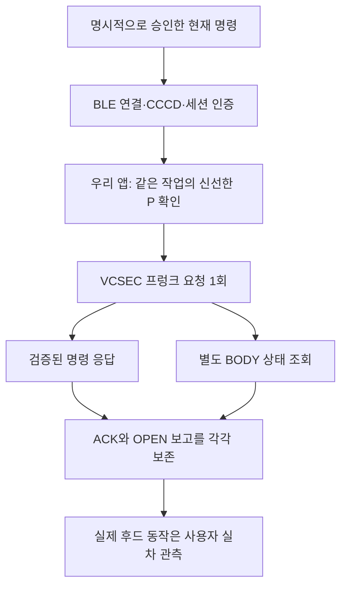
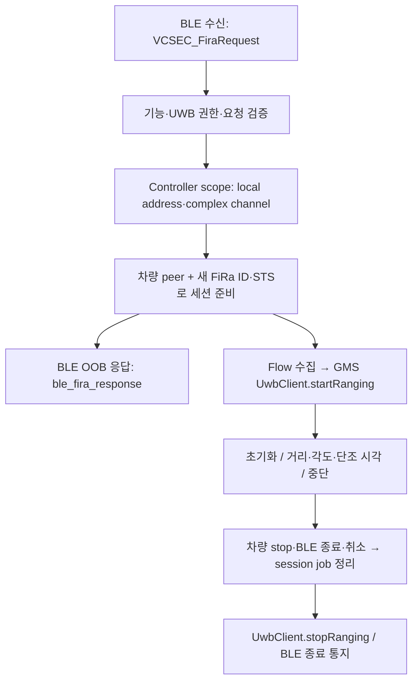

# Tesla 통합 전제

[Wiki 홈](Home.md)

## 문서 상태와 범위

현재 소스·생성 APK는 **`0.66.0`(`versionCode=66`)**이다. [기능별 소스구조](Native-Architecture.md#기능별-실제-소스구조)와 미사용 실행 가지를 정리하고 호스트 빌드·회귀·실제 소비자 smoke를 완료했지만 **정리 APK는 폰 설치 전**이다. S23의 기존 같은 버전 설치본은 [좌표 기반 나침반·UWB 병행 계약](#v66-좌표-기반-나침반uwb-병행)을 구현한 것으로 당시 FGS/source·UI 검증·데이터 보존 설치와 서비스 OFF·실제 서비스 실행0을 확인했다. 실제 차량 위치 응답·UWB 거리·방향 성공은 미검증이다. 과거 버전 관측은 당시 근거로 보존한다.

현재 개발 기준은 **로컬 BLE 우선**이다. v42는 실제 프렁크 명령과 화면 표시 음성 확인을 연결했다. 감지/조회 진단과 실차 명령은 분리하며, 실차 시험 준비를 위해 감지는 정상 중지하고 RAM 동의는 미선택으로 남겼다. 데이터 보존 설치·S23 기기31개 검증을 수행했지만 실제 사용자 발화·차량 명령/개방·잠금 주머니 동작은 미검증이다. [v42 실차 절차](Device-Validation.md#0420-probe--화면-표시-음성-프렁크-실차-시험)를 따른다.

`0.14.0-probe`의 BLE 감지 대조 시험은 별도 경로다. CDM 기준과 선택된 BT·주소 필터 스캔·제한 재시도로 근접 후보와 GATT 회차를 분리하며, 서비스는 등록 차량 GATT·Tesla 서비스/TX/RX·RX 구독과 정리만 검사한다. 감지만 모드는 GATT도 하지 않는다. `VehicleGateway`는 여전히 로컬 dry-run이며 연결/구독·첫 RX는 가상 키·권한·차량 인증이 아니다. CCCD 제어 외 TX characteristic 쓰기·차량 명령·Fleet API 호출은 하지 않는다. 실제 검증과 합성 입력은 [기기 검증](Device-Validation.md#0140-probe--ble-감지-대조-시험)에 구분하고 UWB 세션 start·유효 거리·폰키 인증을 아래에서 따로 다룬다.

앱 내부 UI·도메인·파서·상태 머신·게이트웨이는 Kotlin, Compose, Coroutines/StateFlow, DataStore를 사용한다. 현재 수동 BLE 등록·읽기 진단의 공유 프로토콜과 AndroidKeyStore 경계를 재사용해 향후 네이티브 BLE 차량 게이트웨이를 개발한다. 선택 Fleet 경로에서 서버 필요성이 확인되고 사용자가 승인한 경우에만 Node.js+TypeScript를 검토하며, 해당 경로의 서명은 공식 Go `vehicle-command` 프록시 재사용을 우선한다. Node 서버를 먼저 개발하거나 AndroidKeyStore 개인키를 서버로 옮기는 방식은 채택하지 않는다. SDK·라이브러리 버전은 실제 호환성 검증 뒤 고정하며 외부 음성 SDK는 미선정·미승인 상태다.

현재 제품에서 시작점이 없는 구형 주소 GATT 비교·관찰 모드·자동 BODY→DRIVE 조회·자동 마이크 실행 가지는 제거했다. 아래 v38 이전 비교·접근 읽기·자동 마이크 설명은 당시 이력이다. 현재 서비스 UWB·좌표 sidecar, 수동 BODY/DRIVE·키 등록·별도 승인 프렁크, 공통 암호화/송수신과 과거 로그 모델·해석은 보존한다. Nordic 실행 코드/의존성뿐 아니라 빈 소스 패키지도 제거했다.

## v66 좌표 기반 나침반·UWB 병행

이 절은 v66의 현재 좌표 안내 정본이다. 아래 v59의 GPS/나침반 미추가·UWB 화살표 보류, 과거 connectedDevice-only·location FGS 설명은 각 버전/경로의 이력이며 현재 좌표 안내를 금지하거나 허가하는 근거로 재사용하지 않는다. **좌표 기반 대략적 안내와 UWB 거리/AoA는 독립 출처**다. 자동 마이크·호출어·프렁크·잠금/주행 제어에는 연결하지 않는다.

### 근거·전송 경로

- 공개 BLE 근거는 고정 revision의 [GetState](https://github.com/teslamotors/vehicle-command/blob/a4b43c1eff0e09d77deb9f2dce97031141fe8c8a/pkg/vehicle/state.go), [Infotainment 처리](https://github.com/teslamotors/vehicle-command/blob/a4b43c1eff0e09d77deb9f2dce97031141fe8c8a/pkg/vehicle/infotainment.go), [dispatcher](https://github.com/teslamotors/vehicle-command/blob/a4b43c1eff0e09d77deb9f2dce97031141fe8c8a/internal/dispatcher/dispatcher.go), [LocationState schema](https://github.com/teslamotors/vehicle-command/blob/a4b43c1eff0e09d77deb9f2dce97031141fe8c8a/pkg/protocol/protobuf/vehicle.proto#L478-L524)다. domain3 `READ_ONLY`의 `GetVehicleData.GetLocationState` field7 → `VehicleData.location_state` field8을 읽는다. `DriveState.active_route`는 목적지 정보이며 현재 차량 좌표가 아니다.
- 기존 앱 키·단일 GATT·BE16 decoder·단일 write pump를 재사용한다. UWB domain2가 인증된 뒤 domain3의 fresh handshake/암호화 읽기 sidecar를 **한 접근 한 번·15초**만 시도한다. domain2와 domain3의 crypto context·route/UUID·request identity/hash·counter/replay 집합은 완전히 분리한다. 새 BLE 연결·키 생성/등록·wake·반복 poll·위치 재시도는 없다.
- primary FiRa/stop·기존 metadata와 대기 중 primary 수신을 sidecar TX보다 우선한다. 이미 SDK에 접수한 sidecar 프레임은 BE16 경계까지 마치고 조각 사이에 primary를 끼워 넣지 않는다. 미접수 위치 프레임만 취소할 수 있으며 실제 SDK 쓰기 오류·BUSY 소진·공유 transport 실패는 전체 작업 실패다. 위치 인증 거절·파싱 오류·무응답/15초 만료는 위치만 unavailable로 끝내고 UWB 협상/측정을 실패시키거나 기한을 연장하지 않는다.
- `rxProtocolCount`는 공통 consumer의 **실제 `receive()` 호출 수**다. 활성 sidecar domain3 소비는 frame/protocol을 각각 증가시키되 `rxResponse=null`로 이전 primary 판정을 지운다. 종료 sidecar의 늦은 domain3는 frame만 증가하고 protocol·primary 판정을 만들지 않는다. sidecar를 전혀 시도하지 않은 UWB-only 작업의 잘못된 domain3는 기존 primary `DOMAIN_MISMATCH` 계측을 유지한다. 위치 값·GPS/state 시각·새 telemetry schema는 추가하지 않는다.

### 좌표 선택·시각·표시 정책

- protobuf oneof의 **presence**를 검사한다. 명시적으로 존재하는0 좌표는 누락값이 아니며 latitude/longitude는 같은 family의 완전한 쌍만 사용한다. 유한값·위도 ±90/경도 ±180 범위와 `gps_as_of` 존재/overflow/미래를 검사한다.
- estimated 좌표는 명시적 `estimated_gps_valid=true`일 때만 사용한다. native 필드가 있으면 완전한 쌍·명시적 WGS type·지원 조건을 요구하고, native 필드가 없을 때만 plain latitude/longitude WGS 쌍을 선택한다. estimated 쌍을 쓸 수 없으면 완전하고 유효한 raw `geo_latitude/geo_longitude` WGS 쌍을 별도 출처로 선택할 수 있다. GCJ/corrected를 WGS로 위장하거나 서로 다른 family의 축을 섞지 않는다. raw 선택은 정밀도가 더 좋다는 보장이 아니다.
- `gps_as_of`는 epoch **초 → ms**로 변환한다. 공개 proto의 형식만으로 단위를 추정한 것이 아니라 공식 Hermes bundle31302의 `getGpsAsOf()*1000` 소비와 대조했다. fix 시각·LocationState `timestamp`·최종 frame receipt elapsed·처리 시각은 별개다. state/receipt 시각으로 오래된 fix를 신선하게 만들지 않는다.
- 표시 TTL은 **차량 fix60초·폰 fix15초·heading2초·미래 허용2초**다. 원 fix와 callback ingress freshness를 독립 검사한다. 차량 나이는 원 fix wall age와 receipt elapsed age 중 보수적인 값을 쓰며 만료가 되돌아가지 않게 한다. `elapsed → wall → elapsed` 샘플 구간100ms 초과는 `CLOCK_SAMPLE_DELAYED`로 현재 숫자만 숨기고 epoch anchor를 보존하며 다음 정상 샘플에서 복구한다. 실제 elapsed 역전·허용 범위를 넘는 wall rollback은 `CLOCK_INVALID`로 봉인한다.
- 폰 accuracy100m 초과는 거리/방향을 숨긴다. 거리가 `max(10m, 폰 accuracy)` 이내면 근처로 표시하고 방향을 숨긴다.1km 초과는 거리만 표시한다. 극점·동일점·방향이 유일하지 않은 경로도 화살표를 만들지 않는다. **이 수치들은 우리 안내 정책이며 UWB 입장·근접 인증·탑승·제어 허가 조건이 아니다.**
- 거리 계산은 WGS 좌표의 대략적 구면 거리, 방향은 최단 rhumb bearing에서 **폰 상단의 진북 heading**을 뺀 값이다. Android `LocationManager` GPS+NETWORK와 `TYPE_ROTATION_VECTOR`를 사용하고 화면 회전 축 remap·`GeomagneticField` 편각 보정으로 진북을 맞춘다. provider/센서의 원 fix timestamp와 ingress를 보존한다. 늦은 NETWORK 표본이 더 신선한 GPS fix/heading을 무효화하거나 freshness를 갱신하지 않도록 한다.
- 홈·알림은 **좌표 기반 대략적 거리/방향**과 **UWB 최근 거리·raw AoA 검증 상태**를 구분한다. 좌표 화살표는 폰 상단 기준이며 차량 헤딩·차량 중심·UWB 전후 판정이 아니다. UWB의 단위 미확인 AoA를 변환하거나 GPS/나침반과 합성하지 않는다. heading만 만료되면 화살표만, 폰/차량 fix가 만료되면 해당 거리/방향을 숨긴다. 이전 값·0도·0m를 fallback으로 쓰지 않는다.

### 권한·실제 FGS·접근 한정 수집

- 앱은 `FOREGROUND_SERVICE_LOCATION`·선택 `ACCESS_BACKGROUND_LOCATION`을 선언한다. 설정의 **항상 위치 허용(선택)**은 사용자가 직접 Android 앱 설정에서 승인하며 자동 grant하지 않는다. BLE/UWB 서비스 ON/OFF는 기존 조작을 그대로 사용한다.
- 실제 FGS 소유자는 AltBeacon **`BeaconService`**다. 기본 BLE 감시는 connectedDevice이고 좌표 lease는 같은 서비스의 **connectedDevice|location 실제 type ACK**를 받은 뒤에만 armed가 된다. bound-only `ObservationService`의 실행/바인딩 성공을 location FGS 승격으로 간주하지 않는다. `BIND_AUTO_CREATE`로 죽은 스캐너를 만들지 않는다.
- **armed와 센서 수집은 다르다.** armed idle에서는 GPS/센서를 등록하지 않는다. 살아 있는 동일 `serviceUwbRequest`의 새 접근 입장과 양성 type ACK가 모두 있을 때만 phone source를 시작한다. 서비스 ON 동안 하드웨어 GPS·고빈도 회전 센서를24시간 상시 수집하는 계약이 아니다.
- 위치 읽기 거절·15초 timeout/null 결과 또는 좌표 없이 operation 종료 시 phone source를 봉인·해제한다. 유효 차량 fix가 있으면 operation 종료 뒤에도 **원 fix의 기존 나이를 반영한60초 이내 남은 기간**만 유지하며 fix 만료/clock invalid에는 UWB 측정 중이어도 해제한다. 같은 접근에서 자동 재수집하지 않고 새 poll/retry/GATT를 만들지 않는다. 정상 source 종료 후 FGS lease만 armed로 남겨 다음 **새 접근**에 재사용한다.
- 화면 표시·잠금 해제 상태에서 합법적으로 시작한 location FGS는 background 위치 권한 없이 HOME·잠금에서도 유지할 수 있다. background 권한 없는 boot/복원은 BLE/UWB 감지를 유지하되 좌표는 명시적 앱 재개를 기다린다. background 권한이 있더라도 복원은 **새 owner·빈 좌표**로만 시작하고 과거 fix/heading/sidecar를 재생하지 않는다. 권한 결과/팝업 복귀는 죽은 서비스를 다시 시작하지 않는다.
- OFF·VIN/owner/권한 상실은 입력·새 TX·late callback을 봉인하고 raw RAM을 먼저 지운다. source unregister·FGS demotion/해제 불명은 정리 성공으로 숨기지 않으며 기존 예약·FGS·재입장 차단을 유지한다.
- **FGS IPC 보완의 최종 계약(편집 중; 통과 미주장):** 접근 세대 `fieldToken`과 각 바인딩의 새 `leaseId`를 분리한다. owner binder·token·lease·단조 sequence를 대조하고 실패한 enable도 sequence를 소비한다.128개 bounded terminal ledger로 종료 lease의 replay를 거부하며 기록을 지워 오래된 enable을 되살리지 않는다. death/응답 실패 정리는 owner generation까지 맞는 경우에만 적용한다. close 완료 callback은 단발이며 type 확인 없는 양성 결과·이전 owner의 demotion/death·중복/늦은 결과가 새 소유권을 바꾸지 못해야 한다.

### 개인정보·공식 앱 비교·검증 경계

- 차량/폰 원시 GPS·heading 입력은 **RAM 전용**이다. UI StateFlow에는 좌표 없는 presentation만 전달하고 source 종료/clear·OFF·owner 교체·프로세스 종료 뒤 재생하지 않는다. 파일·일반/RAM 이벤트·FieldLog·Intent·영속 설정·백업·서버로 좌표를 내보내지 않는다. **FieldLog schema27 유지·raw GPS 로그 금지**이며 기존 허용 UWB raw 각도 로그와 혼동하지 않는다.
- 우리 앱은 이 경로에 **Tesla 계정·OAuth·Tesla 서버를 쓰지 않고 BLE만** 쓴다. 이는 Android NETWORK provider의 OS 내부 통신까지 차단했다는 뜻이 아니다.
- 공식 앱은 “GPS에 서버를 쓰지 않는다”는 추측으로 설명하지 않는다. REA native/정적 관측과 별도 parent Hermes parse에서 `getAccessToken → LOCATION_STREAMING WebSocket → Vitals UPDATE → Redux 위치 갱신`의 실제 코드 경로를 발견했다. 공식 앱 위치의 유일 transport라는 증거도, 실행 중 그 경로가 사용됐다는 관측도 아니다. native 좌표/나침반 소비와 서버 경로는 공존할 수 있다.
- 분석 캐시는 `~/.cache/hey-tesla/rea/tesla-location-compass-rea-20261028-0915.json`, `tesla-location-compass-hermes-20261028-091534-812782.json`, `tesla-location-streaming-20261028-092249-118136.json`이다. **REA Evidence와 parent의 별도 Hermes 추출/parse를 모두 REA 단독 추출로 표시하지 않는다.**
- 최종 production consumer·단일 fakeNative 경계·독립 AES peer 실행 기록은 `~/Library/Caches/hey-tesla/coordinate-v66-smoke-20261028-100819-190720/final-combined-production-smoke.txt`에 있다. domain2/3 병행·location response1·좌표 약111m/화살표90도·UWB valid1 및 heading2초/폰15초 만료·clear 비재생을 관측한 **호스트 합성 근거**다. 차량 RF 성공이 아니다.
- 최신 수치·설치·실기기 결과는 [기기 검증](Device-Validation.md)에서 관리한다. 실제 FGS type ACK 뒤 native source 등록·정상 해제와 종료 후 callback0을 확인했으나 짧은 bench에서 유효 위치/heading 표본은0이었다. boot/잠금/다음 실제 접근 재사용·실차 위치/BLE/UWB 동시 수신·전력·방향 정확도는 미확인이다.

## 0.16 도입·0.17 표시·0.18 인증 응답 수정 — 로컬 BLE 키 등록·읽기 진단

- **등록:** 우리 앱 UID의 AndroidKeyStore에서 비추출 하드웨어 P-256/ECDH 키를 생성하고 같은 alias를 재사용한다. 기존 키 손상·사용 불가 시 삭제/교체하거나 다른 앱의 폰키를 가져오지 않는다. 공개키를 `PRESENT_KEY` legacy add-key-request에 담아 `ROLE_DRIVER` / `KEY_FORM_FACTOR_ANDROID_DEVICE`로 요청하고 실제 차량의 NFC 키카드 접촉과 차량 UI 승인은 사용자가 수행한다. 등록 요청은 기존 CDM 대상 한 대에만 전송하며 자동 재등록/재시도는 없다.
- **등록과 인증 분리:** `registrationReported`는 인증 전 legacy 완료 형식의 응답 관측이다. 실제 저장·키 권한·차량 신원의 증거로 승격하지 않는다. 이후 새 VCSEC handshake의 HMAC·challenge·route/domain을 확인하고 personalized AES-GCM으로 `GET_STATUS` 한 회만 전송한다. `FLAG_ENCRYPT_RESPONSE`는 enum 값이 아닌 비트 마스크이며, 수신은 AEAD·request hash·response counter를 검증한다. 이 버전은 암호화되지 않은 상태 응답을 성공으로 취급하지 않는다.
- **중간 인증 응답:** 요청에 대응하는 명시적 무오류 `OK` ACK는 인증 성공이나 오류가 아니라 기존 기한 안의 대기다. 재전송하거나 단계 기한을 연장하지 않는다. 이후 session info의 서명·태그·파라미터·HMAC 검증을 모두 통과해야 상태 요청을 보낸다.
- **실패 근거:** 키 미등록 fault/session status는 차량 응답의 미등록 **보고**로 표시하며 실제 키 부재의 인증된 증거로 취급하지 않는다. 미지원 status·서명/태그 누락·무결성 실패를 구분하고 로그에는 12개 고정 `TESLA_KEY_AUTH_*` 코드만 남긴다. 원시 응답·예외·식별자를 저장하지 않는다.
- **신뢰 경계:** 공식 handshake는 peer 제공 공개키 기반 무결성 검증이며 차량 인증서 기반 신원 인증이 아니다. 사용자의 현장 대상 차량 확인·실제 NFC 승인과 별개로 표시한다. 공식 앱 등록 폰키를 재사용하는 위임 API나 UWB 폰키 구현이라고 주장하지 않는다.
- **수명/안전:** 표시·잠금 해제·Bluetooth ON·연결 권한·단일 CDM 대상과 전역 배타 예약을 시작/전송/250ms watchdog에서 확인한다. 전체 180초, 카드 대기 120초, 나머지 단계별 제한을 적용한다. HOME·화면/탭 이탈·BT/권한/대상 상실은 전송을 봉인하고 로컬 close한다. close 불명은 Application 예약을 유지하며 Activity 재생성으로 풀지 않는다. 전송 후 취소·오류는 등록 철회/미등록을 보장하지 않는다.
- **예약 표시:** 시작 전 입장 검사와 실행 중 자기 예약을 구분한다. 자기 예약 중에는 재진입을 비활성화하되 외부 충돌 문구를 표시하지 않는다. 실제 외부 예약·정리 실패 차단과 runtime 안전 조건은 유지한다.
- **보관/범위:** v24는 명시적으로 등록한 VIN을 앱 전용 암호화 설정에서 재사용하고 편집 중 원문만 RAM에 둔다. 원시 RX·키·주소·VIN·예외 원문은 상태/로그에 쓰지 않으며 공용 VIN 상태는 마스킹만 제공한다. v22의 별도 P 읽기와 등록/VCSEC 읽기를 구분하며 실제 프렁크/잠금/주행·UWB ranging·Fleet API·자동 음성 제어는 추가하지 않는다. 주말 BLE 진단의 RX-only 계약은 그대로 유지한다.

근거는 고정한 [공식 vehicle-command protocol](https://github.com/teslamotors/vehicle-command/blob/a4b43c1eff0e09d77deb9f2dce97031141fe8c8a/pkg/protocol/protocol.md), [SendAddKeyRequestWithRole](https://github.com/teslamotors/vehicle-command/blob/a4b43c1eff0e09d77deb9f2dce97031141fe8c8a/pkg/vehicle/security.go#L320-L366), [session dispatcher](https://github.com/teslamotors/vehicle-command/blob/a4b43c1eff0e09d77deb9f2dce97031141fe8c8a/internal/dispatcher/dispatcher.go), [응답 오류 판정](https://github.com/teslamotors/vehicle-command/blob/a4b43c1eff0e09d77deb9f2dce97031141fe8c8a/pkg/protocol/error.go)이다. 공식 protobuf 5개와 Apache-2.0 license를 보존했고 Java outer class 고정 및 수신 scalar presence만 추가했다. 누락된 잠금/프렁크 값을 enum 0으로 추정하지 않는다. host 회귀·실기기 키 보관·실제 방문 결과 불명과 휴대폰 수정 검증은 [기기 기록](Device-Validation.md#0180-probe--인증-ack-처리와-실패-근거-분리)에 구분한다. 지금 재방문·등록 반복을 권하지 않는다.

**확인된 실차 범위:** v21에서 두 방문 모두 `TESLA_KEY_STATUS_VERIFIED`·`COMPLETE`·`LOCAL_CLOSED`를 기록했다. 앱 키 인증·암호 상태 조회·이전 연결 종료 후 같은 키를 이용한 새 BLE 연결 조회는 통과했다. 두 회차는 같은 앱 프로세스이며 프로세스 종료·재부팅 후 키 재사용까지 확정하지 않는다. 이를 다음 개발의 필수 조건으로 추가하지 않는다. 프렁크 실행·주차 P·차량 접근 감지·UWB 거리 측정의 증거는 아니며 상세는 [실차 통과 기록](Device-Validation.md#실차-앱-키-인증재연결-조회-통과)에 둔다.

**공식 계약과 한계:** [SendAddKeyRequestWithRole / SendAddKeyRequest](https://github.com/teslamotors/vehicle-command/blob/main/pkg/vehicle/security.go)는 P-256 검증, FleetAPIConnector 거부, `PRESENT_KEY` 전송과 사용자 NFC·차량 UI 승인을 설명한다. 정상 반환은 전송만 보장하며 등록 완료가 아니다. 등록·infotainment 동기화 확인에는 `DomainInfotainment`의 `SessionInfo`를 안내한다. v22는 별도 주차 조회에서 새 Infotainment 세션을 검증하지만 대상 차량에서 이 경로의 성공은 미확인이다. [공식 CLI](https://github.com/teslamotors/vehicle-command/blob/main/cmd/tesla-control/commands.go)의 `add-key-request`는 `requiresAuth=false`, `requiresFleetAPI=false`이고 `driver` / `android_device`를 허용한다. Fleet Manager는 2023.38 이상에서 BLE 명령을 보낼 수 있으므로 로컬 Driver 키와 혼동하지 않는다.

**v21 이후 순서의 이력:** 통과한 키를 삭제·재등록하지 않고 v22의 별도 Infotainment 주차 조회와 감지 개선을 진행했다. 현재 v28의 접근 인증·읽기 통합은 아래 계약을 따른다. 연결·인증·지난 P를 근접이나 제어 허가로 취급하지 않으며 프렁크 시험은 별도 승인과 신선한 P·안전 조건 뒤에만 진행한다.

### v22 별도 주차 기어 읽기

- 진단의 **주차 기어 상태 1회 조회**는 기존 앱 키로 domain3 fresh handshake 후 암호화된 `Action.VehicleAction.GetVehicleData.GetDriveState`만 요청한다. [공식 GetState](https://github.com/teslamotors/vehicle-command/blob/a4b43c1eff0e09d77deb9f2dce97031141fe8c8a/pkg/vehicle/state.go)와 [Infotainment 응답](https://github.com/teslamotors/vehicle-command/blob/a4b43c1eff0e09d77deb9f2dce97031141fe8c8a/pkg/vehicle/infotainment.go)에 맞췄다. 기존 등록·VCSEC GET_STATUS·키 alias와 예약/취소 경계는 유지한다.
- domain3는 정확한 UUID·route/domain·전체 HMAC·request hash 기반 AEAD를 요구한다. 누락 UUID 허용은 domain2에만 남긴다. 암호 검증 뒤 실제 DriveState가 있어야 완료하며 차량 오류 원문은 노출하지 않는다. ActionStatus 생략은 공식 proto3 기본 OK 계약을 따르되 기어 데이터 누락은 실패다.
- P·R·N·D를 실제값대로 표시하고 missing/Invalid/SNA/미지원은 UNKNOWN이다. 정상 범위 차량 Timestamp만 원본 epoch ms로 보존하며 없거나 잘못되면 null이다. 최종 GATT fragment 수신 monotonic과 처리 시각 기반 기한을 구분한다. 지난 P 조회를 현재 P·감지·프렁크 허가로 쓰지 않는다.
- 공식 protobuf 4개를 같은 고정 revision에서 추가해 총 9개 schema를 lite로 생성하고 Apache-2.0 license를 유지한다. 독립 JCA 피어 직접 실행과 S23 화면/취소 계측은 통과했으나 실제 차량의 Infotainment 기어 수신·수면 호환성·실행 직전 신선성은 미확인이다. Fleet API·wake·자동 재등록·재전송·BODY fallback·차량 제어는 없다. [v22 실측 기록](Device-Validation.md#0220-probe--주차-기어-읽기)을 따른다.

### v23 공식 광고명 기반 감지

[공식 BLE connector](https://github.com/teslamotors/vehicle-command/blob/a4b43c1eff0e09d77deb9f2dce97031141fe8c8a/pkg/connector/ble/ble.go)의 `VehicleLocalName`은 VIN SHA-1 첫 8바이트를 `S…C` 이름으로 만든다. 기존 앱은 등록 chooser에만 이를 사용했고 반복 스캐너는 CDM 등록 주소로 고정했다. v23은 공유 계산·정확한 이름 필터·실제 ScanRecord 이름 재검증을 반복 감지 소비 경로에 연결했다. 등록 주소가 달라도 같은 이름의 광고를 소비하지만 이름 미광고/비광고·OS/OEM 제한·40초/120초 공백은 해결 보장이 없다.

이 경로는 **별도 BLE 진단의 감지 전용 모드**이며 이름 일치는 차량 신원·권한·거리·P·제어 허가가 아니다. GATT·TX·마이크·UWB는 없고 일반 CDM 자동 접근의 음성 조건도 바꾸지 않는다. v24는 저장 VIN의 시작 스냅샷으로 이름을 계산하며 name/hash는 RAM에서만 사용한다. 기존 키·등록·로그를 삭제하지 않는다. v23 호스트 검증과 S23 데이터 보존 설치·계측 21개·실제 준비 화면 확인은 완료했다. 스캐너 계측의 transport는 합성이므로 실제 차량 광고 감지는 별도 미확인이다. [v23 기록](Device-Validation.md#0230-probe--차량-광고명-감지)을 따른다.

### v28 접근 기반 기존 키 읽기

- 새 선택 모드는 실제 광고의 현재 기기를 RAM에 고정하고 10초 freshness·owner/token/후보/회차·단일 등록 대상·VIN/권한/FGS·기한을 검사한다. CDM의 과거 주소나 BT 연결만으로 인증 읽기를 시작하지 않는다.
- native 스캔 정지 확인 이후 기존 하드웨어 P256 키만 로드하고 같은 GATT에서 BODY→새 DRIVE 세션을 각각 fresh handshake와 읽기 요청으로 실행한다. 프로토콜·암호 검증은 기존 구현을 유지한다. 없는 키를 생성·등록·교체하지 않고 제어 명령은 전송하지 않는다.
- background 읽기 예외는 정확한 서비스 소유 회차에만 적용하며 수동 등록·조회 화면/잠금 게이트를 약화하지 않는다. 총40초·후보당 조회1회·실제 자원 해제/예약 반환 후 스캔 재개다. v36은 전송 전 초기133 연결만 정리 확인 후1초 뒤 한 번 재접속하며 인증/조회 요청은 재송신하지 않는다. BODY만 성공하면 부분 결과, 정리 불명은 재입장 차단이다.
- 지난 기어·누락 원본 시각·UNKNOWN은 현재 P나 프렁크 허가가 아니다. 프로세스 복원은 감지만이며 이전 조회를 재생하지 않는다. 실제 same-GATT 두 도메인·잠금 상태·공식 폰키 동시 사용은 사용자 실차 테스트와 [로그 분석](Device-Validation.md#0280-probe--접근-기반-인증읽기-조회)에서 판정한다.

### v24 공통 VIN 암호화 설정

개발자 진단 상단에서 저장한 VIN을 차량 키 등록·BODY 인증/상태·DRIVE_STATE 기어 조회·광고명 감지·명시적 CDM 차량 선택에서 공통 사용한다. AndroidKeyStore의 별도 AES-256/GCM 키와 noBackupFilesDir의 암호문을 사용하며 기존 P-256 차량 키는 변경하지 않는다. 저장/복원은 Main 입장 상태와 IO 처리를 분리하고 완료 전이나 실패 시 차량 작업을 막는다.

정상 저장은 pending 암호문과 기존 유효암호문의 commit 복구용 `.previous`를 동기화하고 원자 rename 및 디렉터리 동기화 후 완료된다. `.previous`는 Android 백업이 아니며 정상 복원 fallback으로 쓰지 않는다. 손상·누락/잘못된 키·쓰기 실패는 원문 없이 정적 코드로 표시하고 자동 키 교체·평문 fallback·차량 작업 재개는 없다. 암호문 파일과 계측 fixture는 백업·기기 간 전송에서 제외한다.

VIN을 저장하거나 앱을 재실행해도 진단을 자동 시작하지 않는다. 실행·예약·정리 불명·chooser 요청 중에는 변경을 막고 작업 대상 스냅샷을 유지한다. v24 데이터 보존 설치·AndroidKeyStore 저장·별도 프로세스 복원·격리된 실제 Compose UI 회귀를 확인했다. 설치 앱의 공통 등록·차량 키·BLE 화면도 확인했다. 실제 차량 P 수신·광고 감지·프렁크·Tesla UWB ranging은 이 검증에 포함하지 않는다.


## MVP 명령 계약

제품 명령 목표는 프렁크 하나이며 우선 경로는 인증된 로컬 BLE다. [공식 CLI의 `frunk-open`](https://github.com/teslamotors/vehicle-command/blob/main/cmd/tesla-control/commands.go)은 `requiresAuth=true`, `requiresFleetAPI=false`로 BLE 경로를 지원한다. 이는 SDK의 지원 사실이지 우리 앱의 제어 구현이나 대상 차량의 실차 성공을 뜻하지 않는다. 키 등록·읽기 진단의 성공도 프렁크 실행 허가가 아니며 신선한 `P`와 별도 실차 승인이 필요하다.

아래 HTTP 형식은 **선택 Fleet 인터넷 경로에만** 해당한다. 실행 가능한 `curl` 예제를 제공하지 않으며 승인 전 실차 요청을 유도하지 않는다.

```http
POST /api/1/vehicles/{vin}/command/actuate_trunk
Content-Type: application/json

{"which_trunk":"front"}
```

이 요청은 프렁크 래치 해제 또는 후드 완전 개방을 보장한다고 주장하지 않는다. 대상 차량 매뉴얼의 직접 조회는 현재 403으로 확인하지 못했고 차량 동작도 미확인이다. 따라서 명령 수락, 래치 해제, 후드 완전 개방은 실차에서 각각 구분해 관찰해야 한다.

## 게이트웨이와 실행 안전성

`VehicleGateway`의 기본 구현은 mock/dry-run이다. mock은 다음을 재현할 수 있어야 하나, 어느 시나리오도 실제 차량 성공으로 표현하지 않는다.

|시나리오|mock/dry-run에서 재현할 계약|실차 확인 상태|
|---|---|---|
|주차 상태|명시적으로 신선한 주차 판정이 없으면 거절|미확인|
|상태 신선도|차량 관측 시간, 수신 유효성, 출처, 연결 상태를 함께 검증; 오래된 cache가 방금 전달됐다고 신선한 상태로 처리하지 않음|미확인|
|권한|BLE 앱 키의 차량 권한 검증; 선택 Fleet 경로는 추가로 OAuth 범위·차량 권한 부족을 오류로 반환|미확인|
|취소|전송 전에는 취소가 전송을 막음|미확인|
|만료|만료된 의도는 전송하지 않음|미확인|
|연결|BLE 연결 또는 선택 Fleet 네트워크의 단절·시간 초과를 실행 성공으로 처리하지 않음|미확인|
|차량 절전|깨우기 정책 없이는 깨우기 호출을 하지 않음|미확인|
|전송 후 `UNKNOWN`|결과 불명을 성공·실패로 추정하거나 재전송하지 않음|미확인|

명령은 `VALIDATING` 단계에서 검증되고, 해당 모드의 사전 승인 조건과 필요한 음성 확인을 만족한 경우에만 `EXECUTING`으로 진행한다. 전송 전 취소는 전송을 막도록 설계하지만, 전송 후 차량 명령을 철회할 수 있다고 약속하지 않는다. 무제한 재시도, 지연 명령 저장, 결과 불명 명령의 재전송은 금지한다. 차량 깨우기 호출은 사용자가 제한·비용 정책을 명시적으로 승인하기 전에는 하지 않는다.

개발 중 수동 진단 버튼은 초기 검증용이며 운영 필수 경로가 아니다. BLE 키 등록·상태 읽기는0.16, 화면 표시 음성 프렁크 시험은0.42에 도입했다. 자동 접근·잠금 주머니 음성 제어는 아직 연결하지 않았다. 최종 제품 목표는 초기 설정 후 잠금·주머니 무터치이며, 현재 시험의 화면 동의를 제품의 매사용 필수 단계로 확정하지 않는다.

## v42 프렁크 제어·음성 연결

Tesla4.61.6 APK의 `oc0.e.V`는 `RKE_ACTION_OPEN_FRUNK`를 생성하며 `CommandActionsKt.getDomain`은 이를 VCSEC로 분류한다. `fe0.f`의 세션 기반 서명/암호화·응답 decode와 `fg0.e.k`의 프렁크 상태 갱신은 별도다. 검사한 native 경로에서 프렁크 전용 P·속도·폰 잠금 gate를 찾지 못했지만 JS UI/펌웨어까지 없다는 의미는 아니다. 상태 helper는 closureStatuses 객체 전체가 없으면 CLOSED를 합성하고, 명시 UNKNOWN/중간 상태는 null로 변환해 cache merge에서 이전 값을 유지할 수 있다. 이 캐시 동작은 우리 안전 판단에 복사하지 않는다.

우리 구현은 APK RKE 숫자를 추가하지 않고 공개 SDK [OpenFrunk](https://github.com/teslamotors/vehicle-command/blob/a4b43c1eff0e09d77deb9f2dce97031141fe8c8a/pkg/vehicle/actions.go)→[executeClosureAction](https://github.com/teslamotors/vehicle-command/blob/a4b43c1eff0e09d77deb9f2dce97031141fe8c8a/pkg/vehicle/vcsec.go)의 `frontTrunk=MOVE(1)`를 기존 인증 전송에 연결했다. 새 키·OAuth·UWB·자동 wake는 추가하지 않았다. 신선한 P는 실제 음성 명령 확정 후 같은 차량 작업에서 검사하며 이전 접근의 P를 실행 허가로 재사용하지 않는다.

Tesla APK의 `com.wenkesj.voice.VoiceModule`은 일반 SpeechRecognizer 결과를 JS 이벤트로 넘긴다. 잠금 주머니 음성 프렁크 구현의 근거는 확보하지 못했다. `assets/index.android.bundle`은83.5MB Hermes bytecode v96으로 UI/음성 전체 경로는 이번 정적 조사 범위 밖이다. 우리 앱은 기존 온디바이스 인식과 Android의 foreground 마이크 조건을 사용하며 화면 확인·취소 후에만 실제 작업에 입장한다.

APK 근거는 PC 캐시 `tesla-frunk-next-evidence-20261019-4cc343d29ce84ae9851adbf0f7a51347-supplement-8685db6246d9.json`(86건)에 보존했다. 핵심 생성기 `ev_d9fe2011b71a3202df2456e9e412ac2db464837401887e7b3a6b8503ea09dd11`, 서명 경로 `ev_47a439899ffcd705e6afd097de48b6d728fc716c2ef6cca2e11b37e03c39ffd6`는 shipped-artifact의 정적·derived 근거이며 실제 실행 성공이 아니다.

## v60 수정 전 REA 대조 — 연결부터 프렁크까지

### 대상과 근거 경계

설치된 공식 앱은 `4.61.6-4647`이며 기존 보존 `base.apk`의 SHA-256 `63adb6bb0556a44ea83996c719e2dfdcdbda4b33b8250bf46f6e5ee853c3d083`와 같은 분석 버전이다. 새 REA 메서드 분석과 기존 증거를 대조했다. 새 증거는 PC의 `~/.cache/hey-tesla/rea/tesla-4.61.6-frunk-connect-v60-20261026-081306.json`에 보존했다. APK 원문·키·VIN·STS·토큰은 위키에 넣지 않는다. 정적 shipped-artifact 근거이며 공식 앱 실행·후킹·차량 명령·실차 개방은 수행하지 않았다.

### 연결·UWB 수명 차이

|경계|공식 APK에서 확인|우리 v59의 차이와 수정 계약|
|---|---|---|
|초기 연결|`Peripheral.<init>`의 SDK34+ autoConnect=true, `createInitialConnection`의 직접 GATT 생성|autoConnect는 이미 적용돼 있다. 다시 켜는 것이 이번 해결책은 아니다.|
|광고의 10초|`shouldTryBackgroundScanConnect`는 마지막 backgroundConnectTime 후 10초 간격을 검사한다. `u1.d.a`는 연결 가능·대상·연결 상태·RSSI 조건을 거쳐 재초기화한다.|우리 광고 수신 후10초 만료와 다른 조건이다. 최초 SDK 연결 발급 전의 입장 신선도는 유지하되 실제 handle 소유 뒤 서비스 연결 수명을 원 광고 나이로 취소하지 않는다.|
|연결 끊김|`Peripheral.a.o` → `reconnect(status)` → 기존 GATT의 `connect()` 또는 새 생성|서비스 UWB는 기존 초기133 제한 복구 자격에서 빠졌다. 전송 전·연결 진전 전·같은 handle·2초 뒤1회만 적용하고 원 단계/전체 기한을 연장하지 않는다. 공식 앱의 장시간/상위 재시도를 통째로 복사하지 않는다.|
|UWB 시작|`u1.j0`의 관리 job 준비와 `K0`의 차량 FiRa 입력→세션 시작은 별도|v59 실차는 BLE 초기화 이전/도중에 종료돼 거리·각도 backend 문제로 단정할 수 없다. 새 무선 backend·자동 차량 깨우기는 추가하지 않는다.|
|관측|공식 앱은 연결·구독·명령 결과를 구분한다.|서비스 종료 `BleProbeState`에 status/reason/localClosed만 전달해 실제 GATT 관측이 false/null/0으로 빠졌다. 같은 Operation의 단계·발급/반환·원 callback·CCCD·경과시간을 기록하고 미관측을 성공/0으로 합성하지 않는다.|

실차 보존 상세4/5/6회차는 원 광고 수신 후10.060/10.068/10.072초의 `SCAN_RESULT_STALE`,7회차는8.719초의 `GATT_CONNECTION_LOST`다. 스캔 pause 상태에서 CCCD 뒤 프로토콜 시작까지 원 광고 age를 계속 검사하는 코드와 일치한다. 7회차의 하위 status는 당시 로그 변환에서 소실돼 소급 확정할 수 없다. 초기133을 실제로 관측했다는 뜻도 아니다.

### 프렁크 요청·응답·상태 계약



- 공식 `oc0.e.V`는 `RKE_ACTION_OPEN_FRUNK`를 만들고 `I`는 주입된 transport 선택기에 위임한다. 이 생성기만으로 BLE 전용 강제나 JS/펌웨어의 P·속도 gate 부재를 단정하지 않는다.
- `getDomain`은 RKE와 closure 모두 VCSEC, 서명 helper는 프렁크에 세션 인증·AES-GCM 경로를 사용한다. `fe0.f.d`에서 RKE와 closure는 별도 protobuf 분기다. 두 wire가 바이트 단위로 같거나 모든 차량에서 완전 동등하다는 증거는 없다.
- 우리 `frontTrunk=MOVE`는 고정 공개 SDK의 [OpenFrunk](https://github.com/teslamotors/vehicle-command/blob/a4b43c1eff0e09d77deb9f2dce97031141fe8c8a/pkg/vehicle/actions.go) → [executeClosureAction](https://github.com/teslamotors/vehicle-command/blob/a4b43c1eff0e09d77deb9f2dce97031141fe8c8a/pkg/vehicle/vcsec.go) 경로다. 잘못된 명령이라는 근거가 없어 유지하며 RKE fallback이나 두 명령 순차 전송은 추가하지 않는다.
- 공식 `Peripheral`의 직렬 큐와 상위 명령 retry는 다른 경계다. `nc0.a.c`/`ag0.j.e`의 BLE nominal retry·100ms 지연을 우리 SDK201 미접수 복구의 근거로 혼동하지 않는다. 우리 actuator는 SDK 접수 뒤 응답 불명이어도 재발급하지 않고 후속 BODY만1회 조회한다.
- 공식 decoder/result evaluator의 명령 성공은 hood-open 센서 확인과 다르다. 우리 ACK만으로 개방 완료를 표시하지 않으며, 별도 BODY의 명시 OPEN을 관측해도 ACK가 없으면 최종 결과는 UNKNOWN이다. OPEN 보고도 후드 전체 개방 스트로크 완료를 증명하지 않는다.
- `fg0.e.k`는 closureStatuses 전체 부재 시 CLOSED 합성, `fg0.e.a`는 OPEN→true/CLOSED→false/그 외→null, `jg0.m.c`는 null 입력의 기존 캐시 유지다. 이를 신선한 열림/닫힘이나 실행 허가로 복사하지 않는다.

### 이번 수정에 적용할 범위

1. **서비스 연결 입장과 수명 분리:** 최초 GATT 발급 직전 광고10초 검사, 실제 반환 handle 소유 뒤에는 연결/단계/전체 기한. 원 광고 시각·handshake 의미는 바꾸지 않는다. owner/token/후보/회차/association/VIN/권한/BT/OFF/FGS/정리 실패 봉인은 유지한다.
2. **서비스 원 관측 보존:** 신규 회차 초기화, terminal 보존, SDK 접수·원 status/state·구독·실제 경과시간을 분리한다. GATT 사건을 새 UWB 거리/각도 수신으로 세지 않는다.
3. **프렁크 음성 정리 순서:** 현재 `FrunkVoiceProbe`는 인식 성공과 별도 정리 실패가 함께 오면 handoff 뒤 finally 취소가 가능하다. 인식기/pipe 정리 불명에서는 command dispatch·음성 lease 반환·차량 core 입장을 먼저 차단한다. 이 결함으로 실차 actuator가 전송됐다고 주장하는 것은 아니다.
4. **유지/비목표:** 공개 closure wire·신선 P·명시 승인·단발 actuator·ACK/OPEN/물리 완료 분리 유지. 자동 마이크·자동 프렁크·프렁크 background 예외·새 키·클라우드·360도 화살표는 추가하지 않는다. 호스트/기기 검증과 사용자 실차 검증은 별도로 기록한다.

### 새 핵심 REA 근거

|경계|Evidence ID|
|---|---|
|연결 생성 / 기존 handle 재접속|`ev_a2dd4d1de7c87e3a31ff09a27edc2e25bacf2dcad4df11f1bf77909d8d408ba7` / `ev_45cc290963d33e73d6fbe01ee51cec43dfdbb673fa70c149ad38a2b7b79c4399`|
|10초 연결 간격 / 광고 소비|`ev_d37a11965be893e6bc5901f383848e3d4396f18e634f3a6d5d5d3df17273a5c4` / `ev_add930248c3b1c2db3f1e898d3f16391ba4c51097f906d340535fafdaebc275f`|
|프렁크 생성 / 도메인|`ev_786d8c69dc851f8496831c91bdd5c5f63e00e0ee16eff7495954320f4ab2f8ca` / `ev_6144234fd8a21e4d5029f5bb6ecb375d63be4d0d315f1f3d18a4d5d04ee50761`|
|별도 wire / 세션 서명|`ev_68e812ca2a4234b65d65d3b3af6cad087b96f1ca18c74f9163286b603b46305b` / `ev_082b6ddbfda12255c73cca7df1b4579898c7fe6e9e085c21f634fe051b02515c`|
|VCSEC 응답 decode / 상위 retry 평가|`ev_ac53d52e8246dbd8f9e63b7155e67cde778e539431dc155aba88faabb24ba3fd` / `ev_22f39fd4f0c09ad080c86d936f164337f869b3816676c39965959b10085eb62a`|
|상태 객체 부재 / UNKNOWN / null 캐시 유지|`ev_500a47623552f7e1ef5ac353e166f558d0a5f1dca41f57913351efdd4d802542` / `ev_1d3d3278d3c4874bcc6ffa0af0333cb523b43466e3e3a2bc410fcc77305b63b0` / `ev_26c0f9c6853bda5de24167220178311d114661585a613f33e53367d02f5128e1`|

## v61 REA·원 DEX 대조 — FiRa 식별자 계약 정정

### 실측과 정적 근거의 경계

2026-10-26 **11:12:42~11:12:54 KST의 v60 실차 1회**는 11.675초 동안 기존 앱 키 인증 성공·CCCD 성공·native status0·RX12를 관측한 뒤 로컬 `UNSUPPORTED_ENDPOINT`로 끝났다. RF 세션은 시작하지 않았고 거리·각도 수신은 모두0이다. 이는 차량의 endpoint 거절 응답이나 RF/backend 실패를 관측한 것이 아니다. 실제 request ID 값은 보존된 비민감 관측만으로 확정할 수 없다.

v61은 아래 식별자 해석 오류를 수정했다. 빌드·JVM428개·분석기116개·생산 wire smoke·실기기 비차량 coordinator 회귀7개를 통과했고 데이터 보존 설치·실제 설정 버전·서비스 ON/FGS를 확인했다. **차량의 response 수락·RF 시작·유효 거리·각도 성공은 아직 확인하지 않았다.** v60의 연결·인증 진전이나 정적 분석·비차량 검증을 v61 차량 성공으로 확대하지 않는다. 구체적 실행 범위는 [v61 검증](Device-Validation.md#0610--fira-요청-id와-중지-enum-분리)에 둔다.

분석 대상은 같은 공식 Tesla **4.61.6-4647**, `base.apk` SHA-256 `63adb6bb0556a44ea83996c719e2dfdcdbda4b33b8250bf46f6e5ee853c3d083`다. 최종 REA bundle은 PC 캐시 `~/.cache/hey-tesla/rea/fira-id-v61-20261026-113957/tesla-4.61.6-fira-id-rea-evidence-final.json`에 보존했다. 124개 record에는 이전 세션의 중복 근거가 포함되므로 신규 Evidence124개라는 뜻이 아니다. 공식 앱·차량 실행 근거가 아닌 shipped-artifact 정적 분석이다.

### 서로 다른 식별자

|식별자|공식 APK에서 확인한 의미|v61 계약|
|---|---|---|
|request `sessionId`|`vd0.u0.field1`의 `UINT32`; 누락 기본값0. `pg0.f.s`에는 endpoint enum 범위 검사가 없다.|request·plan·소유 세션의 `requestSessionId: Long`을 `0..0xffff_ffffL`로 무손실 보존한다.0·상위 bit·최댓값을 거절/재매핑하지 않고 중복 검사는 유지한다.|
|response 상관 ID|`vd0.v0.field1`에 원 request ID를 `UINT32`로 echo한다.0은 proto 기본값에 따라 field를 생략한다.|서명 있는 `Int`로 축소하거나 부호 확장하지 않는다.0의 field 생략은 의미상0 보존이지 응답 누락 실패가 아니다.|
|새 FiRa/backend ID|`pg0.f.o`가 별도 생성한 값을 RF parameter와 `vd0.t0.field4`에 넣는다. 공식 `og0.h.a.b`는 `SecureRandom.nextInt()`이며 nonzero 보장은 없다.|우리 backend의 별도 `firaSessionId: Int`·기존 nonzero 정책을 유지한다. request ID나 stop enum으로 대체하지 않으며 우리 nonzero 정책을 공식 보장으로 설명하지 않는다.|
|peer 주소/객체|request의 주소 bytes를2바이트 peer들로 분할한다. request 항목 수와 peer 수는 별개다.|peer index·주소·Android session handle/UUID로 request/stop ID를 추정하지 않는다.|
|stop/stopped enum|`vd0.y1/z1.field1`은 `vd0.t` enum 목록. exact 변환은 **0=BLE_ENDPOINT_NONE을 포함한0..11**, 나머지는 null이다.|별도 enum `Int`로 해석한 뒤 원 `requestSessionId`와 정확한 숫자값만 비교한다.0은 exact0 key 선택이지 “전체 stop” 명령이 아니다.|

**명시 정정:** v60의 request ID를 유한 endpoint enum1..11로 제한한 해석은 잘못됐다. request의 uint32 domain과 stop/stopped의 enum domain은 같지 않다. 기존 v54 wire 설명의 “차량 endpoint용 ID”·“enum1~11”도 이 구분과0을 빠뜨린 표현이다. 범위밖 request ID에서 하위 bit·상위 bit·나머지 연산으로 endpoint를 복원할 근거는 없으며 그런 매핑을 추가하지 않는다.

### 공식 exact stop 경로와 원 DEX 보완

REA event 분석에서 `ng0.b.C1943b`(원 `Lng0/b$b;`)는 `FiraSessionStop`, `ng0.b.c`(원 `Lng0/b$c;`)는 `FiraSessionStopped`다. `STOP_REASON_VEHICLE_FIRA_STOP_EVENT`와 ranging disconnected는 후자로, BLE disconnected는 전자로 전달된다. 따라서 차량 wire stop은 아래 원 DEX의 `0x0363` 분기에 연결된다.

REA는 collector `Lpg0/f$c$a$b;->a(Lng0/b;Lkotlin/coroutines/Continuation;)Ljava/lang/Object;`와 accessor `pg0.f.d` 본문을 unavailable/native·abstract로 잘못 반환했다. 이를 “본문 없음”이나 “REA로 collector 확인 완료”로 보고하지 않는다. parent가 APK 원 DEX를 직접 읽어 보존한 `collector-raw-dex-supplement.json`은 **REA Evidence record가 아닌 별도 원문 보완**이다.

- 원본 `classes8.dex` SHA-256: `8449f743be4421063f2081fb7a4b6bdbb941e102730040cd53a67880c53899b3`.
- collector **methodIndex52956, codeOffset5084388, 1006 code units, accessFlags0x11**. 분기 위치는 code item 기준 code-unit offset이다.
- `0x0301`의 `b$b` 분기: event 목록 → `Number.intValue`(`0x031f`) → 같은 int 이동(`0x033e`) → `d(map,id)`(`0x034e`). `0x0363`의 `b$c` 분기도 `intValue`(`0x0382`) → 같은 int(`0x03a0`) → `d(map,id)`(`0x03b2`)이며 정리 뒤 원 event 목록을 `og0.i.b(List)`에 전달한다.
- accessor **methodIndex52979, codeOffset5087848**은 `invoke-direct method@52991`로 `Lpg0/f;->p(ConcurrentHashMap,int,Continuation)`를 동일 인자·무변환 호출한다. resolved target은 supplement에 보존돼 있다.
- 별도 REA `pg0.f.p`는 `map.get(id)` → 해당 job의 `cancelAndJoin` → `map.remove(id)`다. key가 없으면 해당 job 정리 없이 반환한다. 전체 종료나 bit/peer 매핑을 수행한다는 근거가 아니다.

`b$c → og0.i.b → og0.d.b → og0.k.a → u1.e.a → u1.W0 → ag0.n.u → oc0.e.G`는 원 목록을 전달한다. 마지막 `G`에서만 `vd0.t.b.a(int)`의 exact enum 변환·null 제외(`mapNotNull` 의미)를 수행하고 `z1`을 구성한다. **모든 ID가 enum으로 표현 불가능해도 공식 코드는 빈 `z1`을 생성한다.** 이것은 빈 메시지의 차량 수락이나 실제 TX 완료까지 관측했다는 뜻은 아니다.

### Hey Tesla의 보수 종료 정책 — 공식 동등성과 구분

- 알려진0..11의 비어 있지 않은 stop 목록은 `Long`으로 확장해 원 request ID와 exact 비교하고 해당 세션만 정리한다. 나머지 peer 주소·STS·RF 소유권은 유지한다.
- **빈 목록·unknown enum·한 항목이라도 미매칭**이면 회차를 봉인하고 소유 RF 전체를 로컬 정리하며 새 TX를 금지한다. 이는 기존 Hey Tesla fail-closed 정책이며 공식 코드의 unknown/미매칭 전체 종료와 동등하다는 주장이 아니다.
- 자연 종료·timeout·peer 종료의 로컬 정리는 uint32 전체 ID에 대해 수행한다. 정리 성공 뒤 stopped에는 원 ID 중0..11로 정확히 표현 가능한 항목만 넣는다. 혼합 목록은 그 항목만 보내며 큰 ID를 캐스팅·가공·대체하지 않는다.
- **표현 가능한 항목이 하나도 없으면 stopped TX를 생략**하고 기존 `TESLA_UWB_SESSION_STOPPED_NOT_SENT`를 남겨 로컬 종료를 완료 정산한다. 공식의 빈 `z1` 생성과 다른 우리 보수 정책이다. 실제 송신 여부와 통지 처리 완료는 별개이므로 미표현 ID 때문에 무한 대기하지 않는다.
- response 전송 대기 중 stop된 plan은 나중 BLE 완료 callback에서도 RF를 시작하지 않는다. 취소·실패·OFF·권한/owner 상실은 새 TX 금지, 불확실한 native close는 lease 보존, 중복 close·late callback 봉인을 유지한다.
- 기존 키·세션 HMAC·personalized AES-GCM·권한·owner/token/VIN·capability/config·주소/STS 소거 격리·요청별 replay 검증·서비스 기한·RAW backend는 불변이다. 자동 마이크·프렁크·fallback·새 telemetry는 추가하지 않는다.

### 핵심 REA Evidence와 미확정 범위

|경계|실제 Evidence ID|
|---|---|
|request UINT32 decode / validator|`ev_34bbee4e3226c61c19eaf540a529d731964a46099a8b70e500b30d28dae91b4f` / `ev_0f1125461bf4ea01dfd42d4e723fdff059f4b9340bd11719abf7b4b5b3b13bc3`|
|별도 FiRa 준비 / random ID|`ev_13340740c500a257e2b4f6dfa5ad4678980179f0f67c5d5e5257cddbce74749d` / `ev_3f91ac4308a222e008d5badc71ad69783c7d0dfc2da81105127d42c7c9e66750`|
|response 원 ID / 새 FiRa ID encode|`ev_69dce2188d95144cfa582ab3da3bdd7e19b23628cd132e520437dba763bf1843` / `ev_30532a31d171bfacb2ba1fb9d39a8464f4f135d8187b10b2e9faf66c3e5dc9f9`|
|stop decode / exact enum 변환 / stopped 생성|`ev_6e5250c884e3861f11d5b73f8442eabfb4c3257a3679c11db9615b2799d6694f` / `ev_e2c8fabb20432f94128ecac16e73c188cd871ce54dbfe9391393fd6612ad235f` / `ev_936b94dd564456ff991b3e150743c69e5890ad8adfb204c12c75755b59f498cb`|
|Stopped event 목록 / reason별 event 생성|`ev_478117fe326066aa5d77ef5d03e82e4c20cd0bc17e1fab4a504cc3041dc6c5a3` / `ev_f45c8aa00f9a6ed03893c4db599b8c0ba403f0106c8bc8a85cada70553bf7afc`|
|exact key 정리 `pg0.f.p` / stopped 전달 `ag0.n.u`|`ev_a5fde15751dc9ead4ee58ccb4238b0a4a8e15f896010bf2ce39051b38878c9c5` / `ev_036faed639200b932924b0c1a429159c0f029c4c3f9afd7174d82d58f8563b2a`|

원 DEX 보완으로 REA의 collector 본문 누락을 줄였지만 도구가 본문을 반환하지 못한 한계 자체는 남는다. 실제 차량의 request ID·0/max 사용·echo response 수락·out-of-enum stop 패턴·stopped TX 생략의 차량측 영향·거리/각도는 미확정이다. 정적 직렬화 가능성은 실차 상호운용 성공과 다르다.

## v62 REA 수신 대조 — 프레임·프로토콜 관측

### v61 실차에서 확정한 것

2026-10-26 **17:07:23~17:07:54 KST**, 보존된 v61 차량 시도는1회다. 잠금 상태 정확 광고(RSSI−83)·BLE native0·CCCD0·기존 앱 키 인증·빈 capabilities BLE 전송 완료를 관측했다. 수락된 GATT notification은12회이고 인증 뒤 약30초에 `DEADLINE_EXPIRED`, 전체31.246초로 끝났다. FiRa request 처리 완료·response 전송·backend opened·거리·각도 사건은0이다.17:08:08 알림 중지 후 저장 OFF였다. 회수한5파일2380행은 분석 오류0이며 PC `~/Library/Caches/hey-tesla/field-v61-20261027-074316/`에 보존했다.

notification 수는 완성 frame 수가 아니다. 서비스 경로는 기존 접근 진단의 frame/protocol/header 관측을 발행하지 않아 차량 미송신·미완성 조각·앱 내부 제외를 구분할 수 없었다. 이번 회차에는 `UNSUPPORTED_ENDPOINT`가 없지만, 정상 FiRa request가 ID 검사를 통과했다는 증거도 없다. v61 수정의 실차 수락·RF 성공으로 판단하지 않는다.

### 공식 앱과 자체 수신 경계

대상은 같은 Tesla4.61.6-4647, APK SHA-256 `63adb6bb0556a44ea83996c719e2dfdcdbda4b33b8250bf46f6e5ee853c3d083`다. REA 정적 근거67개를 `~/.cache/hey-tesla/rea/rx-v62-20261027-080822/tesla-4.61.6-rx-rea-evidence.json`에 보존했다. 공식 앱·차량 런타임을 관측한 것은 아니다.

|경계|공식 APK에서 확인한 것|자체 적용|
|---|---|---|
|notification→frame|`Peripheral`이2바이트 길이 header와 누적 body로 완성 메시지를 만든다.|현재 streaming decoder를 유지하고 notification·완성 frame·실제 protocol 소비의 분모를 구분한다.|
|raw/envelope 분리|`gg0.p.b`는 목적지 없는 raw VCSEC, VEHICLE_SECURITY envelope의 body, RoutableMessage를 분리한다.|기존 세션 HMAC 검증 뒤 raw/wrapped FiRa를 협상 입력으로 받는 정책을 유지한다.|
|FiRa 전달|`u1.i`가 VCSEC를 `K0`에 먼저 전달하고 명령 RoutableMessage는 별도 bus로 넘긴다.|plaintext FiRa에 명령 응답 UUID 검사를 새로 강제하거나 기존 검사를 완화하지 않는다.|
|명령 응답|별도 request 조회·route 선택·복호화·domain 결과 평가 경로다.|기존 상관관계·AEAD·replay 검증을 유지하고 signature 존재와 복호화 성공을 구분한다.|
|capabilities|`lg0.b.a`의 빈 본문 생성은 기존 조사와 일치한다.|지원 mask 추정·대기시간 연장·backend 교체의 근거로 쓰지 않는다.|

확인한 공식 복호화 경로에서 decrypted FiRa를 `K0`로 다시 넣는 연결까지는 확인하지 못했다. 따라서 공식 앱의 encrypted FiRa 전체 처리를 입증했다고 설명하지 않는다. 현재 실차 타임아웃 원인으로 확정된 수락/암호/route 결함은 없으며, 동작 변경이 아닌 비민감 관측 보강이 목적이다.

### v62 관측 계약

- 공통 `TeslaBleResponseObservation`의 실제 header·판정과 기존 auth evidence를 재사용한다. 실제 반환 step·입력 형식·AEAD 검사 결과·FiRa request/stop/미분류/해석 오류를 구분한다. 정상 FiRa 입력이 기본 `RESPONSE_INVALID`로 표시되던 관측 결손을 교정하되 수락 정책은 바꾸지 않는다.
- 기존 `TESLA_UWB_GATT_OBSERVATION`의 RX1행에 decoder 산출 frame 수·미완성/실패 상태를 추가하고 실제 conversation 소비에만 PROTOCOL 관측을 발행한다. terminal·거리·capability의 반복 snapshot은 새 RX나 새 분류가 아니다.
- schema26의 notification/frame/protocol 분모·시각·고정 enum/Boolean/숫자만 허용한다. 이전 schema1~25의 새 필드는 미확인 null, 지원 회차의 실제 무수신은0이다. 각 protocol 입력은 새 metadata이며 raw/malformed 입력에 이전 header·암호 결과를 이월하지 않는다.
- 패킷 원문·키·STS·VIN·MAC·UUID·자유 예외 문구를 저장하지 않는다. 모든 분류는 이번 처리 관측이며 차량 신원·거리 성공·명령 허가로 승격하지 않는다.
- 기존 인증·AEAD·replay·owner/token/VIN/OFF·deadline·queue/소거·callback 봉인을 유지한다. GATT/PROTOCOL 사건은 거리 freshness·미수신 기한·wake lock을 갱신하지 않는다. 로그512KiB×4·2MiB 상한과 건강/유실 표시를 유지한다.

### 핵심 정적 Evidence

|경계|Evidence ID|
|---|---|
|notification / frame 조립|`ev_af2448fb018b2f8d0b77c65460c33387c1eceff9fa9823fb461bc04109ef0fdc` / `ev_c7fab75b224a30060acd0d86e300795fb25f9b605918d29ac39d40e3ba06baff`|
|raw/envelope parser / 이중 dispatch|`ev_48092339a640e9a22646e27e350669033ca7721233f44010b8e79bd59ecfa1eb` / `ev_ab3f5530141f23d853f5bbecb141e30b3a7001095fa1e34ba78d4e7a82939e55`|
|FiRa 분기 / request 조회|`ev_ba4865fc1493db7554dcd494da81d5e43404ed8c737381f162606e2ba61420a4` / `ev_f06d20399d601b527a38335bdba14b34b47cb88bd5b01820121481173a8340a6`|
|domain 복호화 / 복호화 core|`ev_5493494c65a843859f567966c39c60555b1b3dea7a19ac0f84b195db3abd9d3c` / `ev_91cfe0c83ad53b5861ded60a43d42327d1cf0419acbd027efad7a6d3fbfaad03`|
|빈 capabilities|`ev_9ec30518e88572ddf2e994af4314c96035ea519281c2216e8d2ea54629abc412`|

v62의 빌드·생산 경로 smoke·설치·기기/실차 검증은 [기기 검증](Device-Validation.md)에 실제 실행 여부를 분리해 기록한다. 사용자의 USB 분리 전 마지막 확인 설치본은0.61.0/61·서비스 OFF다.

## 실차 재시험 전 계약 재감사·독립 상대편 검증

대상 APK는 위 v62와 같은 Tesla4.61.6-4647이다. **확인**은 공개 프로토콜 또는 APK의 정적 관측, **우리 정책**은 자체 제한, **미확인**은 연결·차량·RF 근거 부족이다. 서로 다른 범주를 하나의 “공식 동등” 판정으로 합치지 않는다. v61의 RX12·협상 타임아웃 원인은 아직 확정하지 못했다.

### 프레임·인증·응답 계약

공개 기준은 [vehicle-command 고정 revision의 프로토콜](https://github.com/teslamotors/vehicle-command/blob/a4b43c1eff0e09d77deb9f2dce97031141fe8c8a/pkg/protocol/protocol.md)이다.

|경계|확인한 계약|우리 정책·남은 차이|
|---|---|---|
|BLE framing|protobuf 바깥 BE16 길이, 조각 누적·여러 frame 분리|4096바이트·queue 상한·오류 봉인은 자체 제한|
|SessionInfo|P-256 ECDH 결과32바이트→SHA-1 앞16바이트; `HMAC(K,"session info")`로 VIN·challenge metadata와 **수신 원문** HMAC 검증|명목 ACK는 인증 완료가 아니며 기한을 늘리지 않음|
|요청|signature5, nonce12, AES-GCM tag16, AAD=`SHA256(TLV)`; epoch·domain clock·증가 counter·VIN·flags 결합|fresh session·TTL10초·자동 재동기화/재전송 없음|
|응답|signature9, **응답** flags는0도 포함, fault BE32 포함, request hash=`05 || 해당 요청 tag16`; 요청별 중복 counter 거절|현재 최신 요청 context 하나만 보유; replay에서 전체 종료; plaintext 명령 결과 거절|
|상관관계|route와 domain 분리; 공개 VCSEC dispatcher는 UUID를 lookup key로 쓰지 않음|우리는 VCSEC도 nonempty UUID 불일치 거절. 공식보다 엄격한 정책|
|상태·시간|공식 명령 decoder는 outer operation status를 payload 평가 전에 분기|UWB/DRIVE의 별도 분기는 기존 동작으로 유지. SessionInfo의 알려진 수신→소비 지연은 수신 시각 기준으로 교정|

protobuf의 `clock_time`·`expires_at` fixed32는 **LE32**, metadata의 counter·expires·flags·fault는 **BE32**다. BLE 길이 BE16과도 구분한다. route/UUID/outer operation status는 위 응답 AAD에 직접 포함되지 않으므로 AEAD 성공만으로 이 필드가 인증됐다고 설명하지 않는다.

### FiRa·RF parameter·중지 계약

|메시지·경계|확인한 계약|우리 정책·미확인|
|---|---|---|
|capabilities58|빈 nested message; 기본0 mask·빈 목록은 생략|비영 mask의 bit 의미·차량 수락 조건은 미확인|
|request54→`q0.1` 목록|`u0.1` UINT32 원 session ID, 누락0; `.3` 주소를2바이트씩 순서 보존; `.7` STS mode; `.8` 차량 STS; `.9` update rate|request ID와 새 backend ID를 혼동하지 않음. 주소0000/ffff/중복 거절은 자체 정책|
|요청 미적용 필드|`.2` rangingType, `.5` slotDuration, `.6` rangingInterval, `.10` intervalSkipCount의 초기 RF 적용 근거 없음|추정해 parameter에 적용하지 않음. unknown rate 숫자는 공식 decoder의 default 보존과 달리 거절|
|response59→`r0.1` 목록|`v0.1` 원 UINT32 ID echo, `.2=t0` 성공 data, 성공 `.3` error 생략|ID0 생략은 의미0. error0을 성공으로 사용하지 않음|
|성공 `t0`|1 local address,2 preamble,3 channel,4 새 UINT32 FiRa ID,5 STS;6 responderAddresses는 기본 빈 값|새 backend ID nonzero·동시 유일성은 자체 정책. STS8/16/16바이트와 RF key 동일|
|`r0.2`·`.3`|2는 wall-clock 초;3 keyId는 성공 경로 생략|AES counter·elapsed·framework timestamp와 별개. STS를 keyId에 넣지 않음|
|RF config|STATIC Jetpack2/1→framework2/1; PROVISIONED Jetpack5/4→framework4/3; INDIVIDUAL Jetpack7→framework5|API namespace 숫자 차이는 오류가 아님. 다중 peer unicast fallback 금지·채널/주소 선택·AoA 요청은 자체 정책|
|주소·slot·rate|APK request bytes→GMS 주소 객체는 역순 변환 없음; slot2ms; rate0→3|OEM/UCI/RF byte order와 실제 호환은 미확인|
|stop48 / stopped43|각 nested field1의 enum0..11; **원 request ID exact 일치**;0은 전체 stop 아님|빈/unknown/미매칭 stop은 전체 fail-closed. 표현 불가 ID만 남으면 빈 stopped 전송 생략: 공식과 의도된 차이|
|비동기 완료|공식 job 취소와 Android native `onClosed`는 서로 다른 완료 경계|우리는 response BLE 완료 후 시작, native close 확인 후 stopped; close5초·최초거리60초·서비스 공백10초는 자체 정책|
|종료·재설정|공식 peer disconnect→request-session stop 축약 경로 존재|우리는 남은 peer 유지. 반복 request/재설정·이전 요청 encrypted stop의 차량 호환은 미확인|

[Android API36 UwbRangingParams](https://developer.android.com/reference/android/ranging/uwb/UwbRangingParams), [RawRangingDevice](https://developer.android.com/reference/android/ranging/raw/RawRangingDevice), [Android16_r1 multicast grouping](https://android.googlesource.com/platform/packages/modules/Uwb/+/refs/tags/android-16.0.0_r1/ranging/service/java/com/android/server/ranging/session/RangingSessionConfig.java?format=HTML)을 API namespace·그룹화 근거로 사용한다. framework 지원 선언은 Tesla 차량의 실제 RF 수락 증거가 아니다.

### 재감사 근거 색인

|항목|REA Evidence / 원본|
|---|---|
|SessionInfo HMAC / KDF|`ev_779760e91b5ad124465555500a563d541863eec86398a80f77e7db04a7479103` / `ev_a2c1055c1ae7360748af71639d87b756fde02dabc57538847afba57fe957a9ee`|
|요청 metadata / 응답 metadata / outer status|`ev_8defd1cbe9950769ee031f4bed2da8cb9a3b07e53b8af47cc03805409c7f709b` / `ev_8a137491ec32200665848ec3def8a900a0c5dfd0666e40343bac0767f2331010` / `ev_5493494c65a843859f567966c39c60555b1b3dea7a19ac0f84b195db3abd9d3c`|
|request decode / plan 생성|`ev_34bbee4e3226c61c19eaf540a529d731964a46099a8b70e500b30d28dae91b4f` / `ev_13340740c500a257e2b4f6dfa5ad4678980179f0f67c5d5e5257cddbce74749d`|
|response item / data / wall-clock|`ev_69dce2188d95144cfa582ab3da3bdd7e19b23628cd132e520437dba763bf1843` / `ev_30532a31d171bfacb2ba1fb9d39a8464f4f135d8187b10b2e9faf66c3e5dc9f9` / `ev_f8a1f4560a1d3d3f4f9526a5d1a19f846d8c67877c105a7e3672c9b54ffce671`|
|stop decode / enum / stopped 생성 / exact job key|`ev_6e5250c884e3861f11d5b73f8442eabfb4c3257a3679c11db9615b2799d6694f` / `ev_e2c8fabb20432f94128ecac16e73c188cd871ce54dbfe9391393fd6612ad235f` / `ev_936b94dd564456ff991b3e150743c69e5890ad8adfb204c12c75755b59f498cb` / `ev_b228743dec41c2daff8917ed9c9332b8d82dd990ea745d1feeec6ff7be1aea04`|
|주소 객체화 / 저장 / GMS 주소|`ev_3943fabdf9f561473ebcf4bed7a6ee8350d5dc9ea345785804550bc85c90cd56` / `ev_328e5c56881d6042e26bd65f1c7e50484080b35c99ce374d0dbfd57161561c97` / `ev_305b4dde075673820e6425d803929fa61fdb8fd9e086bba68ca40d5c6f72341b`|

stop collector의 원 DEX 보완 범위·한계는 위 v61 절을 따른다. decompiler 누락을 native/abstract 동작으로 간주하거나 collector 전체 동시성을 복원한 것으로 확대하지 않는다.

이번 재감사의 추가 정적 근거는 `~/.cache/hey-tesla/rea/tesla-4.61.6-contract-v63-20261027-independent-peer.json`에103 records·2,822,174바이트로 별도 보존했다. 이전 v61/v54 bundle과 원 DEX supplement는 보존한다. bundle의 unknown0은 도구 원장에 등록된 unknown 수이지 이 문서의 미확인이 해소됐다는 뜻이 아니다.

### 독립 실행 판정과 남은 차이

v63은 [호스트 검증](Device-Validation.md#0630--실차-이전-계약-재감사독립-차량-상대편)에서 전체 JVM529개·독립 standalone41시나리오를 통과했다. 기존 완료 순서를 재생해 queued stop 두 회귀의 실패를 관측했고, 수신 시각 기준·종료 우선 순서 교정 후 통과했다. decoder 오류 소거와 추출 과정의 이전 frunk 작업 발행 가드도 교정했다.

최신 요청 context만 보유, replay 시 종료, VCSEC nonempty UUID 검사, unknown rate 거절, 한 peer 종료 때 나머지 유지, 반복 request 거절, 빈 stopped 생략은 여전히 명시적인 차이다. 외부 계약의 모든 허용 입력을 수용한다거나 공식 앱 전체와 동등하다고 주장하지 않는다. 특히 공식 명령 decoder의 outer status 분기를 encrypted FiRa collector에도 그대로 적용해야 한다는 전체 연결 근거가 없어 이번에 추정 분기·retry·수락 완화를 추가하지 않았다. 이 차이들을 v61 실차 원인으로 단정하지 않는다.


## v64 미분류 본문 구조·직전 요청 상관 관측

### v63 실차에서 좁혀진 범위

10/27 10:01:39~10:02:11 KST의 보존 차량 작업은1회, 전체31.437초다. BLE·CCCD·기존 키 세션 HMAC·capabilities 전송까지 진행했고 notification/frame/protocol은각6개, decoder 오류·미완성은0이었다.1·2번은 route 제외,3번은 SessionInfo 준비 완료,4번은 현재 요청과 일치하는 AEAD 검증 성공 뒤 FiRa 미분류,5번은 wrapped plaintext FiRa 미분류,6번은 encrypted header의 route·UUID 불일치로 복호화 전에 제외됐다. request 처리·backend·거리·각도는0이며 협상30초 뒤 `DEADLINE_EXPIRED`로 로컬 정리했다.

`FIRA_UNRECOGNIZED`는 현재 decoder가 request54/stop48을 찾지 못했다는 뜻이다. 정상 ACK·다른 VCSEC 메시지·구조 차이를 구분할 본문 필드 정보는 당시 저장하지 않았다. `CAPABILITIES_UNSPECIFIED`는 빈 capabilities 송신을 나타내는 자체 상태이지 차량 미지원 응답이 아니다. 마지막 제외 응답의 이전 요청 소속도 당시 로그만으로 확정하지 못한다.5파일2475행 분석 오류0, 보존 위치는 `~/Library/Caches/hey-tesla/field-v63-20261027-100723-654192/`다. 당시 읽기 전용 확인에서 설치63·저장 서비스 ON·Observation/Beacon service record2를 관측했고 상태를 바꾸지 않았다.

### 변경 계약 — 수락 정책 아님

- observer가 있는 UWB conversation에서 실제 FiRa 본문이 **미분류 또는 해석 오류**일 때만 최상위 protobuf 구조를 요약한다. raw/wrapped의 실제 body 또는 현재 요청 검사를 통과해 AEAD 검증에 성공한 plaintext가 대상이다. ciphertext·route 제외 응답·복호 실패·SessionInfo·정상 request/stop에는 본문 요약이 없다.
- 본문4096바이트·최상위8항목으로 제한하고 각 항목의 **필드 번호/wire type/길이**만 보존한다. varint는 값이 아니라 encoding 길이, length-delimited는 내용 길이, fixed64/32는8/4다. nested message를 재귀 분석하거나 bytes·숫자 값·원문·해시·예외 문구를 기록하지 않는다.
- 상태는 `COMPLETE/TRUNCATED/MALFORMED/UNSUPPORTED`다. 빈 body는0바이트·COMPLETE·빈 목록으로 미관측null과 구분한다.9번째 항목은TRUNCATED, groups3/4는 해당 항목을 기록하지 않고UNSUPPORTED로 멈춘다. 요약은 입력을 변경하거나 정상 parser의 수락·실패를 대체하지 않는다.
- 동일 conversation의 **현재/직전 생성 요청 한 세대**에 대해 source domain·route·UUID header 일치를 비교해 `CURRENT/PREVIOUS/UNMATCHED`만 관측한다. VCSEC UUID 생략 특례는 기존 검사와 같고 raw·미파싱·비UWB는null이다. 혼합 세대의 route/UUID는 한 요청의 일치가 아니다.
- 직전 route/UUID는 RAM에서만 보존하며 회전·실패·종료·close에 소거한다. key·request hash·replay context는 이전 요청용으로 보존하지 않는다. observer가 없으면 추가 identity 보존이나 요약을 하지 않는다. 생성 요청의 일치는 SDK 전송·차량 수락·복호 성공 증거가 아니다.
- **`PREVIOUS`여도 기존 수락 검사는 그대로 제외한다.** 이전 응답을 다시 복호화하거나 재생하지 않는다. route/UUID·HMAC·AEAD·replay·기한·단발 정책·OFF/owner·RF·마이크·프렁크 경계와 서비스 상태는 변경하지 않는다.

schema27의 새 필드는 `uwbRxBodyBytes`, `uwbRxBodyStatus`, `uwbRxBodyFields`, `uwbRxRequestCorrelation`이다. fields는 최대8개의 canonical 숫자 triple `번호/wire/길이`이며 최대135자, ASCII·범위·wire별 길이를 Kotlin sink와 Python이 각각 검증한다. 부분·모순된 본문 요약은 세 필드 모두 미관측으로 제외한다. schema1..26의 새 필드는null이고 기존 notification/frame/protocol 분모는 유지한다. 본문 요약·상관 집계도 새 PROTOCOL 사건에만 부여하며 RX·terminal 반복 snapshot을 새 관측으로 세지 않는다. 기존 순환 로그2MiB·4×512KiB·queue512 상한은 유지한다.

검증·생성본·설치 상태는 [기기 검증](Device-Validation.md)에 실제 실행 결과로 분리한다. v63의 실제 본문은 복원할 수 없으므로 합성 구조·타이밍 검증을 해당 실차 packet 재현이나 차량/RF 성공으로 보고하지 않는다.

## v65 단말 정보 응답·거리 receipt 시각

### 근거와 실차 인과의 한계

같은 Tesla **4.61.6-4647**, `base.apk` SHA-256 `63adb6bb0556a44ea83996c719e2dfdcdbda4b33b8250bf46f6e5ee853c3d083`의 private VCSEC 정적 계약을 대조했다. REA bundle은 `/Users/simgyubin/.cache/hey-tesla/rea/tesla-4.61.6-device-info-v65-20261028.json`에262 records로 보존했다. 이는 공식 APK의 정적 근거이며 공식 앱 실행·OEM RF 동작·차량 수락 증거가 아니다. 아래 wire 상세는 이 절을 정본으로 삼고 다른 문서는 소유권·안전 요구사항만 연결한다.

v64 실차에서 native opened는17:07:54.901, peer started는5회였지만 **AOSP adapter의 전체 peer fan-out은 RF 왕복5회 성공을 뜻하지 않는다.** opened 이후 첫 stop은10.651초, 마지막 stop은13.010초 뒤였고 이후 앱 close와 `onClosed` 원 코드4(`SYSTEM_POLICY`)를 관측했다. 앱의 최초 거리60초 타이머가 이 종료를 일으킨 것은 아니다. 다만4는 backend의 원 사유를 축약했을 수 있어 전력·STS·채널 중 어느 하나를 원인으로 단정하지 않는다. field44 미처리는 확정된 프로토콜 누락이지만 **앱 거리 무수신의 RF root cause는 미확정**이며 이 보완의 실차 효과도 미검증이다.

### field44 요청과 field40 응답

|방향·필드|wire 계약|v65 처리|
|---|---|---|
|`FromVCSEC.field44`|VARINT enum: `NONE=0`, `GET_MODEL_NUMBER=1`, `ONCHANGE_BATTERY_STATE=2`|UWB conversation의 별도 typed 요청이다. FiRa request/stop·ACK·차량 인증 승인으로 분류하지 않는다. NONE은 무응답이며 구독 해제 명령으로 해석하지 않는다.|
|`ToVCSEC.field40`|LEN nested `AppDeviceInfo`|기존 personalized AES-GCM 송신 경로를 사용한다. challenge/token/timestamp echo나 새 ECDSA·키 등록은 없다.|
|nested1·2·3|모델 SHA-256 bytes·OS enum·UWB availability enum|실제 `Build.MODEL`의32바이트 SHA-256, `ANDROID=1`, 현재 우리 framework owner의 지원·`RANGING` 권한·준비 관측을 사용한다. 미관측은 UNKNOWN이지 AVAILABLE이 아니다.|
|nested4|LEN version, 내부1..6은 uint32|실제 Android API level, `Build.BRAND`·`Build.VERSION.INCREMENTAL`의 SHA-1 마지막4바이트 unsigned 값, **Hey Tesla** `BuildConfig.VERSION_NAME`의 major/minor/patch다. Tesla 앱 버전이나 다른 모델로 위장하지 않는다.|
|nested5|batchedNI Boolean|false의 proto3 기본값으로 생략한다.|
|nested6..9|배터리 percent·battery state enum·thermal enum·lowPower Boolean|ONCHANGE에서만 실제 Android snapshot을 읽고 포함한다. GET_MODEL은6..9를 전부 생략하며 배터리·전력·thermal을 조회하거나 구독하지 않는다.|

proto3의0/false 기본값은 wire에서 생략한다. ONCHANGE의 배터리 percent는 유효한 level/scale의 정수0..100이며 누락값을 측정된0%로 표현하지 않는다. Android battery CHARGING/FULL/DISCHARGING·NOT_CHARGING은 각각 CHARGING/FULL/UNPLUGGED, 나머지는 UNKNOWN으로 변환한다. Android thermal NONE/LIGHT/MODERATE/SEVERE/CRITICAL/EMERGENCY/SHUTDOWN은 각각 NOMINAL/LIGHT/MODERATE/SEVERE/CRITICAL/EMERGENCY/SHUTDOWN이며 미지원 원 코드는 UNKNOWN이다. lowPower는 실제 `PowerManager.isPowerSaveMode`다. 이 정보는 해당 차량 응답용 RAM/wire 데이터이며 모델 원문·digest·버전 hash·배터리 payload를 일반 로그에 추가하지 않는다.

- ONCHANGE 최초 요청은 배터리 receiver·절전 receiver·thermal listener를 **BLE owner당 한 번** 등록하고 현재 snapshot을 응답한다. 반복 요청은 새 snapshot을 응답하지만 중복 구독하지 않는다. 변경 callback은 owner queue의 작업 하나로 합치고 동일 상태는 생략하며 미송신 변경 body는 최신1개로 교체·소거해 무한 TX queue를 만들지 않는다.
- 기존 request 송신은 bounded queue·단일 write pump를 사용한다. 메타데이터도 실제 owner/token/VIN·OFF·권한·기한을 다시 검사하고 기존 epoch/counter/nonce/expiry·request identity·AEAD 경로를 통과한다. 수신 encrypted envelope는 기존 route/UUID·request hash·AEAD·replay 검사를 유지한다. wrapped plaintext metadata는 명시된 toDestination과 비어 있지 않은 requestUuid를 각각 검사하므로 **toDestination 누락이 잘못된 명시 UUID를 허용하지 않는다.** raw/plaintext 요청은 협상 입력이지 인증된 차량 승인이라는 뜻이 아니다.
- field44의 잘못된 wire type·unknown enum·중복이나 field3/48/54 dispatch와의 충돌은 fail-closed다. field44 관측 전의 일반 malformed body는 기존 FiRa 오류·값 없는 본문 요약 경로가 계속 처리한다. 기존 FiRa/stop plaintext 수락 정책을 metadata 특례로 변경하지 않는다.
- seal·취소·OFF·owner/권한 상실·종료는 callback과 새 송신을 먼저 봉인하고 pending task/body를 제거·소거한다. source close는 배터리/절전 receiver와 thermal listener를 모두 해제하며 부분 등록 실패도 정리한다. 해제 실패를 정상 close로 숨기지 않고 기존 정리 불명·lease/예약·재입장 차단에 합산한다. late callback·이전 owner가 새 회차를 송신·복원하지 못한다.
- **field3 authentication challenge는 별도 권한 경계**다. `NONE=0 / UNLOCK=1 / DRIVE=2` 요청을 단말 정보나 UWB 거리 승인으로 취급하지 않는다. 이번 변경은 UNLOCK/DRIVE 자동 grant도 임의 rejection도 추가하지 않고 미처리를 유지한다. 마이크·프렁크·잠금/주행 제어와 기존 키 권한을 확대하지 않는다.

생산 근거는 [`TeslaUwbAppDeviceInfo.kt`](../app/src/main/java/com/heytesla/app/vehicle/protocol/TeslaUwbAppDeviceInfo.kt), [`AndroidTeslaUwbAppDeviceInfoSource.kt`](../app/src/main/java/com/heytesla/app/vehicle/uwb/AndroidTeslaUwbAppDeviceInfoSource.kt), [`TeslaBleProtocol.kt`](../app/src/main/java/com/heytesla/app/vehicle/protocol/TeslaBleProtocol.kt), [`TeslaBleKeySession.kt`](../app/src/main/java/com/heytesla/app/vehicle/key/TeslaBleKeySession.kt)다. 공개 VCSEC schema에 없는 private 계약을 공개 SDK 지원으로 설명하지 않는다.

### source timestamp와 ingress receipt

`TeslaUwbRanging.onResults()`는 **callback 진입 즉시** monotonic elapsed를 캡처해 owner queue dispatch 이후에도 `receivedAtElapsedMs`로 보존한다. 이는 앱 callback 접수 시각이며 RF/controller 발생 시각이나 queue 처리 시각이 아니다. framework의 `frameworkTimestampMillis`는 출처 시각으로 원값을 보존하고 기준 시계·단위를 추정해 보정하거나 receipt로 대체하지 않는다. 역순/같은 source timestamp 역시 로컬 receipt와 별개다.

권한·활성 상태·owner 및 기한 검사는 기존처럼 **dispatch 시점**에 적용한다. queued/late 표본이 권한 상실·close·만료 뒤 현재 거리나 live peer를 부활시키지 못한다. 알림 TTL2초와 서비스 마지막 유효 receipt+10초 미수신 종료는 그대로이며 queue 대기 뒤 처리 시각으로 새2초/10초를 부여하지 않는다. 최초 유효거리60초·초기 협상/전체 기한·수동 측정60초/180초·wake lock 정책도 바꾸지 않는다. 기존 최초60초 창 안에서 지연된 최초 표본이 지난 진단값으로 기록될 수 있어도 현재 알림 freshness를 통과하지 않으며 이미 지난 receipt+10초 기한을 새로 연장하지 않는다.

생산 근거는 [`TeslaUwbRanging.kt`](../app/src/main/java/com/heytesla/app/vehicle/uwb/TeslaUwbRanging.kt)다. v64 ingress1000ms·processing3000ms에서 receipt3000ms였던 재현은 v65 receipt1000ms로 교정됐다. 이는 callback freshness 결함 수정이지 무수신 RF 원인 해결 근거가 아니다.

### 유지한 정책과 검증 경계

- **FieldLog schema27·기존 필드·분모·순환 상한은 변경하지 않는다.** metadata를 새 거리/인증/ACK나 freshness·미수신 기한·wake lock 갱신으로 세지 않으며 기존 미분류 관측을 가짜 FiRa 성공으로 바꾸지 않는다.
- channel·STS·AoA·timeout·retry는 기존 정책 그대로다. 공식 GMS는 `getComplexChannel()` 반환을 사용하므로 채널9 고정으로 단정하지 않는다. 공식 `DISABLE → setIsAoaDisabled(false)`는 **AoA 활성 요청**이다. GMS individual config7의0/null 준비값과 builder 필수조건의 정적 상충은 framework config5 controller의0/null 오류라는 증거가 아니다.
- [고정 Android16 UwbAdapter](https://android.googlesource.com/platform/packages/modules/Uwb/+/refs/tags/android-16.0.0_r1/ranging/service/java/com/android/server/ranging/uwb/UwbAdapter.java?format=HTML)의 callback·peer 매핑과 [ConfigurationManager](https://android.googlesource.com/platform/packages/modules/Uwb/+/refs/tags/android-16.0.0_r1/ranging/uwb_backend/src/com/android/ranging/uwb/backend/internal/ConfigurationManager.java?format=HTML)의 RF 변환은 공개 소스 계약이며 설치 OEM 하위 실행 증거가 아니다. 실제 SDK builder 실행·OEM RF·차량 firmware 수락은 호스트 wire oracle과 별도 경계다.
- 부모 실행 근거는 JVM38 suites/600개 fail·error·skip0, 독립 standalone81 PASS, Python129 PASS, 앱/계측 APK build·lint 성공(0 errors/17 warnings)이다. 독립 AES peer의 GET_MODEL 응답은 v64의0에서 v65의1로 바뀌었고 명시 wrong UUID+missing to의 구독/응답은0/0이다. 상세 실행·설치 이력은 [기기 검증](Device-Validation.md)에 둔다. **v65 데이터 보존 설치·서비스 실행0·기존 사용자 OFF 유지**는 확인했지만 RF·차량·마이크·제어 실행은 이 결과에 포함하지 않는다.


## v41 BUSY·Infotainment 선행 조사

같은 Tesla4.61.6-4647 APK의 `Peripheral.writeToCar`는 legacy Boolean 쓰기 API를 사용한다. false면 busy를 풀고 `PHONE_KEY_TRANSMISSION_FAILURE`→`u1.z/l` disconnect/reset 경로로 전달한다. 큐는 atomic busy로 직렬화하며 완료 callback을 Handler에 게시한 뒤 다음 큐를 진행한다. 확인한 경로에 SDK201 전용100ms 재발급은 없었다. Android36 `BluetoothGatt`의201은 로컬 busy 또는 서비스 busy 반환이며 SDK 내부에도 별도 짧은 처리가 있다. 우리100ms/최대2회는 이 **명시적 미접수**에만 적용한 제한값이며 Tesla와 동일한 정책·실차 해결 보장이 아니다. [Android 쓰기 API](https://developer.android.com/reference/android/bluetooth/BluetoothGatt#writeCharacteristic(android.bluetooth.BluetoothGattCharacteristic,%20byte[],%20int))의 SDK 접수와 native 완료도 분리한다.

Infotainment는 별도 전제다. `ag0.j.c`는 modern domain3 요청에서 차량 online 상태가 ONLINE이 아니면 `kc0.g.B`를 거친 뒤 진행한다. `oc0.e.q0`의 선행 동작은 BLE `RKE_ACTION_WAKE_VEHICLE`라는 **별도 차량 명령**이다. `AUTHENTICATION_LEVEL_DRIVE`는 VCSEC 인증 수준이지 domain3 세션을 뜻하지 않으며 `ff0.g`는 두 domain 세션을 분리한다. 관련 bonded-read 메서드의 존재만으로 Android bond를 필수로 볼 근거도 없었다.

[공식 프로토콜의 domain 설명](https://github.com/teslamotors/vehicle-command/blob/a4b43c1eff0e09d77deb9f2dce97031141fe8c8a/pkg/protocol/protocol.md#domains)도 VCSEC 통신 중 Infotainment가 asleep일 수 있음을 명시한다. [dispatcher](https://github.com/teslamotors/vehicle-command/blob/a4b43c1eff0e09d77deb9f2dce97031141fe8c8a/internal/dispatcher/dispatcher.go)의 HELLO field/domain·route/UUID 매칭과 우리 구현 사이에서 이번 무응답을 확정 설명할 불일치를 찾지 못했다. domain2 불일치 프레임을 DRIVE 응답으로 수용하지 않는다. BODY 종료가 다음 공개키를 소거하거나 세션을 잘못 재사용한다는 근거도 없었다. 차량측 HELLO 수신·키 인식·Infotainment awake 여부는 미확인이다.

따라서 자동 깨우기·bond·무한 HELLO 재전송은 추가하지 않았다. 대신 검증된 BODY의 절전 원 코드를 기록한다.0 UNKNOWN은 awake로 보정하지 않고1 AWAKE도 현재 DRIVE 준비·제어 허가로 쓰지 않는다. 실제 차량 화면이 깨어 있는 조건과 잠금 접근 조건을 구분해 다음 로그를 비교한다.

근거는 PC 캐시의 `tesla-4.61.6-busy-infotainment-v41-evidence-7f89bc04c1324a65905e064bb1025805.json`(기존146건), `tesla-4.61.6-busy-v41-worker-cc7e2903b8394a5e9a48fefaa3427744.json`(추가5건), `tesla-4.61.6-infotainment-v41-worker-d0d885499dfd436ea910efcd471e8984.json`(추가62건)에 보존했다. 핵심 Evidence는 쓰기 `ev_e5eac5a13942cd7fb330b00fea064e70645936c574231cdc9959ee13f33fbb32`, online gate `ev_67cc3b132c9e9a0453bdd40fd9fd95978d7eaaeb9ffaaae76e0106dfe38ed9c0`, 별도 wake 생성 `ev_8ee50abfbc39cb6edc339f35172745f237d861d9c4b94da27b61750945b49164`다. 정적 분석이며 Tesla 앱 실행·후킹이나 실제 wake 송신은 하지 않았다.

## v40 Tesla 133 경로 추가 대조·적용

같은 Tesla4.61.6-4647 base APK에서 이전에 미확인했던 연결 콜백 내부를 추가 추적했다. `Peripheral.a.o`는 disconnected status133을 명시적으로 처리하고 `getDelayDurationForStatus`의133 대기는2000ms다. 생성자는 SDK34 이상에서 autoConnect=true를 설정하며 `createInitialConnection`이 그 값을 SDK에 전달한다. 재접속 lambda는 기존 GATT가 있으면 `connect()`, 없으면 새 생성을 사용한다. `onConnectionLost`는 MTU/탐색/구독 상태를 지우고 대기 명령을 실패 처리한다.

우리 v40은 지원 OS에서 autoConnect=true를 사용하고, 접근 읽기의 초기133에만 기존 handle을2초 뒤1회 재접속한다. Tesla의 장시간 재접속 전체를 복제하지 않고 원40초/광고10초·최종 close·이전 콜백 세대 봉인·SDK 거절/예외 차단을 유지한다. 성공 후 명령 재생·무제한 재시도·차량 제어는 추가하지 않는다. [현재 실행 계약](Native-Architecture.md#v40-tesla-연결-모드기존-gatt-재접속)을 따른다.

133에서 `warnAboutBluetoothShouldCycle()`라는 경로는 있지만 도착 지점 `BLEService.n1()`은 해당 DEX에서 return-void뿐이었다. 자동 Bluetooth OFF/ON 구현이나133 해결 보장으로 해석하지 않는다. 추가 증거146건은 PC의 `~/.cache/hey-tesla/rea/tesla-4.61.6-gatt133-evidence-f2c6399f4ae049529f1a1b3680509f55.json`에 보존했으며 APK·디컴파일 원문은 저장소에 올리지 않는다. 핵심 근거는 callback `ev_ed4790be33d9de4bbca916a8dda3fad202a05ea4dbd7b1fa3f920e87154742f3`, delay `ev_8d7bca99f3cbbd9899bc294a8bc45875f20cd49500f6eb113739afdd816095cd`, reconnect lambda `ev_df19896c567a86a2de6475c47fe72947283f360c0ac9fece28f1a2c5d1426d01`이다. 정적 코드와 DEX 대조이며 실제 Tesla 앱을 실행·계측하지 않았다.

## v39 연결 상태 기반 제한 복구

Tesla APK `u1.z/l`의 전송 실패→reset/disconnect·후속 정리 흐름을 참고했다. 공식 앱의 전체 재인증·백오프·세션 캐시 정책을 복제한 것은 아니다. 우리 앱은 명시적인 일시 GATT 실패에만 close·예약 반환 확인→3.5초→새 광고에서 읽기를 다시 시작하며 같은 후보 최대2회·기존40초 예산을 유지한다. 성공·보안/프로토콜 오류·정리 불명은 반복하지 않는다.

인증 모드에서60초 무수신 대기를 제거하고 기존10초 광고 최신성 기준을 부재 판단에도 사용한다. 스캔이 중단되는 GATT/정리 시간은 이탈 증거로 쓰지 않는다. 비인증 감지/비교·AltBeacon 스캔 주기·키·암호 검증·제어 금지 경계는 그대로다. [현재 실행 계약](Native-Architecture.md#v39-60초-이탈-대기-제거제한-재조회)을 따르며133·첫 쓰기 문제 해결 여부는 새 실차 로그로 판단한다.

## v38 직접 GATT 적용

사용자 요청으로 **Nordic만 제거**했다. Tesla APK에서 확인한 단일 쓰기 직렬화·CCCD 완료 게이트·SDK 접수와 callback 완료의 분리를 참고하되, 공개 Android API로 우리 앱에 맞게 구현했다. 공식 앱의 디컴파일 원문·폰키·세션을 복사하거나 동일한 장시간 안정성을 구현했다고 주장하지 않는다.

`TeslaBleKeyProbe`의 수동 등록·BODY/DRIVE 읽기·접근 읽기는 같은 native 경로를 사용한다. v38에서는 AltBeacon 감지·BeaconService FGS·알림·스캔 공백0과 기존 프로토콜·키·VIN·40초 기한·60초 재무장·초기133 제한 재접속을 유지했다. v39에서 바뀐 재조회 정책과 구분하며 [v38 검증 기록](Device-Validation.md#0380-probe--직접-gatt-전환)은 당시 구현 경계다. UWB·차량 제어는 추가하지 않았다.

## Tesla 앱 REA 추가 조사

### 대상·방법·판정 범위

2026-10-16, 연결된 휴대폰에 설치된 **Tesla `4.61.6-4647` / versionCode4647**의 APK 세트5개를 읽기 전용으로 PC에 회수했다. 이번 정적 분석 대상은 `base.apk`이며 minSdk24·targetSdk35, SHA-256은 `63adb6bb0556a44ea83996c719e2dfdcdbda4b33b8250bf46f6e5ee853c3d083`이다. 우리 앱의 minSdk·targetSdk·compileSdk는36이며 설치 버전은 `0.37.0-probe`다.

- **실행한 조사:** REA6.5.0 / JADX headless0.7.1로 클래스44,261개 인벤토리 검색, 메서드 디컴파일·정적 참조 추적. Kotlin bridge·중복 블록 경고가 있는 경로는 smali와 Android SDK `apkanalyzer dex code`의 정확한 DEX 메서드를 대조했다. 디컴파일 표시명은 원본 소스명·원본 소스 라인이 아니며 이 APK에 한정한다.
- **하지 않은 작업:** Tesla 앱 실행·계측·후킹, 사설 저장소/폰키/실제 STS·토큰 열람, 차량 명령, 우리 앱 코드·설정·권한 변경, 새 APK 설치. split 내부와 native 전체를 분석하거나 APK 서명을 검증한 것도 아니다.
- **PC 보존:** APK는 `~/.cache/hey-tesla/rea/apk-smoke-6807734be6dd460c9a6245e17ed6dd8f/com.teslamotors.tesla/`, REA Evidence133건은 `~/.cache/hey-tesla/rea/tesla-4.61.6-uwb-evidence-20261016.json`에 있다. APK·디컴파일 원문·증거 bundle은 저장소/Wiki에 올리지 않는다. 아래 식별자는 이 bundle의 `evidence_id`다. `unknowns=0`은 등록된 unknown 레코드가 없다는 뜻이지 미확인 사항이 없다는 뜻이 아니다.

### BLE — AltBeacon·Nordic 사용 여부와 전송 구조

**확인한 핵심 BLE 경로는 Android GATT 직접 호출이다.** 전체 클래스 이름 인벤토리에서 `org.altbeacon`·`no.nordicsemi`는 일치하지 않았다. 난독화·재패키징까지 포함한 라이브러리 부재 증명은 아니며, Tesla가 쓰지 않는다는 이유로 우리 앱의 AltBeacon/Nordic을 제거할 근거도 아니다.

|관측 지점|정적 코드에서 확인한 내용|우리 앱에 참고할 경계|
|---|---|---|
|`Peripheral.enqueue / checkCommandQueue`|큐 삽입 후 `mBusy` CAS로 쓰기를 하나씩 진행|프로토콜 프레임·SDK 작업·콜백을 단일 소유자로 직렬화|
|`Peripheral.writeToCar`|연결·권한·service/TX를 검사하고 `WRITE_TYPE_DEFAULT=2` 및 legacy `writeCharacteristic(characteristic)` boolean API 사용|SDK 접수 결과와 나중의 GATT callback status를 구분. legacy API가 최신 API보다 낫다는 증거는 아님|
|`Peripheral.a`의 GATT callback|Handler로 넘겨 처리. CCCD status0 뒤 `connectionEstablished`, 쓰기 callback 뒤 busy 해제·다음 큐 진행|라이브러리 ready·구독 완료·차량 인증 완료는 별개|
|`u1.y / u1.k / u1.x0`|연결·readiness 확인 후 enqueue. ready 시 조건부 인증 요청 경로와 별도의1초 지연 `sendDeviceInfoResponse`가 있음|“첫 HELLO 전에 반드시1초 대기”의 근거로 쓰지 않음|
|`u1.z / u1.l`|전송 실패 시 peripheral reset·disconnect와3500ms 후속 정리 경로|공식 앱의 전체 재접속 정책을 우리 앱의 단발 인증 조회에 그대로 복사하지 않음|

### UWB — BLE OOB 협상 뒤 별도 거리 세션

**UWB는 최초 BLE 발견을 대체하는 스캐너가 아니다.** `u1.j0`는 BLE 연결 전에 UWB 관리 job을 준비할 수 있지만, 준비만으로 무선 ranging을 시작한 것은 아니다. 아래는 차량 FiRa 요청을 처리하는 경로이며 차량의 인증 수락·실제 세션 실행을 관측한 흐름도는 아니다.



|경계|정적 코드 관측|판정 한계|
|---|---|---|
|관리·FGS|`u1.Y0`가 BLE OOB connector와 `kg0.c` manager 생성. `u1.K0`가 FiRa 요청·차량 stop을 전달. 준비 중 `u1.E0 → BLEService.v0("UWB session prepare")` 호출|FGS 요청이 실제 OS 시작 성공을 보장하지 않음|
|전화기 역할·backend|`pg0.f.d → lg0.c.a.a → l6.l.a.a`가 controller scope를 얻으며 factory는 GMS 구현 `o6.i`를 생성|확인한 경로에서는 전화기가 Controller/Initiator. 실제 차량·기기에서 선택·실행됐다는 증거는 아님|
|매개변수 검증|`pg0.f.o/s`: UWB_RANGING, VIN 공백, peer address의 비어 있지 않은 짝수 길이, STS mode, 기기 지원 config 검사. peer를2바이트 주소로 분리하고 local address·channel/preamble·update rate를 조합|광고명·MAC 일치만으로 세션을 만들지 않음. 실제 차량 펌웨어·FiRa 호환은 미확인|
|보안 재료|`og0.h.a.b/c/d`: SecureRandom으로 새 FiRa ID와 STS 생성. 이 APK는 STATIC8바이트, PROVISIONED 계열16바이트. 차량이 STS를 보내는 구형 분기는 거절|장기 BLE 앱 키와 임시 STS는 별개. 이 길이를 모든 backend·향후 버전의 보편 계약으로 고정하지 않음|
|BLE OOB 송신|`u1.U0/V0/W0 → ag0.n.n/o/u`의 `ble_fira_capabilities / ble_fira_response / ble_fira_session_stopped`. `CommandActionsKt.getDomain`은 VEHICLE_SECURITY로 분기|해당 도메인 경로와 실제 서명·인증 성공은 별개. 우리 앱의 기존 조회 payload로 대체할 수 없음|
|실제 시작·종료 API|`o6.b.a`는 callbackFlow. 수집 시 `o6.b.C1984b.invokeSuspend`에서 GMS `startRanging`; 정리 coroutine `o6.b.C1984b.a.C1985a`에서 `stopRanging`|Flow 생성·초기화 callback·유효 위치 수신을 각각 구분|
|거리 결과|`o6.b.C1984b.C1986b.onRangingResult`가 distance·nullable azimuth/elevation·`elapsedRealtimeNanos`를 보존하고 `pg0.f.q`가 `PositionUpdated`로 변환|도착 시각이 아닌 측정 시각으로 신선성을 판단할 수 있는 구조. 누락 각도를0으로 만들지 않음|
|중복·종료|`kg0.c.i`의 중복 job 방지, `pg0.f`의 session별 Job·mutex, `pg0.f.p`의 같은 session 취소/대기, `pg0.f.r / kg0.c.j`의 취소·정리|우리 앱에서는 이전 세션 callback·동시 공식 폰키·취소 후 재시작까지 별도 검증 필요|

`kg0.c.b.C1743b.emit`의 **PositionUpdated 소비 분기는 거리·각도·측정 시각을 로그로 전달**한다. 이 소비 경로에서 “몇 m 이내면 잠금 해제” 로직은 확인되지 않았다. 차량측 판단·다른 앱 경로·센서 융합·최종 잠금 조건은 미확정이다. 반대로 이 사실만으로 잠금 판단을 차량이 전담한다고 확정할 수도 없다. `onRangingSuspended` adapter는 reason을 상위 이벤트에 보존하지 않으므로 우리 앱 설계에서는 이 손실까지 복사하지 않는다.

### 우리 앱 대조와 다음 개발 우선순위

아래 표는 **REA 조사 당시 v37의 대조와 제안**이다. 이후 사용자 요청으로 Nordic만 제거한 실제 변경은 [v38 적용](#v38-직접-gatt-적용)에 구분한다.

조사 당시 v37의 [`UwbSupportProbe.kt`](../app/src/main/java/com/heytesla/app/vehicle/uwb/UwbSupportProbe.kt)는 `RangingManager.registerCapabilitiesCallback`으로 **지원 정보만** 조회했고 `RANGING / UWB_RANGING`도 선언하지 않았다. 이 지원 조회는 그대로 유지하며, 이후 구현한 별도 실측 경로는 [v54 수동 진단](#v54-수동-tesla-uwb-거리-진단)에 구분한다. 과거 S23의 가용3/ENABLED·background 지원 보고는 Tesla 거리 측정 성공이 아니다.

현재 당면 문제는 [v37 실차 첫 쓰기 실패](Device-Validation.md#v37-실차-후속-분석)다. Nordic2.11.0의 [`internalWriteCharacteristic`](https://github.com/nordicsemi/Android-BLE-Library/blob/2.11.0/ble/src/main/java/no/nordicsemi/android/ble/BleManagerHandler.java#L1206-L1245)은 API33+ SDK 반환값이 SUCCESS인지 검사하고 SecurityException도 false로 처리한다. [`nextRequest`](https://github.com/nordicsemi/Android-BLE-Library/blob/2.11.0/ble/src/main/java/no/nordicsemi/android/ble/BleManagerHandler.java#L3942-L3958)는 연결 중 작업이 false이면 `REASON_NULL_ATTRIBUTE=-3`으로 축약한다. 따라서 **`-3`만으로 null characteristic·차량 인증 거부·native133 중 하나를 확정하지 않는다.**

|권장 순서|최소 작업·검증 목표|아직 구현하지 않은 항목|
|---|---|---|
|1. 첫 BLE 쓰기 원인 분리|가능한 최소 계측으로 SDK 진입/반환·원 상태 코드/예외 종류·세션 세대·service invalidation을 구분. payload·키·주소는 기록하지 않음|현재 앱은 Nordic enqueue를 SDK 성공으로 기록하지 않으며 원 SDK 반환값은 미관측. 추가 adapter는 공개 API/최소 수정 가능성부터 확인|
|2. 초기화·수명 후보 검토|현재 MTU 완료 후 post한 CCCD는 일반 작업 큐에 들어간다. MTU+CCCD를 initialize 안에서 enqueue하는 후보와 invalidation 시 기존 회차 봉인을 검토. HELLO는 계속 CCCD 완료 뒤에만 전송|현재 `onServicesInvalidated`는 참조만 지운다. 이것이 이번 실패 원인이라는 증거는 없고 callback 중첩 race도 미입증|
|3. BLE 실차 재검증|구현→빌드·USB smoke→데이터 보존 설치→사용자 두 접근→로그 분석. 첫 쓰기, BODY/DRIVE, 취소·정리·60초 재무장을 각각 확인|더 긴 임의 sleep·무제한 재시도·큐 우회로 성공을 만들지 않음|
|4. 별도 UWB 연동 판단|승인된 우리 앱 키, 차량/펌웨어 지원, FiRa OOB 계약, backend·권한·FGS/report 조건을 정리한 뒤 실제 연동 구현 여부 결정|공식 앱 키/세션 복사 금지. 현재 고정 공개 VCSEC schema에는 완결 FiRa 계약이 없으며 APK 호출명만으로 상호운용 보장 불가|
|5. UWB 실측 후 제품 결합|fresh 거리/누락·차폐·세션 교체·잠금/화면OFF·공식 폰키 동시 사용·해제·배터리를 측정. 광고 발견·거리·인증·신선한 P·제어를 분리|10회 반복·장시간 대기·유효 거리·차량 잠금 변화 모두 이번 조사에서 미실행. 프렁크는 별도 승인 뒤 시험|

위 표는 **조사 당시 개발 제안이지 실차 성공이나 새 차량 제어 승인 기록이 아니다.** 후속 요청으로 v38 직접 GATT를 적용했지만 UWB를 BLE 기능의 필수 조건으로 만들거나 AltBeacon 감지까지 교체하지 않았다.

[Android UWB 공식 문서](https://developer.android.com/develop/connectivity/uwb)는 안전한 OOB와 세션별 매개변수 재교환을 요구하고, 백그라운드 세션 유지와 위치 report 수신을 구분한다. [Android16 Ranging 문서](https://developer.android.com/develop/connectivity/ranging)의 표준 OOB도 peer 검색·연결을 대신하지 않으며 Tesla 전용 OOB 호환을 제공한다는 뜻이 아니다. 실제 세션에는 선택 backend의 runtime 권한·동시 세션·시스템 건강 제한을 적용해야 한다. FGS 실행·칩 지원만으로 잠금 화면 거리 report·정확도·배터리 비용을 보장하지 않는다.

### 핵심 REA 근거 색인

|근거|Evidence ID|
|---|---|
|AltBeacon / Nordic 클래스 이름 검색|`ev_09423628c87dcffdb2e5bf695cf111c272697ae489ed45b2619ca49566b2bc74` / `ev_0121b758f32242a76d4ffa73418ab315b4e378595f757976729e7187d15fbc94`|
|`Peripheral.writeToCar`|`ev_e5eac5a13942cd7fb330b00fea064e70645936c574231cdc9959ee13f33fbb32`|
|`u1.K0` FiRa 수신|`ev_0563d143bcb1c96ad7fd538189749e212a602994b79ac5cbc564fbecfe3fce23`|
|`pg0.f.o` 세션 매개변수|`ev_2304b49b4818a9d21374013fc24b1588b100e222ae7fad568c2e482a651ce749`|
|GMS factory `l6.l.a.a`|`ev_d1f3d73eaf4618915525c1681d38747e9d81b2f3b0ade86df8f3a326bf4df793`|
|GMS start / stop|`ev_06d62b859284354cdd3d1508b1e2fc457eee1db3ca6e646de96e979d57eeb293` / `ev_e18230449bdb892678747ff9549b02ae4ef8e7986538696d27fc391576773c3d`|
|거리 callback / 앱 소비 `emit`|`ev_8c2b1274f3f88a9b1ca9f1e7fa8a55fa1e5ee5ce61af4b6f8f009f3d712e94f8` / `ev_dc1092553706633565380e500d1dc15af2c729ef062d5e07d6b069279cd22c61`|
|OOB 메시지 도메인|`ev_284e7902670ca70f529524bc51bd847226cc256b1e8eb206c7e8646fe7b222af`|

Kotlin inline 경로 `pg0.f$c$a$b.a(Lng0/b;Lkotlin/coroutines/Continuation;)Ljava/lang/Object;`는 REA의 `a/emit` 출력만으로 본문을 확보하지 못해 `apkanalyzer dex code --class 'pg0.f$c$a$b' --method 'a(Lng0/b;Lkotlin/coroutines/Continuation;)Ljava/lang/Object;' <base.apk>`로 대조했다. 이 별도 DEX 출력은 위 REA bundle 레코드가 아니며 원 APK·정확한 selector로 재현한다. 설치 `apkanalyzer`는 JDK21의 JAXB 오류 때문에 명령에 한해서 JDK8을 사용했다. 전역 JDK나 프로젝트 빌드 환경은 바꾸지 않았다.

## BLE와 UWB 감지 조사 — 2026-10-06

아래는 **Tesla4.61.0-4607과 당시 시스템 상태의 과거 조사**다. v25/v26의 직접 스캔 구성도 해당 버전 이력이며 현재 AltBeacon 구성 설명이 아니다. 최신4.61.6의 추가 정적 분석과 현재 개발 판단은 [위 REA 조사](#tesla-앱-rea-추가-조사)를 따른다.

S23 Ultra Android 16의 `android.hardware.uwb`는 true다. 설치된 Tesla `4.61.0-4607`의 APK를 읽기 전용으로 분석하고 실제 Bluetooth/UWB 시스템 상태를 조회했다. 공식 앱의 키·사설 저장소·차량 설정은 열거나 변경하지 않았다.

- **BLE:** `BLEService`의 UUID 필터 스캔/PendingIntent 경로와 별도의 주소 필터 LOW_POWER 경로가 있다. API 34 이상 `Peripheral.mAutoConnect=true` 분기를 확인했으며 실제 기기의 Tesla LE 연결 요청 15건도 `isDirect=false`였다. PendingIntent 경로의 ScanSettings는 LOW_LATENCY이므로 이를 저전력 스캔이라고 부르지 않는다. 현재 Tesla의 CDM association은 0개이며 우리 앱의 CDM 출현만 기다리는 경로와 다르다.
- **UWB:** APK의 BLE OOB connector, `ble_fira_capabilities`/`ble_fira_response`/`ble_fira_session_stopped`, GMS UWB controller와 ranging session 구성을 확인했다. 추가 공개 코드 추적으로 FiRa 빌더→BLE 전송 큐→`BluetoothGatt.writeCharacteristic` 호출 체인까지 확인했다. UWB 단독 최초 검색이 아니라 BLE를 통한 세션 협상 구조다. 이것은 코드 분석이며 우리 앱의 실제 FiRa TX·차량 인증 수락·유효 거리·최종 잠금 판단의 실측이 아니다.
- **실제 세션:** 시스템에 남은 Tesla UWB 세션 metric 99개는 각각 startCount 1·startFailureCount 0이다. 그러나 rangingCount/validRangingCount는 모두 0이다. 세션 시작은 확인했지만 유효 거리·각도 보고나 잠금 해제 성공은 확인하지 못했다. 제조사 metric 보고 한계와 실제 ranging 실패를 이 로그만으로 구별할 수 없다.
- **주말 누락과 대조:** 우리 앱의 BLE 출현이 없던 10/4 13:44·16:19, 10/5 09:03·14:23에도 대상 LE 연결과 약 2.1~2.4초 뒤 Tesla UWB 세션 시작이 남았다. 시간상 대응이지 우리 앱 누락의 단일 원인이나 UWB 성공을 증명하지 않는다.

### v25 foreground 감지에 적용한 범위

2026-10-08 연결된 S23에서 같은 Tesla 앱 버전의 `BLEService`가 실제 foreground service로 실행 중임을 확인했다. 위 APK 분석은 기존 코드 조사이며 이번에 Tesla의 스캔 비율·배터리 비용·유효 UWB 거리를 새로 측정한 것은 아니다.

우리 앱은 기존 `connectedDevice` FGS를 유지하고 exact 필터 스캔을 LOW_POWER·PendingIntent·5초 배치 전달로 바꿨다. [Android BLE 백그라운드 가이드](https://developer.android.com/develop/connectivity/bluetooth/ble/background)와 [startScan/stopScan API](https://developer.android.com/reference/android/bluetooth/le/BluetoothLeScanner)를 따르며, Tesla의 LOW_LATENCY 경로를 그대로 복사하거나 스캔 등록 시간을 상시로 늘리지 않는다. 프로세스 재생성은 고아 등록 정리만 수행한다. FGS 실행과 화면 OFF 감지·배터리 절감은 다른 검증 항목이다.

UWB는 아래 FiRa OOB 선행 조건이 남아 있어 이번 전환에 포함하지 않았다. 공개 Android Ranging API도 상대 검색·차량 인증·Tesla 전용 매개변수 합의를 자동으로 대신하지 않는다.

### v26 적용 판단 — 발견·연결·거리 측정을 분리

| 조사한 Tesla 경로 | 우리 앱의 적용 범위 |
|---|---|
|필터 스캔·PendingIntent|v25 전환을 유지하고 v26은 예약 지연·명시 오류 제한 복구를 보강한다. LOW_LATENCY로 복사하지 않는다.|
|주소 필터 LOW_POWER|기존 주소 비교 모드는 유지하되 실제 광고 주소의 안정성이 확인되기 전 광고명 감지의 기본값으로 바꾸지 않는다.|
|GATT autoConnect|기존 독립 비교 옵션이며 기본 false다. 감지 전용 모드에 자동 연결을 추가하지 않는다.|
|BLE FGS|기존 connectedDevice 서비스를 유지한다. 서비스 생존을 CPU 실행·무선 수신 정상의 증거로 사용하지 않는다.|
|GMS UWB·BLE OOB|BLE 발견·인증과 차량 FiRa 합의 이후의 정밀 거리 단계다. 초기 BLE 감지 누락의 대체 해법으로 주장하지 않는다.|

APK 조사에서 특정 비콘 라이브러리가 장시간 스캔 먹통을 해결한다고 확인한 것은 아니다. Android API 조합은 확인했지만 Tesla의 전체 watchdog·OEM 대응·배터리 정책은 미확인이다. 우리 앱은 Android BluetoothLeScanner를 직접 사용하며 새 라이브러리·상시 wake lock·정확 알람을 추가하지 않는다.

v26은 기존 서비스 readiness 실행에서 elapsed 만료를 조정하고 오류 2/3/5만 정상 정리 뒤 최대 2회·120초/240초 대기 복구한다. 무광고는 정상적인 차량 부재와 구분할 수 없으므로 침묵 watchdog 재시작을 하지 않는다. v25 실차의 약 109분 뒤 광고 수신은 그 시점 정상 동작의 증거이지 전체 시간 무누락·감지 순간 잠금·배터리 절감 증거가 아니다.

Android 공식 UWB 계약은 상대 발견 뒤 안전한 OOB로 주소·채널·세션 보안 재료를 교환하도록 요구한다. BLE는 그 채널의 한 선택이며 조사한 Tesla는 BLE FiRa 협상 구조다. UWB 하드웨어 지원이나 기존 BLE 앱 키 등록만으로 차량의 거리 세션이 성립하지 않는다. [공식 UWB 절차](https://developer.android.com/develop/connectivity/uwb#steps)와 아래 선행 조건을 따른다.


### 우리 앱 UWB 연동의 선행 조건

1. 대상 차량의 실제 펌웨어·폰키 UWB 지원과 업그레이드 상태 확인. Model Y 매뉴얼의 UWB 기능 안내는 검색 색인에서 찾았지만 [본문](https://www.tesla.com/ownersmanual/modely/en_us/GUID-3667D28B-5B3B-49CE-A1C1-3D70AC60D9F6.html)은 HTTP 403이어서 단말/차량별 호환을 확정하지 않았다.
2. 승인된 앱 키 인증 뒤 Tesla 차량과의 FiRa BLE OOB 교환 계약 및 session ID·peer address·channel/preamble·STS 합의가 필요하다. v21의 우리 앱 키 인증·암호 조회·새 BLE 연결 조회는 실차에서 통과했지만 FiRa OOB 교환은 미확인이다. 공식 앱의 폰키·키·세션은 복사하지 않으며 장기 BLE 키를 등록했다고 UWB 세션 재료가 확보된 것으로 판단하지 않는다.
3. 우리 앱 UID에서 UWB 권한·backend·background-ranging/report 제약 확인. [Android 공식 UWB 문서](https://developer.android.com/develop/connectivity/uwb)는 안전한 OOB 매개변수 교환이 필요하고 세션 종료 후 재교환할 수 있으며, 백그라운드에서 세션 유지와 ranging report 수신을 구분한다. 공식 앱의 GMS 경로 동작을 우리 앱에 자동 적용하지 않는다.
4. 실제 유효 거리/각도·peer 종료·권한 철회·잠금·취소 및 자원 정리 검증. 세션 start만으로 거리 표시나 접근 성공 판정을 만들지 않는다.

[고정 공식 vehicle-command 프로토콜](https://github.com/teslamotors/vehicle-command/blob/a4b43c1eff0e09d77deb9f2dce97031141fe8c8a/pkg/protocol/protocol.md)은 BLE transport와 도메인별 인증을 설명한다. 다시 대조한 [공개 VCSEC schema](https://github.com/teslamotors/vehicle-command/blob/a4b43c1eff0e09d77deb9f2dce97031141fe8c8a/pkg/protocol/protobuf/vcsec.proto)의 InformationRequest·UnsignedMessage·FromVCSECMessage에는 FiRa 설정·협상 payload가 없다. 다른 공개 schema와 차량 API에서도 Tesla UWB 상대와 매개변수를 합의하는 완결 계약은 확인하지 못했다. 공개 Android API의 세션 생성 기능만으로 이 공백을 해결하지 않으며 제3자 연동이 기술적으로 절대 불가능하다고도 단정하지 않는다. 현재 앱은 지원 조회만 제공하고 실제 ranging은 구현하지 않는다.

### 공개 APK 추가 추적 — OOB와 인증 경계

보존 APK의 버전은 SDK `apkanalyzer manifest version-name`으로 `4.61.0-4607`을 확인했다. 기존 DEX disassembly와 `apkanalyzer dex code --class … --method … <APK>`의 단일 메서드 출력으로 다음을 확인했다. 공개 코드만 읽었고 공식 앱 사설 저장소·실제 키/주소/세션 값은 접근하지 않았다. 난독화 이름은 이 APK 버전에 한정한다.

|경계|직접 확인한 코드|판정 한계|
|---|---|---|
|FiRa payload 생성|`u1.U0/V0/W0 → ag0.n.n/o/u → oc0.e.E/F/G`가 각각 `vd0.n0/r0/z1` payload를 구성. `CommandActionsKt.getDomain`의 해당 getter `j/k/v`는 `DOMAIN_VEHICLE_SECURITY`로 분기|일반 BLE 데이터나 Fleet OAuth만으로 대체되는 계약이 아님|
|요청 준비·큐|`ag0.n.e → mc0.a.c(ag0.j.c) → ag0.j.P → df0.h.h → ag0.j.S`. source public-key lookup 실패·선택 차량 controller 부재·Bluetooth 비활성은 각각 거절. 큐에 session-info 중간 요청이 있을 수 있음|public-key 존재·큐 enqueue는 차량의 인증 수락/명령 성공이 아님|
|세션 정보·envelope|`ag0.j.x`가 `VehicleSessionInfo`를 builder에 전달. routable은 `fe0.k.a → j$f → BLEService.D0 → u1.y`, legacy는 `fe0.p.b → j$h → BLEService.S0 → u1.m → u1.y`|서명 위임 경계는 확인했으나 구체 서명 모드·차량 검증 결과는 미확인|
|실제 BLE 쓰기 진입점|`u1.y → Peripheral.enqueue → checkCommandQueue → writeToCar → BluetoothGatt.writeCharacteristic`. write type은 2/with-response. `u1.y`는 연결과 내부 readiness flag를 확인|readiness flag는 `connectionEstablished` 등에서 설정되므로 암호학적 인증 완료로 세지 않음|
|차량 인증 요청 처리|`u1.I0`에 auth level·token 길이·`h0.i()` 조건, `se0.h.c → ag0.n.i` 응답, `NO_TOKEN` 거절 분기가 있음|코드상 응답 경로 존재와 차량의 실제 수락은 별개|
|UWB 세션 매개변수|`pg0.f.o`가 UWB_RANGING·지원 config를 확인한 뒤 controller scope의 channel/address와 차량 OOB 입력을 ranging parameters에 넣음. 차량이 STS를 보낸 구형 펌웨어 분기는 거절하고 앱이 STS를 반환하는 분기가 있음|실제 차량의 펌웨어·mode·peer/channel 합의와 종료까지 확인해야 함|
|임시 STS 생성|`og0.h$a.d/c`는 `SecureRandom.nextBytes`를 사용. 공개 mode 매핑은 STATIC 8 bytes, PROVISIONED/PROVISIONED_INDIVIDUAL 16 bytes|장기 등록 폰키와 임시 STS는 다른 재료. 키를 생성한다고 안전한 OOB·폰키 인증이 생기지 않으며 우리 앱은 생성하지 않음|

따라서 후속 실제 연동에는 **우리 앱의 승인된 BLE 키/인증 경로, VCSEC FiRa 메시지·세션 상태 계약, 차량 펌웨어에 맞는 OOB 매개변수 교환, 선택 backend의 실제 ranging/정리 검증**이 필요하다. 공개 코드의 호출 순서와 기본 매개변수만 복사하여 이 조건을 건너뛰지 않는다. 차량 인증 수락·fresh한 거리/각도·잠금 상태 변화는 각각 독립 실측 대상이다.

### framework 지원 조회와 실제 거리 측정의 구분

지원 조회용 `UwbSupportProbe`는 minSdk36의 [RangingManager](https://developer.android.com/reference/android/ranging/RangingManager) capability callback만 사용한다. 설치 SDK36의 register/unregister는 `@RequiresNoPermission`이며 이 조회 자체는 권한 요청·RF 세션을 시작하지 않는다. v54의 별도 RAW 진단에서 `RANGING` 선언·명시적 사용자 요청을 추가했고, v55는 같은 권한을 자동 UWB 서비스에도 요구한다. [실제 ranging 문서](https://developer.android.com/develop/connectivity/ranging)의 거리 세션 권한·OOB·background 제약은 지원 조회와 별개다.

하드웨어 feature, framework backend 존재, [RangingCapabilities](https://developer.android.com/reference/android/ranging/RangingCapabilities)의 UWB 원 가용 코드, [UwbRangingCapabilities](https://developer.android.com/reference/android/ranging/uwb/UwbRangingCapabilities)의 공개 지원 항목을 분리한다. backend 없음/unknown/null을 하드웨어 미지원·GMS 미지원·false/0으로 치환하지 않는다. 공식 앱의 GMS capability/helper 경로와 같은 backend라고 가정하지 않는다. 조회 callback 정리·timeout·Activity 이탈을 검증하되 실제 session·peer/address/STS를 만들거나 거리 성공으로 표시하지 않는다.
2026-10-06 S23의 우리 앱 UID에서 framework backend와 공개 capability 응답을 실제 확인했다. `RANGING`/`UWB_RANGING`은 미승인이었고 가용 `3/ENABLED`, 최소 간격 100 ms 및 거리/각도/background 지원 보고를 받았다. 별도 공개 SDK callback과 앱 RAM 값을 대조했다. 상세 결과·취소/Activity 재생성·정리 불명 예약 검증의 범위는 [0.15 기기 기록](Device-Validation.md#0150-probe--차량-방문-전-준비)에 둔다.

slot 목록은 SDK getter Javadoc의 microseconds 설명과 `@SlotDuration` annotation/[UwbRangingParams](https://developer.android.com/reference/android/ranging/uwb/UwbRangingParams)의 `DURATION_1_MS=1`, `DURATION_2_MS=2`가 상충한다. 실측 반환 `2,1`을 µs로 표시하지 않고 SDK enum 원시 코드로 유지한다. update-rate도 enum이며 실제 range sample 또는 선택한 세션 설정이 아니다.

## v55 자동 UWB 서비스와 알림

사용자가 선택한 제품 흐름은 **홈 서비스 ON → 새 정확 BLE 광고 → 기존 앱 키 인증·FiRa 협상 → UWB 측정 → 포그라운드 알림**이다. `VEHICLE_SERVICE_UWB`를 기존 순수 감지·BODY/DRIVE 조회와 구분한다. 이전 세션이나 후보를 복원하지 않으며 저장 ON 복원도 새 token·빈 후보·새 광고부터 시작한다. 마이크·프렁크·신규 키 등록·자동 깨우기·클라우드는 연결하지 않는다.

- `TeslaServiceUwbRequest`는 실제 서비스 인스턴스·token·회차·후보·association·현재 광고의 `BluetoothDevice`에 묶인다. 저장 VIN의 작업 스냅샷과 함께 검사하며 CDM의 과거 주소나 자체 GATT 신호로 시작하지 않는다.
- native scan pause 확인 → 기존 단일 key lease → BLE/UWB → 실제 정리 확인 → scan resume 순서를 따른다. AltBeacon `BeaconService`의 실제 FGS와 알림102를 유지한다. HOME·잠금 예외는 이 서비스 소유 작업뿐이고 수동 키·프렁크·음성·UWB의 화면 경계는 유지한다.
- 한 접근당 한 번만 시작한다. 실패·반복 광고·권한 승인·스캔 재개만으로 같은 후보를 재시도하지 않는다. pause 시간은 이탈로 세지 않으며 스캔 재개 후 관측 가능한 무수신 구간과 새 광고가 있어야 다음 접근을 소비한다.
- 최초 연결·인증·협상 전체180초, RF 시작 후 최초 유효거리60초를 제한한다. 첫 유효거리 이후에만 서비스의 고정180초 제한을 해제하고 **유효거리 callback이10초 끊기면 종료**한다. 수동 UWB의 고정60초/전체180초는 그대로다.
- 대기 중 wake lock은 없다. 활성 서비스 회차의 초기 락은185초로 제한하고, 새 유효거리 수신에서만 최소5초 간격으로20초 갱신한다. 최초 취득 전 객체를 소유하고 갱신은 기존 락의 해제 성공 뒤에만 진행한다. 취득 실패는 작업을 중지하며, 해제 자체가 실패하면 참조·정리 불명·scan 예약·FGS를 유지하고 새 갱신을 막는다. OFF·권한/BT/대상/owner 상실은 TX를 먼저 봉인한다. 정상 해제를 시도하되 플랫폼 해제 예외를 성공으로 표시하지 않는다.
- `RANGING` 미허용은 BLE 감지를 유지하고 UWB만 차단한다. 권한 요청은 기존 시스템 launcher를 통해 사용자가 직접 승인한다. 권한 팝업 복귀만으로 중지된 서비스를 재시작하지 않는다.
- 알림의 거리는 `RANGING`·살아 있는 peer·callback2초 이내 표본만 사용한다. 최신 callback을 선택하고 동시각이면 낮은 peer 번호를 선택하며 가장 가까운 peer나 차량 중심으로 해석하지 않는다. 종료·정리·오래된 표본은 현재 값에서 제외하고 과거 진단값은 보존한다.

### 방향 수신과 단위 충돌

실제 세션 capability의 방위각/고도각 지원에 따라 공개 [`SessionConfig.Builder.setAngleOfArrivalNeeded`](https://developer.android.com/reference/android/ranging/SessionConfig.Builder#setAngleOfArrivalNeeded(boolean))를 요청한다. nullable 각도와 개별 confidence는 거리와 독립 검증하고 같은 peer·같은 표본으로만 취급한다. **v55 당시** raw 각도·confidence는 RAM 진단이며 새 영속 로그 필드를 추가하지 않았다. **v59는 아래 승인된 360도 검증용 schema24 계측으로 이를 확장한다.**

공개 [`RangingMeasurement.getMeasurement()`](https://developer.android.com/reference/android/ranging/RangingMeasurement#getMeasurement())는 각도를 **degrees**로 설명한다. 그러나 API36의 고정 [Android16 변환 소스](https://android.googlesource.com/platform/packages/modules/Uwb/+/refs/tags/android-16.0.0_r1/ranging/uwb_backend/src/com/android/ranging/uwb/backend/internal/Conversions.java?format=HTML)와 [공개 API bridge](https://android.googlesource.com/platform/packages/modules/Uwb/+/refs/tags/android-16.0.0_r1/ranging/service/java/com/android/server/ranging/uwb/UwbAdapter.java?format=HTML)는 하위 `getRadians()` 값을 각도 변환 없이 전달한다.

USB 연결 후 S23의 `/apex/com.android.uwb/javalib/service-ranging.jar`를 읽기 전용 회수했다. SHA-256은 `c2710eee5f7e56a4ac148f297e1e572073f3ea257336b93711908c37af1b7858`이다. 실제 DEX의 `Conversions.convertToPosition`→`createMeasurement`는 `getRadians`→`double-to-float`, `UwbAdapter$UwbListener.onRangingResult`→`convertMeasurement`는 `getValue`→`float-to-double`→공개 `setMeasurement`/`setAzimuth`/`setElevation`이었다. **현재 모듈의 라디안 전달 경로에 대한 정적 근거**이며 실제 차량 각도 수신·좌우 정확도 증거가 아니다.

단위를 명시하는 native [`AngleMeasurement.getRadians()`](https://android.googlesource.com/platform/packages/modules/Uwb/+/refs/tags/android-16.0.0_r1/framework/java/android/uwb/AngleMeasurement.java?format=HTML)는 `@SystemApi`다. 직접 [`UwbManager.openRangingSession`](https://android.googlesource.com/platform/packages/modules/Uwb/+/refs/tags/android-16.0.0_r1/framework/java/android/uwb/UwbManager.java?format=HTML) 경로는 `UWB_PRIVILEGED`와 `UWB_RANGING`을 모두 요구하므로 일반 앱의 현재 `RANGING` 권한만으로 대체하지 않는다.

[Android16 `AngleOfArrivalMeasurement`](https://android.googlesource.com/platform/packages/modules/Uwb/+/refs/tags/android-16.0.0_r1/framework/java/android/uwb/AngleOfArrivalMeasurement.java?format=HTML)는 세로로 세운 휴대폰 **후면에서 수직으로 멀어지는 방향**을 방위각 기준축으로 설명하고, [Jetpack `RangingPosition.getAzimuth()`](https://developer.android.com/reference/androidx/core/uwb/RangingPosition#getAzimuth())는 **양의 azimuth를 기준축 오른쪽**으로 설명한다. 이는 1차 출처의 좌표 설명 확인에 한정하며 현재 공개 API36 표본의 단위 확정·full360 앞뒤 판별·실차 정확도 보장 근거가 아니다.

API36의 `RangingData`·`RangingMeasurement`·UWB capability에는 단위 discriminator가 없고 모듈 업데이트 이후 단위를 선택하는 공개 계약도 확인되지 않았다. 기기명·해시·값 크기로 분기하거나 무조건 도 변환하지 않는다. 현재 공개 계약과 실측만으로 단위·앞뒤 판별이 보장되지 않아 **정밀 360도 화살표는 보류하고 검증 중**이며 영구 불가능으로 단정하지 않는다. 알림은 방향의 **미지원 / 미수신 / 수신·단위 확인 필요**만 표시한다. UWB 각도는 휴대폰 기준 peer 상대각이며 북쪽 방위·차량 중심 위치·차량 heading을 뜻하지 않는다. 실제 거리·각도·OEM 종료·잠금 중 지속 수신은 [v55 검증 기록](Device-Validation.md#0550--자동-uwb-서비스와-알림)에서 기기 단독 smoke와 구분한다.

### v59 360도 검증용 raw 계측

사용자는 단위·앞뒤 불확실성을 설명받고 **“360도 검증부터 진행”**을 선택했다. v59/0.59.0은 raw 계측 로그와 개발자 UWB 시험 안내만 추가한다. 회전 화살표·좌우 cue·각도 변환·GPS·나침반 센서·새 무선 backend는 추가하지 않으며 기존 거리 알림·스텔스 그레이 아이콘·서비스 안전 경계와 자동 마이크/프렁크 미연결을 유지한다.

FieldLog schema24는 동일 `lastReceivedSample`의 거리·peer·수신 시각에 `uwbLastAzimuthRaw`·`uwbLastElevationRaw`와 독립적인 `uwbLastAzimuthConfidence`·`uwbLastElevationConfidence`를 기록하고 세션의 `uwbAzimuthSupported`·`uwbElevationSupported`를 함께 남긴다. raw는 음수도 허용하는 유한 Double/null, 축별 confidence는 0..2 정수/null, 지원 여부는 Boolean/null이다. 누락값은 이전 표본에서 채우지 않고 반복·종료 스냅샷은 새 수신으로 세지 않는다. v1..v23 해석을 보존하며 비민감 숫자·Boolean/null만 기존 순환 로그에 추가한다. VIN·MAC·STS·GPS·자유 문구나 추정 단위/방향은 기록하지 않는다.

실차 시험은 **정차 차량 앞 안전한 한자리에 서서 휴대폰을 세로로 세우고 후면이 차량을 향하게** 시작한다. 자리를 옮기거나 차 주위를 걷지 않고 **몸과 휴대폰을 함께 오른쪽으로 한 바퀴** 돌며 **90도마다 5초씩 정지하고 각 정지 시각을 기억**한다. 기존 서비스/수동 UWB의 시작·중지·권한 경계는 그대로이며 이 안내가 자동 시험 시작을 뜻하지 않는다. 사용자 시험 이후 USB로 로그를 회수해 수신 시각·raw 변화·축별 confidence·지원 여부를 대조해야 한다. 호스트 합성 로그나 설치·UI 확인은 실차 RF·단위·앞뒤 판별 성공을 대신하지 않는다.


## v54 수동 Tesla UWB 거리 진단

v54의 `0.54.0-probe`는 기존 앱 키의 세션 HMAC/personalized AES-GCM을 재사용하고, `TeslaBleKeyProbe`의 단일 lease 안에서 BLE OOB와 Android16 RAW initiator를 소유한다. 지원 조회와 달리 실제 RF 세션을 여는 구현이며, 초기 구현 시 USB가 없어 호스트 검증부터 수행했다. 이후 데이터 보존 설치·설정 버전 표시는 확인했지만 차량 거리 수신은 확인하지 않았다. 자동 마이크·거리 임계·탑승 판정·차량 제어에는 연결하지 않는다.

### APK wire와 인증 근거

추가 정적 분석도 **Tesla4.61.6-4647 / SHA-256 `63adb6bb0556a44ea83996c719e2dfdcdbda4b33b8250bf46f6e5ee853c3d083`**에 한정한다. PC 캐시의 `tesla-4.61.6-uwb-wire-v54-evidence-20261022.json`에 추가106개 Evidence를 보존했고, 기존133개 bundle은 변경하지 않았다. 클래스 이름·번호를 별도4.61.0 분석과 섞지 않는다.

|방향|VCSEC body field|메시지|
|---|---:|---|
|앱→차량|58|FiRa capabilities (`vd0.n0`)|
|앱→차량|59|FiRa response (`vd0.r0 → v0 → t0`)|
|앱→차량|43|sessionStopped (`vd0.z1`)|
|차량→앱|54|FiRa request (`vd0.q0 → u0`)|
|차량→앱|48|sessionStop (`vd0.y1`)|

번호는 APK adapter에서 복원했으며 공개 proto의 reserved field를 추정 확장한 것이 아니다. **v61 정정:** 종전에 “차량 endpoint용 uint32 ID”라 부른 request `sessionId`는 uint32 전체의 상관 ID이며, 앱의 새 FiRa/backend ID와 별개다. 정상 response의 `errorCode`는 생략하고 error enum0은 성공이 아닌 `FIRAERROR_UNKNOWN`이다. stop/stopped는 별도 enum **0=NONE을 포함한0..11** 목록이며 request의 허용 범위를 정하지 않는다. 자세한 정정·정책 차이는 [v61 REA·원 DEX 대조](#v61-rea원-dex-대조--fira-식별자-계약-정정)를 따른다.

`CommandActionExtensionsKt.getRequiresSigning/getUseEncryptedResponse`, `fe0.f.j`에서 capabilities/response/stopped의 personalized AES-GCM·응답 암호화 경로를 확인했다. 이전 색인의 `fe0.k`는 interface이고 실제 서명 구현 본문이 아니다. `gg0.p.b → u1.i → K0`는 raw 또는 VEHICLE_SECURITY route plaintext 요청도 전달한다. 우리 앱은 세션 HMAC 검증 후에만 이를 **협상 입력**으로 받고, 요청 파싱을 인증된 차량 수락·제어 허가로 승격하지 않는다. BLE 장기 키·임시 STS·FiRa/backend ID·request 상관 ID·stop enum은 서로 대체하지 않는다.

암호화 응답 counter의 중복 집합은 세션 전체가 아닌 **요청별**로 관리한다. 공식 [Counter verification](https://github.com/teslamotors/vehicle-command/blob/a4b43c1eff0e09d77deb9f2dce97031141fe8c8a/pkg/protocol/protocol.md#counter-verification)의 “for the same request” 계약에 맞춘다. 같은 요청의 replay는 계속 거절하며, 이전 요청의 응답을 새 요청으로 옮겨 route·UUID를 바꿔도 request hash가 포함된 AEAD 검증에서 거절한다.

핵심 Evidence: outer 송수신 `ev_5ac737834dc5ce9483667f1a7934ab95a8d792ea45f13c63a1d9b61e8fea709c` / `ev_a7243ac488ab4c631f1f33abe65454da18dd46b16a03ad4b6cb55518a7c545aa`, request `ev_60312b5ea776bd1f0886916100991274482ac2ddd065c60b938bbf2568b52223`, response data `ev_d70e63c69c6db4af185a5e421b9e28ad9420a7395b1ca93546d3f2f3c57cd3ce`, signing `ev_e4cab0fec6d93c8d71b58f5a653321e1030906adb59b3576231552a42eb5121c`, plaintext parser `ev_cad28d56afc4e0e96137862871afcb4a8523c6b997d331dd567408df8f25be6f`다.

### RAW 매핑과 실제 결과의 의미

|STS 의미|공식 APK의 Jetpack config|우리 framework config|STS 길이|
|---|---|---|---|
|STATIC|2 우선, 아니면1|2 우선, 단일 peer만1|8바이트|
|PROVISIONED|5 우선, 아니면4|4 우선, 단일 peer만3|16바이트|
|PROVISIONED_INDIVIDUAL|7|5 (`subSessionId=0`)|16바이트|

모든 request 항목의 원 `requestSessionId`와2바이트 peer를 보존하고 실제 지원 config·2ms slot·update rate·channel/preamble 교집합을 검사한다. 지원 채널5/9 중5를 우선하고 BPRF preamble9~12 중 지원값을 선택하며, local short address·nonzero FiRa/backend ID·STS는 회차마다 SecureRandom으로 생성한다. nonzero는 우리 backend 정책이며 공식 random 생성기의 보장이 아니다. 차량이 STS를 제공하는 구형 분기·알 수 없는 STS mode는 거절한다. response 프레임의 BLE 쓰기 완료 뒤 RF를 시작하는 것은 우리 순서 정책이며 공식 APK가 동일하게 전송 완료를 기다린다는 증거는 없다.

요청을 준비하기 전 capability가 바뀌면 최신 지원 목록으로 협상한다. 응답 전송 중 차량 stop으로 이미 닫힌 request 세션은 전송 완료 뒤에도 RF를 시작하지 않으며, 세션별 소거가 남은 peer의 주소·STS를 지우지 않는다. 미사용 `rangingType` 필드는 저장하지 않고 건너뛰며 config·peer 의미를 추정하는 데 쓰지 않는다.

[RAW API](https://developer.android.com/reference/android/ranging/uwb/UwbRangingParams.Builder)는 앱이 local/peer 주소·channel·key를 전달하는 경로다. 실제 권한은 `RANGING`이고 `UWB_RANGING`/GMS/알파 라이브러리는 추가하지 않았다. `onOpened`/`onStarted`와 nullable 거리 callback을 분리하며, 알려진 peer의 UWB·유한 비음수 m·confidence0/1/2만 유효 수신으로 센다.

framework timestamp는 [RangingData 문서](https://developer.android.com/reference/android/ranging/RangingData)의 epoch 설명과 [Android16 AOSP UWB adapter](https://android.googlesource.com/platform/packages/modules/Uwb/+/refs/heads/android16-release/ranging/service/java/com/android/server/ranging/uwb/UwbAdapter.java?format=HTML)의 elapsed 변환이 상충한다. 원값과 callback 수신 elapsed를 별도 저장하고 보정·신선도 판정에 쓰지 않는다. 각도 단위도 이 진단에서 재해석하지 않는다. JSONL v23과 분석기는 실제 거리 사건만 새 수신으로 세며 세션/종료의 과거 샘플을 다시 측정한 것으로 세지 않는다.

### 남은 상호운용 경계

- `lg0.b.a`의 관측 생성식은 mask0·빈 목록·false이며 synthetic constructor/encoder와 합성하면 **빈 capabilities body**다. `ev_10c59f0efbc323a2b6db6ebc573ee96e8b566015dabd340b2ac31a8f38e3d281`에 근거한 `CAPABILITIES_UNSPECIFIED`로만 사용한다. 비영 mask의 bit 위치나 backend 변환식을 추정하지 않았고, 0의 차량측 의미·실제 수락은 미확정이다.
- 실제 기기의 config5 individual-key 호환·주소 byte order·동시 공식 폰키·차폐·거리 report·native 종료와 전력은 미관측이다. SDK 내부 STS 복사본은 공개 API로 직접 소거할 수 없으며 앱 소유 복사본만 종료 시 지운다.
- capability10초·협상30초·측정60초·전체180초 제한과 화면 이탈·잠금·권한/대상/연결 상실 취소를 구현했다. 실제 native close는 `onClosed`까지5초 기다리고 정리 불명은 예약을 유지한다. 취소/화면 이탈/실패 중 새 차량 TX는 하지 않으며 미전송 sessionStopped도 별도 기록한다.
- 서비스가 실행 중이지 않더라도 저장 ON이면 수동 UWB를 차단한다. 권한 제한·복원 대기를 OFF로 간주하지 않으며, 진행 중 ON으로 바뀌어도 취소한다.
- 측정60초는 Handler의 uptime 타이머뿐 아니라 기존 watchdog과 native 이벤트의 elapsed 검사에서도 적용한다. 유효 거리 수신이 있으면 COMPLETE, 없으면 TIMED_OUT으로 기존 종료 경로를 거치며, 동기 종료 직후 소유자가 예약 상태를 다시 검사해 후속 송신을 막는다. 절전·OEM 콜백의 실제 동작은 아직 기기에서 확인하지 않았다.

호스트 검증은 프로토콜 구현의 근거이지 실차 거리 성공이 아니다. 설치 상태·실행한 검증·다음 사용자 절차는 [v0.54 검증 기록](Device-Validation.md#0540-probe--수동-uwb-거리-진단)에 둔다.


## 주차 판정과 텔레메트리

프렁크 명령 전에는 어느 전송 경로든 명시적이고 신선한 `P` 주차 상태가 있어야 한다. `null` 또는 오래된 `P`는 허용하지 않는다. 신선도는 차량 관측 시간, 값의 유효성, 출처, 연결 상태를 함께 확인한다. **현재 BLE `GET_STATUS`는 잠금·프렁크 상태 읽기이며 v22에서 별도 Infotainment `GetDriveState` 읽기를 구현했다. 실제 차량의 기어 수신과 제어 직전 신선성은 미확인이다.** 로컬 경로에서 신선한 `P`를 확보하지 못하면 프렁크를 거절하며 현장 승인이나 접근 신호로 이를 대신하지 않는다. 선택 Fleet 경로에서 검토할 [Fleet Telemetry 프로토콜](https://github.com/teslamotors/fleet-telemetry/blob/main/protos/vehicle_data.proto)은 `ShiftStateP`를 정의하지만 실제 차량 수신·신선도·전달 지연은 별도 실차 검증 대상이다. Telemetry를 모든 통합의 필수 조건으로 삼지 않는다.

주차 판정의 최소 기록 항목은 차량 식별자를 제외한 상태 출처, 차량 관측 시각, 수신 시각, 검증 시각, 연결 상태, 기어 값, 판정 결과, 거절 사유다. 이 기록은 사용자·차량 식별정보 및 토큰을 포함하지 않는다.

## 인증, 권한, 비밀 관리

다음 세 종류의 인증 재료는 별개다. 기존 Tesla 공식 앱의 폰키 개인키를 우리 앱으로 전달·복사·위임받는 공개 API를 전제로 하지 않는다.

|구분|목적·보관 경계|현재/미확인 범위|
|---|---|---|
|OAuth 사용자·partner token|선택 Fleet 인터넷 API의 계정 권한. 사용자 third-party token은 사용자 차량 대행, partner token은 앱 등록·설정용|미구현. 차량 명령 키·NFC 승인·UWB 세션 키를 대체하지 않음|
|차량 명령용 앱 키|우리 앱이 자체 생성한 P-256 키. 로컬 BLE 개인키는 앱 UID의 AndroidKeyStore 안에 비추출로 유지|v21 실차 인증·암호 조회·같은 키 새 BLE 연결 조회 통과. 프로세스 종료·재부팅 후 재사용·철회는 별도 미확인|
|UWB STS 세션 키·OOB 매개변수|거리 세션용 임시 재료와 peer 주소·채널 등 안전한 OOB 교환|v54부터 앱 키 인증 뒤 차량 FiRa 협상·Android UWB 세션 구성 경로 구현. 실제 차량 거리 수신은 미확인이며 v59 보존 로그는 세션 개시 전 종료됐다. OAuth나 장기 차량 명령 키와 동일하지 않으며 원문을 로그에 남기지 않음|

[Fleet virtual key 개발자 가이드](https://developer.tesla.com/docs/fleet-api/virtual-keys/developer-guide)의 자체 `prime256v1` 키 생성·개발자 도메인 공개키 게시·`_ak` 링크는 선택 Fleet 온보딩이다. 기존 공식 Tesla 앱 폰키의 개인키 전달 절차가 아니며 AndroidKeyStore 로컬 개인키 추출을 요구하지 않는다. [Android UWB 가이드](https://developer.android.com/develop/connectivity/uwb)의 OOB 주소·채널·세션 키 교환은 이 Fleet 절차와 별개다.

**다음 OAuth 범위와 비밀 관리 조건은 Fleet 경로를 선택·승인한 경우에만 적용한다.** partner token으로 사용자 승인을 대체하지 않으며 최소 권한을 검토한다.

|범위|목적|확인 상태|
|---|---|---|
|`vehicle_cmds`|승인된 차량 명령|실제 요구 범위·권한 미확인|
|`vehicle_device_data`|주차 상태 등 차량 상태 조회|실제 필요 신호·수신 경로 미확인|
|`offline_access`|사용자 승인 범위 안의 갱신 토큰 수명 관리|갱신 흐름·보관 방식 미확인|

선택 Fleet 경로의 공개 도메인, 공개키 고정 경로 `https://<app-domain>/.well-known/appspecific/com.tesla.3p.public-key.pem`, 파트너 지역 등록, 계정 지원 여부는 해당 연동 전에 각각 확인한다. 로컬 BLE에는 이 도메인·파트너 등록·OAuth·서버가 필수 조건이 아니다. 개인키 원문과 `client_secret`은 APK, Git 저장소, 로그에 넣거나 배포하지 않는다. 로컬 개인키는 AndroidKeyStore 안에서만 사용하고 선택 Fleet 서버의 키·토큰 보관은 별도 승인된 경계로 설계한다. 서버 필요성이 확인·승인된 뒤에만 공식 Go 서명 프록시와 최소 Node.js+TypeScript 서비스의 역할을 검토한다.

Fleet 갱신 실패·사용자 취소·권한 철회 시에는 해당 Fleet 경로를 중지하고 재설정을 안내한다. 이를 BLE 권한 유효성의 증거로 삼지 않으며 로컬 경로도 자체 키·차량 권한·안전 조건을 만족해야 한다.

## 비용·한도 전제

**로컬 BLE 경로의 Fleet API 호출은 0이며 아래 Fleet 사용량 과금·월 무료 크레딧을 소비하는 경로가 아니다.** 이는 BLE 실차 성공, 모든 운영 비용 0 또는 다른 인터넷 기능의 무료를 약속하지 않는다.

아래는 선택 Fleet 경로에서만 적용할 2026-09-22 확인 가격·한도 기록이다. 실제 계정·지역·계약 적용을 보장하지 않으며 해당 경로 채택 전에 [공식 과금 문서](https://developer.tesla.com/docs/fleet-api/billing-and-limits), 콘솔과 계약 조건으로 재확인한다.

|항목|문서상 단가 또는 한도|
|---|---|
|Commands|1,000건당 USD 1|
|Data|500건당 USD 1|
|Wakes|50건당 USD 1|
|Signals|150,000건당 USD 1|
|월 무료 크레딧/할인|USD 10|
|기본 한도|0|
|과금 응답|HTTP 500 미만 과금, HTTP 500 이상 비과금|

선택 Fleet 경로는 공식 문서상 결제수단 미설정 또는 사용 한도 초과 시 API 애플리케이션이 비활성화될 수 있다. 한도 초과로 제거된 Fleet Telemetry 설정은 한도 복구만으로 자동 복원되지 않으므로 실제 채택 시 복구 절차를 검증한다. 서버·도메인과 선택 유료 SDK 비용은 별도로 미정이다. 월 무료 크레딧/할인은 Fleet 호출 비용에서 차감하는 조건이지 로컬 BLE의 API 호출 0과 같은 의미가 아니며 무조건 무료를 약속하지 않는다. Fleet 결제 설정을 로컬 BLE 등록·인증의 선행 조건으로 두지 않는다.

## 온보딩과 승인 구분

로컬 BLE 초기 키 등록과 개발 단계 실차 시험에는 대상 차량·효과에 대한 사용자의 명시적 승인이 필요하다. 이는 운영 중 매 음성 명령마다 화면 승인을 요구한다는 뜻이 아니다. 운영 중에는 위험도와 [상태 머신](State-Machine.md)의 음성 확인 정책을 따르며 잠금·주머니 무터치 목표를 유지한다.

**우선 로컬 BLE 순서:**

1. 대상 차량을 확인하고 우리 앱 전용 AndroidKeyStore P-256 키를 준비한다.
2. 명시적 동의 뒤 BLE `PRESENT_KEY`의 Driver/android_device 등록 요청을 보내고 사용자가 NFC 키카드·차량 UI에서 승인한다. 이미 승인·등록 보고를 받은 키에는 추가 등록을 반복하지 않는다.
3. 새 VCSEC 인증과 암호화 `GET_STATUS`를 검증한다. 등록 보고·전송 완료·인증 완료를 구분한다.
4. 앱/프로세스 재시작 뒤 같은 키의 새 인증·읽기 조회를 검증한다. 이 과정에서 키·앱 데이터·기존 로그를 삭제하거나 초기화하지 않는다.
5. 별도 `P` 획득 경로와 신선도·권한·대상·만료·취소·중복·연결 안전 게이트를 확보한다.
6. 모든 조건 충족 후 해당 시험의 별도 명시적 승인으로 수동 프렁크를 검증한다.
7. 요청 수락과 물리 결과를 확인한 뒤에만 음성·접근 경로를 결합한다.

**선택 Fleet 분기:** 인터넷 차량 기능의 필요성·비용·서버 보관 경계를 승인한 경우에만 앱/파트너 지역 등록 → OAuth 사용자 승인 → 자체 Fleet 공개키 도메인 게시·`_ak` 온보딩 → 계정·차량·지역 지원 확인 → 읽기 진단을 검토한다. 이 분기에도 동일한 신선한 `P`와 안전 게이트, 별도 실차 시험 승인, 결과 확인 뒤 음성 결합 조건을 적용한다. Fleet 온보딩을 로컬 BLE의 필수 순서로 끼워 넣지 않는다.

## 요청 결과와 사용자 피드백

전송과 승인을 하나로 합치지 않는다. 아래는 앱이 실제 관측한 증거 수준에 따른 안내 계약이며, 아직 구현되지 않았다.

| 결과 구분 | 필요한 증거와 TTS 예 |
| --- | --- |
| 미전송 | 게이트웨이 전송 전 차단·취소·만료. “명령을 보내지 않았습니다.” |
| 전송됨 | 전송 시도 사실만 확인. 차량 승인 또는 물리 완료로 안내하지 않음 |
| 차량 요청 승인 | 공식 응답으로 확인한 범위가 차량 승인일 때만 사용. “차량에서 명령을 받아들였습니다. 실제 개방은 확인하지 못했습니다.” |
| 관측 완료 | 별도 상태 관측으로 확인한 물리 상태만 안내. 래치 해제 관측을 후드 완전 개방으로 확대하지 않음 |
| 명시적 거절·실패 | 검증 가능한 오류 근거에 맞게 이유 안내. 통신 응답 유실을 명시적 실패로 추정하지 않음 |
| `UNKNOWN` | 전송 후 실제 결과를 확정할 수 없음. “명령 결과를 확인하지 못했습니다. 다시 보내지 않았습니다.” |

단순 HTTP 성공이나 서버 수락만으로 차량 승인·물리 완료를 확정하지 않는다. 상태 조회를 실제로 하지 않는 동안 “확인 중입니다”라고 안내하지 않으며, 물리 완료 미확인 상태에서 “열렸어요”라고 말하지 않는다.

## 실차 전 승인 게이트

**프렁크 같은 차량 제어 요청**으로 진행하려면 다음 조건을 충족해야 한다. 키 등록·읽기 진단의 명시적 승인과 제어 시험 승인은 별개이며 현재 읽기 경로에 없는 `P`를 확보한 것처럼 표현하지 않는다.

1. 사용자가 대상 차량과 명령 효과를 확인하고 개발 단계의 해당 제어 시험에 별도로 명시적 승인한다.
2. 로컬 BLE는 우리 앱 키의 새 세션 인증·차량 권한·대상·연결을 검증한다. 선택 Fleet은 추가로 OAuth·도메인·공개키·계정 지원 조건을 확인한다.
3. 차량이 신선하고 유효성이 확인된 명시적 `P` 상태임을 확인한다.
4. 의도가 만료·취소·중복되지 않았고 해당 연결 정책 및 차량 깨우기 정책에 부합함을 확인한다.
5. 전송 전 승인·안전 검사를 기록하고 전송 후 결과를 위 증거 수준에 따라 구분한다.

하나라도 충족하지 못하면 해당 모드에서 거절한다. 전송 후 `UNKNOWN`은 재전송하지 않고 실차 실패를 mock 성공으로 바꾸지 않는다. mock은 처음부터 명시적으로 선택한 모드에서만 사용한다. **현재 실차 프렁크 제어는 미실행이며 BLE 등록 요청의 전송/등록 보고와 혼동하지 않는다.**

## 공식 근거

- Tesla Fleet API 인증 개요: <https://developer.tesla.com/docs/fleet-api/authentication/overview>
- 공식 `vehicle-command` Go 도구: <https://github.com/teslamotors/vehicle-command>
- Fleet API vehicle commands endpoint: <https://developer.tesla.com/docs/fleet-api/endpoints/vehicle-commands>
- Tesla virtual keys developer guide: <https://developer.tesla.com/docs/fleet-api/virtual-keys/developer-guide>
- Fleet Telemetry 차량 데이터 프로토콜: <https://github.com/teslamotors/fleet-telemetry/blob/main/protos/vehicle_data.proto>
- Tesla 개발자 포털: <https://developer.tesla.com/>
- Fleet API billing and limits: <https://developer.tesla.com/docs/fleet-api/billing-and-limits>

관련 문서: [요구사항](Requirements.md), [네이티브 아키텍처](Native-Architecture.md), [상태 머신](State-Machine.md), [기기 검증 계획](Device-Validation.md).
